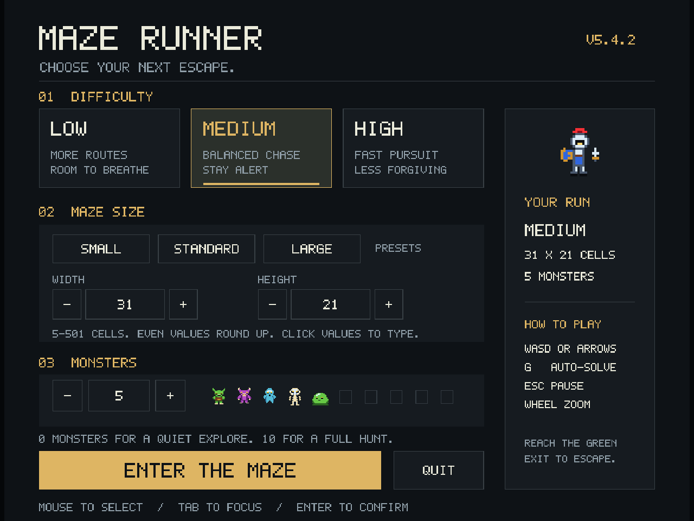
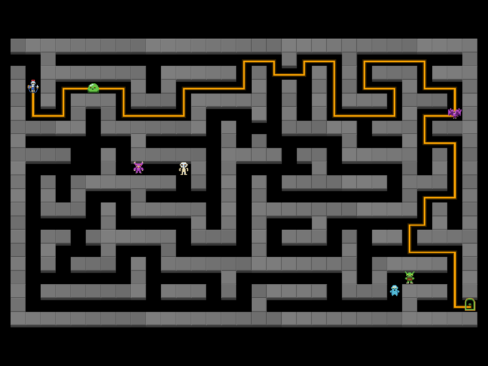

# MazeRunner V5.4.2

MazeRunner is a C++17 maze game with an in-game setup screen, pixel-art characters, raised gray walls on a black background, and a headless simulator for repeatable AI experiments. Play manually or enable the automatic solver while roaming monsters and an adaptive director respond to movement.



The setup screen offers Low, Medium, and High difficulty, a configurable monster count, and three maze presets: **Small 33 × 33**, **Standard 63 × 63**, and **Large 101 × 101**. The game includes ten monster sprite variants, full-route visualization, and an automatic solver that can wait, take alternate routes, and backtrack. Player and monster state logs remain available in the terminal.



## What's new in V5.4.2

- **Fair start:** monsters stay frozen until your first move or until you press G. The HUD shows "MOVE OR PRESS G TO START".
- **Hearing range:** only monsters within a Manhattan hearing radius react to your steps. The radius depends on difficulty and grows on larger maps. Each monster keeps its own scent timer.
- **Searching:** a monster that loses your scent sweeps the last clue area (eyes turn orange) before roaming again. Standing still is no longer a safe way to make monsters forget you.
- **Interceptors:** on Medium (1) and High (2), hunters can be sent to a chokepoint between the clue area and the exit.
- **Corridor sight (High):** a monster that is not already hunting can spot you 3–6 cells down a straight open corridor and charge.
- **Spread-out patrols:** roaming monsters prefer areas no monster has visited recently and avoid crowding each other.
- **Smarter auto-solver:** distant monsters add a detour cost instead of blocking the route outright. Repeated detours shorten waits. Lookahead extends while threats are at mid range. The solver never waits for a scent to fade while a monster is one step away.
- **Fixes:** Esc no longer quits from the setup screen; in a text field it leaves the field. Standing still no longer earns wider director clues. A frame limiter applies when vsync is off. Large seed values give a readable error. Generation always terminates.
- **Controls:** holding a movement key keeps walking at a steady pace.
- **Performance:** about 2.5× less simulation time per frame on 501×501 maps.
- **Balance:** Medium and High monsters are slightly slower (148 ms and 118 ms) to offset the smarter AI.

## Build and play

On Ubuntu, install the compiler and graphical development dependencies, then run these commands from the repository root:

```bash
sudo apt update
sudo apt install build-essential cmake ninja-build libglfw3-dev libglew-dev libgl1-mesa-dev libegl-dev pkg-config
cmake -S . -B build/cmake -G Ninja -DCMAKE_BUILD_TYPE=Release
cmake --build build/cmake --parallel
ctest --test-dir build/cmake --output-on-failure
./build/cmake/bin/mazerunnerV5.4.2
```

Use CMake 3.20 or newer. The [build and reproduction guide](../03-Build-Test-and-Reproduce.md) includes direct compiler commands, Apple Silicon macOS instructions, Windows CMD instructions, dependency troubleshooting, and the full validation procedure.

| Control | Action |
|---|---|
| Mouse, Tab, Enter | Configure and start a game |
| WASD or arrow keys | Move the player (hold to keep walking) |
| G | Toggle automatic solving |
| Esc | Pause or resume (never quits) |
| Mouse wheel, +, − | Zoom |
| Home | Fit the maze to the viewport |
| Q | Quit |

To build the simulator without graphical libraries:

```bash
cmake -S . -B build/headless -DCMAKE_BUILD_TYPE=Release -DMAZERUNNER_BUILD_GRAPHICS=OFF
cmake --build build/headless --parallel
ctest --test-dir build/headless --output-on-failure
./build/headless/bin/maze-headless --simulate 33 33 5 42 60000 --difficulty medium --quiet
```

Here `42` is the random seed, which makes the run reproducible with the same build and inputs; `60000` is the simulated time limit in milliseconds.

## Development kit

| File or directory | Contents |
|---|---|
| [src/mazerunnerV5.4.2.cpp](../src/mazerunnerV5.4.2.cpp) | Complete game source with embedded sprites and font |
| [CMakeLists.txt](../CMakeLists.txt) | Graphical, headless, portable regression, and EGL render/app test targets |
| [01-Source-Line-by-Line.md](../01-Source-Line-by-Line.md) | Detailed annotations for all 3,161 physical source lines |
| [02-AI-Graphics-and-Redesign.md](../02-AI-Graphics-and-Redesign.md) | AI mechanics, measured escape rates, graphics, UI design, and redesign guidance |
| [03-Build-Test-and-Reproduce.md](../03-Build-Test-and-Reproduce.md) | Platform-specific compilation and reproduction instructions |
| [tests/](../tests/) | Gameplay, director, difficulty, V5.4.2 feature, UI, rendering, and application tests |
| [scripts/](../scripts/) | Validation, CMake, and calibration runners; documentation audit; package integrity verifier |
| [artifacts/results/](../artifacts/results/) | Recorded commands, environment, test logs, CMake record, and calibration results |
| [artifacts/screenshots/](../artifacts/screenshots/) | Eighteen PNG captures |
| [manifest.json](../manifest.json), [SHA256SUMS](../SHA256SUMS) | Package metadata and payload checksums |

The three numbered guides, `manifest.json`, `SHA256SUMS`, and everything under `artifacts/` were regenerated for V5.4.2. The README lives under `.github/` so the verifier's exactly-three-guides check passes. `.gitattributes` keeps packaged file bytes identical across platforms, so the checksums hold on any checkout.

Verify the package before editing files or regenerating results, using Python 3.9 or newer:

```bash
python3 scripts/verify_package.py
```

The Linux validation runner rebuilds and reruns the supplied checks:

```bash
python3 scripts/run_validation.py --all
```

This command regenerates files under `artifacts/`, so use a separate working copy to retain the published reference results. `scripts/run_cmake_validation.py` records a real CMake/CTest run, and `scripts/run_calibration.py` re-measures auto-solver escape rates. After an intended change, `scripts/audit_documentation.py` re-records documentation coverage, `manifest.json`, and `SHA256SUMS`. See the reproduction guide for the Linux EGL/Mesa requirements and options for running only the portable checks.

## Recorded validation scope

The recorded V5.4.2 results passed on an Ubuntu 24.04 x86-64 host with GCC 13.3.0. They cover:

- gameplay, UI, and V5.4.2 feature regressions;
- AddressSanitizer and UndefinedBehaviorSanitizer checks;
- repeated preset/difficulty smoke cases;
- real offscreen OpenGL rendering and application logic with injected GLFW callbacks;
- a real CMake configure, build, and CTest run (13/13), with the graphical game linked against Ubuntu's GLFW/GLEW packages;
- a 2,940-game escape-rate calibration.

Native desktop startup (no display was available), native macOS builds, and native Windows builds were not executed. The platform instructions and recorded logs describe these limits in detail.
