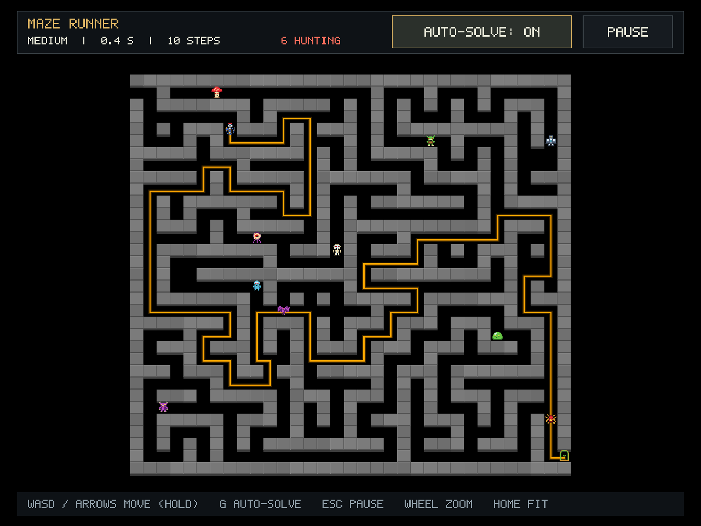

# MazeRunner v5.4.4 AI design deep dive

The monster reasons from private evidence, the Director regulates the information and duties given to the pack, and the automatic player plans against observed monster positions and a conservative reach model. These are different information sets. A property proved for one does not transfer automatically to the others. Sections 1–5 follow their interactions. Section 6 gives the actual difficulty profiles and measured outcomes. Section 7 proves the terrain and motion guarantees, derives the tactical bounds, and accounts for time and memory.

In v5.4.4 a retreat commits to a physically outward path, a sustained second hunter can support the lead, junction scans rank fresh arms, and every eligible listener can nominate the pack’s learned ambush site. The forecast advances copies of these same retreat paths. For a quick comparison, follow the seed-26 encounter in section 5 and the four-edge charge example in section 7. [Production source](src/mazerunnerV5.4.4.cpp) · [C++ function guide](01-SourceCode-Deepdive-and-%20Explanation.md) · [Validation procedure](04-Build-Test-and-Reproduce.md)

## 1. Architecture and game rules

The game is a single C++17 translation unit with a deliberately separated simulation and graphical front end. `Maze` owns terrain, entities, event times, path searches, director state, and terminal reporting. Its decisions do not require GLFW, a window, textures, or a GPU. A headless binary removes GL-dependent sections at preprocessing time and runs this same simulation. `Renderer` turns maze state into world geometry; `UiState` models setup and screen interaction; `UiRenderer` draws the menus; `GameApplication` owns their lifetimes, schedules background generation, and turns held movement keys into repeated steps.

The player must reach the exit without occupying a monster's cell. Terrain is a rectangular grid containing wall, open-path, and exit cells. Actors are separate from that terrain: a moving monster does not overwrite a wall or corridor character. Coordinates use `(row,column)` in simulation and `(x=column,y=row,z=height)` in rendering. Adjacency is orthogonal, never diagonal. The generated entrance is on the left boundary near the top, and the exit is on the right boundary near the bottom.

The setup permits **0–10 monsters** and dimensions **5–501** per axis. Even dimensions round upward to odd numbers. Width and height can differ. The presets are **Small 33×33**, **Standard 63×63**, and **Large 101×101**. The initial editable defaults are **31×21 with five monsters and Medium difficulty**; Standard is a selectable preset, not the initial form value. Form settings remain available during the application's lifetime but are not saved to a configuration file. Manual moves are ignored while automatic solving is enabled; turn it off with G or the HUD toggle before taking control. Pressing a movement key moves at once; holding it repeats the move after 220 ms and then every 120 ms. These repeats are driven by the maze's simulation clock, not by the operating system's key-repeat events.

### Simulation time and event order

Time is represented as signed 64-bit integer milliseconds. An automatic action is due every 40 ms, or 25 action opportunities per simulated second. A wait is an action opportunity but not a successful movement step. Rendering frequency does not change the action interval. Monsters have their own per-profile periods and initially staggered deadlines.

`Maze::advance_to` processes the earliest deadline before proceeding to the next. At equal times it expires scent/search/roles, samples the director, moves due monsters, checks for a terminal result, then dispatches an auto action or held manual repeat. Capture takes precedence when a monster and player coincide. The application applies the first accepted keypress immediately, schedules the first repeat 220 ms later and repeats successful steps every 120 ms. A wall, release, pause, focus loss or control-mode transition can cancel the hold.

**Monsters stay frozen until the player's first successful move or until automatic solving is enabled.** At that moment `start_timer` releases them, adding the current time to their spawn-relative deadlines so their staggering is preserved. Before V5.4.2, monsters roamed from time zero. An idle player still reading the screen could then be caught, about 5% of the time within 30 seconds on a 33×33 map with ten monsters, and the result screen read "0.0 seconds, 0 steps". The HUD now shows "MOVE OR PRESS G TO START" until the first input. The run timer and the director's sampling schedule start at the same moment.

The graphical application advances simulation only on the Playing screen. It consumes the complete nonnegative playing interval, including intervals longer than 250 ms, and schedules movement inside that interval. Setup, loading, pause and result screens freeze the game. Focus loss pauses play and cancels the hold. The renderer uses a frame deadline while playing.

## 2. Maze generation and multiple solutions

`Maze::generate` begins with an iterative randomized depth-first carve on the odd-coordinate room lattice. Moving two cells at a time connects rooms by opening their intervening wall. The initial carved structure is a spanning tree, so by itself it has only one simple entrance-to-exit route. The generator then opens eligible separating walls to introduce loops.

The loop budget is derived from grid area, with a denominator of 100 for maximum dimension at most 40 and 150 otherwise. It is scaled by the profile's integer percentage. In source terms it is `loop_density_percent * max(1, rows*cols / denominator) / 100`, with integer division. This is a carving budget, not a percentage of every wall in the map and not a count of final solutions. Low refreshes eligible candidates after individual carves; Medium and High use the initial shuffled list. Actual openings also depend on available candidates.

The resulting graph must pass an entrance-to-exit diversity check. Medium and High require at least two distinct simple solutions. An iterative DFS computes discovery times, low-link values, and bridges. If a non-bridge edge lies on the DFS tree route from entrance to exit, a cycle supplies an alternative route between points of that route. A cycle attached only to a side branch does not satisfy this check. This distinction prevents cosmetic loops from being mistaken for meaningful alternate solutions.

Low requires a certificate of at least four choices using biconnected blocks along the route. The implementation derives each block's contribution from its edge and vertex counts, caps contributions/products at four, and applies a minimum block size for meaningful diversity. Within a biconnected block, a cycle rank of r guarantees at least r+1 simple paths between its entry and exit (start from a cycle through both, then each added ear contributes a new path). This is a conservative certificate used by this generator, not an exhaustive enumeration of all simple paths. It also does not claim four edge-disjoint or vertex-disjoint routes: alternatives may share corridors. The included small-graph tests compare these certificates against explicit path enumeration.

Generation retries with the same seeded random stream continuing through attempts, so each retry is a new layout. **V5.4.2 caps reseeded attempts at 64.** After that, `add_connections_until_diverse` keeps the current layout and opens connecting walls in seeded batches (one eighth of the candidates per pass, at least one) until the requirement holds. Every pass opens at least one wall, and a fully opened interior satisfies every profile, so generation always terminates. In practice the cap is not reached: over 200 seeds per shape, the worst observed case was 31 attempts (Low, 5×33). Valid topology is checked before monsters spawn, so the guarantee is about terrain. Monsters can still occupy every currently available route later.

### Graph representation and reusable searches

`rebuild_graph` caches up to four walkable neighbors per cell, degree, dead-end information, terrain distance to the exit, the exit chokepoint tree described in section 3, patrol regions, and a terrain signature. Reverse BFS produces shortest grid-distance fields in linear time in the traversed graph. A **least-recently-used** cache retains up to 24 destination fields with shared ownership; a hit moves to the back, so long-lived monster-target fields are not evicted by churn.

Threat forecasts request a bounded field of 64 corridor steps. Its sentinel of 65 is a conservative lower bound for any farther cell. Hearing requests the same BFS machinery with the acoustic radius, which may exceed 64 on large maps. The cache identifies a field by source **and radius**. Generation stamps distinguish valid cells and a buffer retained by a live caller stays allocated.

Debug builds (without `NDEBUG`) hash the terrain at each `rebuild_graph` and check the hash at simulation entry points. Editing `grid` without rebuilding then fails with a clear error instead of running on stale adjacency. Release builds skip the check. The exact A* search that V5.4.1 kept in the game class is now only an independent oracle in the tests; the live game never used it.

At the maximum 501×501 grid there are 251,001 cells, so repeated whole-grid work and mesh allocation matter. Iterative graph algorithms avoid deep recursive DFS stacks. The recovery search is separately bounded. With ten monsters on Medium or High, V5.4.2 spends about 4.7–5.8 ms of simulation per 16 ms frame on average, with a worst frame near 20 ms. V5.4.1 spent 12–15 ms on average with worst frames near 80 ms. The gains come from the LRU cache, bounded threat fields, short reservation lists instead of grid-sized arrays, and rebuilding the solver overlay once per frame rather than after every monster event. The graphics guide describes the renderer’s large-map detail policy. These are measurements on one host, not a promise of identical frame rate across devices.

## 3. Monster AI: hearing, hunting, searching, and interception

Every monster uses the same behavioral rules. The ten creature appearances are visual variants, not classes with different speed, vision, damage, or intelligence. Spawn IDs give them distinct stable artwork. Spawn selection excludes the entrance/player and exit and keeps monsters on unique open cells. It favors positions sufficiently far from the player using graph distance, but can fall back to nearer candidates when necessary; there is no universal minimum separation guarantee on all allowed sizes. On a very small maze, the requested monster count is also capped by the number of distinct available spawn cells.

Each monster has three independent pieces of state. Its sensory state is `Patrolling`, `Hunting`, or `Searching`. Its role is `Chaser` or `Cutter`. Its pack duty is `Roam`, `Investigate`, `Perimeter`, or `Withdraw`. A listener can still be hunting while it walks away under a withdrawal order. Eye color shows its sensory state.

The Director prefers an eligible hunter for the lead and uses the monster’s own clue to rank candidates. It favors keeping the existing investigator. Other informed monsters cover the outer two usable bands on the side assigned by spawn ID modulo four. Larger packs can share a side. An active Cutter holds its assigned interception target, and a first-hand sighting takes priority. A solo predator remains eligible to investigate.

### Patrol behavior

A patrolling monster ordinarily has no active clue. A member of a pack that learned to double back can revisit its last junction during patrol. It samples 32 random open cells and scores each one. A cell scores higher the longer it has been since any monster entered its 8×8 region, capped at 20 seconds. Travel distance (capped at 20 steps) adds a small amount. The score is penalized for cells this monster visited recently, for cells another monster already claimed, and for each other monster positioned or heading within six cells. Together the monsters therefore cover the map instead of clumping. Patrol is not a stationary guard waiting for an alarm.

Ordinary pursuit follows a reverse BFS distance gradient. Withdrawal uses the committed outward route described in section 7. Recent-cell penalties discourage immediate repetition. When blocked, a monster can accept limited non-improving movement to sidestep congestion, and repeated blockage causes a new target choice. Targets are reviewed on a 700-ms schedule, but review can preserve a still-valid waypoint. Each monster keeps a bounded recent-cell history rather than a permanent visited map.

### Local footsteps and map-wide director reports

An actual displacement can create two clues. A blocked keypress, a solver wait and a plain clock tick produce no new location report. Each clue is an inclusive, grid-quantized rectangle tagged with a revision. Fixed sector boundaries give many possible player cells the same reported bounds.

| Channel | Reach | Effect on a monster | Timing |
|---|---|---|---|
| Footstep | Shortest walkable corridor distance within the difficulty budget | The listener hunts its most recent local clue. Each genuine contact refreshes its own scent. | Test hearing on every successful step. Publishing a new local rectangle has its own throttle. |
| Director radio | All monsters on the map | One lead investigates, and remaining informed monsters cover assigned sides. A hunter continues following fresher evidence and can later use an eligible radio fallback. | First eligible step, then movement after the profile cooldown. Confinement relief doubles the cooldown. Backstage suspends broadcasts. |
| Corridor sight | High, clear row or column | All sensory states can acquire at 3–6 cells. An established charge tracks at 1–6. | Two eligible monster actions to acquire. Check again from the last-seen cell after a step. |

Hearing uses `base + floor(per_100 × max(rows, cols) / 100)`. Manhattan distance is a cheap first rejection. A bounded BFS decides which remaining monsters really hear around walls. One acoustic field serves all possible listeners for that displacement. A Medium 63×63 map has a budget of 26 steps.

The local sector side is 9/5/8 cells in Low/Medium/High. The nominal radio side is 19/17/11. Its normal side is limited to `min(profile_radio, max(local_side, floor((2 × max_dimension + 1) / 3)))`. Width and height are separately clipped at map edges. Relief adds padding on both sides. A radio recipient gets these bounds and a revision. The lead uses this as the seed of its sweep. Perimeter agents give positive weight to the nearest usable edge band and its adjacent band on their assigned side.

Each audible step renews the listener's own scent even between clue publications. Normal continuing-motion publication intervals are 200/0/0 ms. During relief they are at least 400 ms. First motion after an idle spell immediately qualifies for a fresh local clue. The radio still observes its own cooldown after an idle spell. [First-step terminal trace](artifacts/results/director-radio.log)
An ordinary hunter favors nearby, less recently visited candidates inside its clue. A trained lead with two consecutive same-direction sector transitions first tries a junction beyond the leading edge. Its fallback weights forward candidates three times as strongly. Other monsters’ existing targets reduce a candidate’s weight.

### Searching after losing the scent

The investigator seeds a bounded multi-source breadth-first search with every walkable cell in the best-known sector. A more recent firsthand sighting can supply a single exact seed. Uncertainty expands through one corridor edge per 180 simulated ms, up to five layers. Junctions and branch mouths have priority. An individual discounts its last 40 inspections for 1,800 ms. Low and Medium physically inspect traversed cells. A High junction scan can also inspect an unobstructed straight arm in its existing visual range. At an eligible junction, the lead pauses for one monster period and looks down an eligible arm chosen by clue direction, straight reach and learned alcove value. Four recent arm choices are remembered independently of the cells actually inspected. The marker points down that arm until the next movement opportunity.

### Tactics learned within a run

| Pack lesson | Evidence for one observation | Behavior after two or more distinct observations and the next eligible unlock |
|---|---|---|
| Alcove sweep | After local scent loss, the lead moves onto or visually inspects a dead-end tip inside the same heard sector. The search expires without fresh contact or retasking. | The search score rewards a dead-end tip by 16 points instead of 4. |
| Heading interception | An audible hunt ends after two consecutive sector transitions in the same cardinal direction. | A lead hunter looks for a junction past its clue in the heard direction. |
| Junction ambush | The listener returns after at least four seconds within the same hunt. At least three distinct sectors participate, and actual open passages permit a circuit through them in order. | An eligible Cutter can hold a nearby junction inside its clue. |
| Double-back check | A listener hears the heading reverse after at least two consistent transitions. | On search expiry a patroller can leave its last junction for three steps and return. |

The Director deduplicates by the original clue revision per lesson, including searches finishing out of order. It unlocks at most one tactic per 12 seconds, starting 12 seconds after play begins. The strongest pending evidence wins, with ties resolved in table order. A listener keeps at most six sector departures. Scent expiry and widening for relief clear that route immediately. Fresh footsteps, radio retasking, sight or withdrawal discard unfinished alcove evidence. An exact hidden player cell contributes no lesson evidence.

At a hunter's scent deadline, it can adopt a broadcast issued strictly after its last physical contact if that report is still within the profile's search lifetime. That sweep ends at the broadcast time plus search duration. Otherwise the monster sweeps its last local area from scent loss. A new broadcast can renew a remote search. Once its search time expires without fresh evidence the monster returns to roaming. Searching uses the orange-eye state.

Expiry is an exact simulation event (`next_monster_state_change`), not a frame-time check, so results do not depend on rendering cadence. A monster that hears a new step while searching becomes a hunter again immediately.

### Interceptors (Medium and High)

`rebuild_graph` builds an exit-rooted depth-first tree with an iterative Tarjan traversal. For each cell it records whether the cell's parent separates that cell's subtree from the exit. When a parent does, every route from anywhere in the subtree to the exit must pass through it. When a new clue is published, `assign_interceptors` starts from the walkable cell of the clue rectangle nearest the exit; it never uses the player's cell. It then walks up that tree for at most 80 links, collecting chokepoints outside the clue area and at least four steps ahead. For each chokepoint, the nearest eligible hunter is sent if it can arrive before a player moving one cell per 80 ms would. Medium sends at most one interceptor and High at most two. Low sends none.

**How the learned ambush chooses its junction in v5.4.4.** Each current listener with a usable clue can nominate, except one in confirmed sight or on a withdrawal order. A radius-four BFS from that listener visits candidates in corridor-distance order. A candidate must lie in the listener’s own rectangle, have at least three open arms and have zero dead-end depth. Across all nominations the game minimizes the ordered pair (corridor distance, cell ID). An earlier listener with no qualifying junction cannot suppress a later listener’s proposal; if two listeners nominate equally near cells, the smaller cell ID wins regardless of listener order.

The allocator tries the winning junction before ordinary exit chokepoints. It assigns a distinct eligible hunter only if the hunter can meet the timing test. The ambush uses an eight-step lead at the 80 ms Cutter reference pace, so an assigned candidate must satisfy $d\,T_{hunt}\le640$ ms. On Medium, four cells cost $4\times148=592$ ms and five cost 740 ms. The nominating listener and assigned guard can be different monsters. Nominating a junction depends on local evidence; being selected to guard it still depends on speed, travel distance, available slots and current duties. The nomination phase costs $O(\sum_i(P+B_4(i)))$ with reusable fields, where $P$ is the pool scan and $B_4(i)$ is that listener’s radius-four neighborhood. The allocator’s later travel tests may request a separate radius-64 field. [Interceptor allocation](src/mazerunnerV5.4.4.cpp#L1235)

A cutter can hold a reachable chokepoint, then release it at its role deadline. The assignment code accounts for guards outside the current group of listeners before choosing additional hunters. It reserves distinct target cells and enforces the profile-wide 0/1/2 cap. A monster mid-charge after a sighting is ineligible. Relief releases existing guards and suppresses new assignments until normal precision resumes.

### Corridor sight (High only)

High samples visual contact when each monster is due to act. An uncharged monster needs two successive checks with the player 3–6 open cells away in the same row or column. The first check spends the motion opportunity facing the player. If the player moves from three cells to two before the second check, the notice resets. The renderer draws the directional diamond only in the Searching state. Low and Medium rely on hearing and radio.

A confirmed charge updates its exact target at 1–6 cells. After losing sight the hunter follows the last observed position. Upon reaching it the monster can continue around the corner only if the player is genuinely visible from the new tile. On High, a charge period is 107 ms, compared with 126 ms for a sound hunt and 120 ms for a held player key after its initial delay. Exact player positions come from firsthand sight.

### Avoiding monster overlap

When several monsters act in a batch, movement priority rotates. Reservations include all starting cells and claimed destinations for that batch, kept in a short list (at most about twenty cells) instead of a grid-sized array. Monsters cannot stack, swap through each other, or immediately follow another monster into a cell it vacated in that same batch. This prevents order-dependent overlap but can create temporary corridor congestion. Target reassessment and sidesteps help resolve congestion over later batches.

## 4. Automatic player AI

The automatic player has two related but distinct responsibilities: choose its next action under moving threats, and maintain a visible route from its current cell to the exit. Only the first action of each tactical plan is committed. Planning repeats from the resulting real state, allowing waiting, forward movement, alternate branches, and backtracking.

### Timing-aware guidance and the full path overlay

The exit field classifies monster cells before calculating the route. This lets the player take a detour around a distant patrol when the extra distance is worth paying.

- **Near** (14 corridor steps or fewer from the player) or **parked** (no movement for 1.5 s): a wall.
- **Distant and moving**: passable, but entering its cell costs 24 extra steps, so routes prefer a detour of up to 24 steps.

Guidance is a weighted shortest-path field from the exit, computed with Dial's bucket queue. Edge costs are 1 or 25, so 26 circular buckets suffice. The cache key includes the classification, so guidance is rebuilt when a monster crosses the near threshold even if no monster moved. If near or parked monsters cut every route, the solver is "blocked" and uses the terrain-only field for direction.

For a step from v into u, the candidate cost is `1 + entry_penalty(u) + distance[u]`. Relaxation stores the successor u that achieved this value. Simply choosing the neighbor with the lowest remaining distance can hide the cost of entering that neighbor and draw a route through a monster. The overlay follows the stored chain all the way to the exit. An occupied route or the fallback for a disconnected weighted field is amber. With zero monsters a downhill terrain step is sufficient. Tactical decisions may wait, retreat or take another branch.

The HUD capture uses seed 8 at 12.400 seconds, while the lead is taking its first physical withdrawal step. The full escape trace in section 5 uses seed 26. [HUD capture](artifacts/screenshots/hud.png) · [Encounter trace](artifacts/results/director-relief.log)

### Tactical forecast and beam search

The planner normally looks ahead 12 actions (480 ms). It extends to **18 actions** when the nearest monster is 10–36 corridor steps away, close enough to shape the route but beyond the default window's view. It retains at most 64 candidates at each depth and considers five actions per expansion: stay or move to one of four neighbors. The forecast copies current monster positions, targets, states, deadlines, and reservation behavior, and projects scheduled movement within the horizon. It also applies the game's sight rule: an unalerted or charging monster that can see the player's current cell is predicted to charge it. It also projects junction pauses and eligible direct sightings using copies of the actors. These speculative inspections leave the real monsters’ memories untouched. Future random target choices and new clues are outside the forecast. Predictions are therefore useful estimates rather than perfect future knowledge.

For a positive corridor distance d, the physical arrival bound is the remaining time to the first move plus (d − 1) times the fastest permitted step. The periods are 210/148/107 ms on Low/Medium/High. A High sound-hunter that has already noticed a stationary player four tiles away reaches them in 447 ms. Its action-by-action forecast still uses the gait actually predicted at each deadline. Dead-end gates and risk scoring use the physical bound.

The score combines movement/action cost with danger, recent repetitions, decaying visit heat, and the chosen guidance. A wait adds 0.35; reversing toward the prior node adds 0.8; danger is weighted by 2.0 in accumulated cost. Threatened deep dead ends and low-degree endpoints receive extra penalties. Deduplication retains the better candidate for a cell at a given depth. An available goal candidate is preserved before beam truncation. If no goal is reached within the horizon, the search retains a feasible deepest frontier. With no monsters, the code bypasses tactical search and follows the exact terrain shortest-path gradient.

The state space is approximated: per-cell/per-depth merging and a finite beam do not preserve every distinct history. The result is not a globally optimal time-expanded path and does not prove survival.

### Bounded waiting, loop detection, and committed recovery

When near or parked monsters block every exit route, the player can stand still to let hunters lose the scent. Two conditions apply. The next action must be conservatively safe. **No monster may be able to reach the player's cell within one action plus one monster step.** The second condition was added after traces showed the solver idling beside a monster and being caught. The waiting budget is twice the profile's scent lifetime. Its start time is kept across decisions, and a clear route must persist for one scent interval before a blocked episode resets.

**Loop detection.** Each committed detour is recorded. Boldness counts the detours started in the last 20 seconds beyond the first, capped at 4. Each boldness level shortens the waiting budget by half a scent period, never below one scent period, and raises how strongly detour selection favors cells closer to the exit. Boldness changes are logged. A more aggressive "ignore danger and press on" mode was implemented and measured, then removed: it turned timeouts into captures rather than escapes.

After the waiting budget, or after 2,400 ms without recognized navigation progress, recovery can select a temporary detour goal. Search explores at most 4,096 cells and depth 32, considers sufficiently distant candidates, and checks time clearance relative to estimated travel. It rewards room to maneuver, junctions, and movement away from repeated cells, while penalizing dead ends, exit-distance increase (weighted by boldness), returning to the entrance, and recently tried recovery areas. Backtracking is explicitly permitted. A chosen goal is committed for up to 4,000 ms, with progress checks and occupancy-aware guidance. Reaching it can include a pause for scent plus one monster period. A stable newly opened exit route cancels recovery early when the downhill next step is safe.

If conservative planning fails, the planner tries a relaxed interpretation of uncertain threats. If that also fails, emergency selection scores unoccupied candidates by estimated time before contact, exit distance and local degree. The benchmark records escapes, captures and unfinished games separately.

## 5. Overwatch/director intensity control

Best progress is the percentage of the entrance-to-exit corridor distance already gained at the closest point reached so far. The normal radio interval interpolates over the first half of that distance. Medium goes from 5,000 to 1,800 ms and High from 7,000 to 1,000 ms. Low uses 3,000 ms throughout. Backtracking retains the best progress. Relief doubles the current interval and Backstage suppresses broadcasts. Local footsteps still renew scent independently.

The Director manages radio, confinement relief and encounter pacing. Every 200 ms it measures corridor distance to a walkable representative of each hunter's own clue and checks for genuine visual contact. It uses peak pressure, a capped contribution from another hunter, separation after a close encounter and an extra contribution when relief padding is active. Menace stays between 0 and 100. At 76 the Director releases guards and requests a primary physical retreat. While the first retreater remains active, a second nonvisual hunter can qualify after two consecutive pressure samples of at least 8. The pair reserve distinct legs and each step has to increase corridor distance from the actor’s own evidence. A trapped actor holds position. The chosen agent uses ordinary movement, occupancy, and collision rules. A current sighting takes priority. Backstage can begin while the only eligible hunter still sees the player. Its withdrawal request stays pending until a candidate can disengage. After at least 1,400 ms, pressure at 26 or below permits backstage to end unless a pending withdrawal still has visual contact. A new broadcast then requires an eligible player step and the usual cooldown. Silence supplies no fresh radio clue.

Every 200 ms of active play the director samples the player on the simulation clock. A full profile-sized window containing at most 12 unique cells and spanning at most eight cells per axis counts as confinement. In auto mode, prolonged absence of navigation progress is another trigger. Voluntary manual idling clears the history. An active solver accumulates samples while waiting or backtracking, even when the exit field contains a technically open route.

An escalation clears the audible heading, sector route and unresolved local-search evidence. It widens the last local clue, the last radio rectangle and each informed monster's **own** memory. It clears stale waypoints, releases cutters and leaves a directly visible High target eligible for sight pursuit. It preserves the source evidence revision and the existing scent/search expiry. A director sample by itself never transmits a new position. Future reports use a wider footprint and longer cooldown. Once padding reaches its cap, another hold period can elapse without repeatedly invalidating broad plans.

Recovery requires that confinement end, the minimum hold elapse and the recovery condition remain true for 2,000 ms. The player must either gain at least six terrain steps toward the exit relative to relief entry or move at least six Manhattan cells from the relief anchor. An automatic player must also have a reachable weighted exit route. Returning to normal narrows subsequent reports. Existing broad memories keep their recorded extent until new evidence arrives.

| Time | Default Medium setup, seed 26 |
|---|---|
| 4.000 s | Confinement triggers relief and widens the radio footprint to 21×25. |
| 21.800 s | Menace reaches 78. Monster 3 receives a withdrawal toward row 12, column 3. |
| 23.200 s | Backstage ends at menace zero. |
| 29.400 s | Sustained escape from confinement restores normal clue precision. |
| 30.800 s | The solver escapes after 330 moves. The pack recorded nine withdrawal steps and four junction scans. |

A wider clue can give the player time to get past a choke. The outcome depends on where monsters are and which walkable targets they choose. [Complete event trace](artifacts/results/director-relief.log)

## 6. Exact difficulty parameters

All values below are read from `difficulty_settings`. Lower periods mean more frequent monster actions. Larger hint side lengths mean less precise information. Loop density is a budget multiplier, not an escape probability.

| Parameter | Low | Medium | High |
|---|---:|---:|---:|
| Minimum certified terrain solutions | 4 | 2 | 2 |
| Loop budget percentage | 225 | 135 | 100 |
| Sound-hunt movement period, ms | 210 | 148 | 126 |
| Patrol period, ms | 273 | 192 | 163 |
| Search period, ms | 241 | 170 | 144 |
| Confirmed charge period, ms | — | — | 107 |
| Normal local sector side, cells | 9 | 5 | 8 |
| Local clue cooldown during continuous movement, ms | 200 | 0 | 0 |
| Nominal normal radio sector side, cells | 19 | 17 | 11 |
| Normal radio cooldown at 0% / 50% best progress, ms | 3,000 / 3,000 | 5,000 / 1,800 | 7,000 / 1,000 |
| Relief radio cooldown | 2× current | 2× current | 2× current |
| Scent lifetime after last heard step, ms | 420 | 560 | 840 |
| Corridor hearing budget (base + steps per 100 cells of longer axis) | 18 + 10 | 18 + 14 | 28 + 18 |
| Hearing budget on 33 / 63 / 101-cell maps | 21 / 24 / 28 | 22 / 26 / 32 | 33 / 39 / 46 |
| Search sweep after losing the scent, ms | 1,500 | 2,500 | 3,500 |
| Maximum interceptors | 0 | 1 | 2 |
| Acquisition / charge tracking, cells | off | off | 3–6 / 1–6 |
| Director confinement window, ms | 2,500 | 4,000 | 6,000 |
| Minimum relief hold, ms | 8,000 | 6,000 | 4,000 |
| Added padding per relief escalation, cells per side | 4 | 4 | 2 |
| Maximum padding, cells per side | 16 | 16 | 8 |
| Maximum nominal expanded local sector side, cells | 41 | 37 | 24 |
| Maximum nominal expanded radio sector side before map limits, cells | 51 | 49 | 27 |
| Auto-player action interval, ms | 40 | 40 | 40 |
| Tactical horizon / beam width | 12–18 / 64 | 12–18 / 64 | 12–18 / 64 |

### Measured escape rates

The release benchmark covers 4,740 deterministic auto-solver games. Five-monster calibration uses seeds 1–400 on 21×21 and 31×31 with a 60-second limit. The pooled calibration counts were Low 748/800 (93.50%), Medium 532/800 (66.50%), High 262/800 (32.75%). The design targets are 92%, 65% and 35%. On the independent square-map holdout (seeds 1201–1400) the counts were Low 376/400 (94.00%), Medium 259/400 (64.75%), High 135/400 (33.75%). Rectangular setup and ten-monster presets are reported separately.

| Cohort | Rows × columns | Monsters | Difficulty | Escaped | Caught | At limit | Escape rate [95% Wilson interval] |
|---|---|---:|---|---:|---:|---:|---|
| calibration | 21 × 21 | 5 | Low | 362/400 | 30 | 8 | 90.5% [87.2%, 93.0%] |
| calibration | 21 × 21 | 5 | Medium | 242/400 | 144 | 14 | 60.5% [55.6%, 65.2%] |
| calibration | 21 × 21 | 5 | High | 93/400 | 305 | 2 | 23.2% [19.4%, 27.6%] |
| calibration | 31 × 31 | 5 | Low | 386/400 | 12 | 2 | 96.5% [94.2%, 97.9%] |
| calibration | 31 × 31 | 5 | Medium | 290/400 | 99 | 11 | 72.5% [67.9%, 76.6%] |
| calibration | 31 × 31 | 5 | High | 169/400 | 226 | 5 | 42.2% [37.5%, 47.1%] |
| presets | 33 × 33 | 10 | Low | 52/60 | 8 | 0 | 86.7% [75.8%, 93.1%] |
| presets | 33 × 33 | 10 | Medium | 26/60 | 33 | 1 | 43.3% [31.6%, 55.9%] |
| presets | 33 × 33 | 10 | High | 8/60 | 52 | 0 | 13.3% [6.9%, 24.2%] |
| presets | 63 × 63 | 10 | Low | 57/60 | 3 | 0 | 95.0% [86.3%, 98.3%] |
| presets | 63 × 63 | 10 | Medium | 38/60 | 22 | 0 | 63.3% [50.7%, 74.4%] |
| presets | 63 × 63 | 10 | High | 15/60 | 45 | 0 | 25.0% [15.8%, 37.2%] |
| presets | 101 × 101 | 10 | Low | 59/60 | 1 | 0 | 98.3% [91.1%, 99.7%] |
| presets | 101 × 101 | 10 | Medium | 46/60 | 14 | 0 | 76.7% [64.6%, 85.6%] |
| presets | 101 × 101 | 10 | High | 14/60 | 44 | 2 | 23.3% [14.4%, 35.4%] |
| setup | 21 × 31 | 5 | Medium | 264/400 | 124 | 12 | 66.0% [61.2%, 70.5%] |
| holdout | 21 × 21 | 5 | Low | 185/200 | 11 | 4 | 92.5% [88.0%, 95.4%] |
| holdout | 21 × 21 | 5 | Medium | 114/200 | 82 | 4 | 57.0% [50.1%, 63.7%] |
| holdout | 21 × 21 | 5 | High | 51/200 | 148 | 1 | 25.5% [20.0%, 32.0%] |
| holdout | 31 × 31 | 5 | Low | 191/200 | 8 | 1 | 95.5% [91.7%, 97.6%] |
| holdout | 31 × 31 | 5 | Medium | 145/200 | 53 | 2 | 72.5% [65.9%, 78.2%] |
| holdout | 31 × 31 | 5 | High | 84/200 | 112 | 4 | 42.0% [35.4%, 48.9%] |
| setup-holdout | 21 × 31 | 5 | Medium | 144/200 | 53 | 3 | 72.0% [65.4%, 77.8%] |

Every game has an outcome, seed, simulated duration and step count. [Per-game CSV](artifacts/results/calibration-runs.csv) · [Summary and intervals](artifacts/results/calibration.json)

## 7. Why the navigation algorithms work

Write $N=RC$ for rectangular storage, $V$ for the number of walkable cells, $E$ for undirected walkable adjacencies and $M$ for the number of monsters. The graph is undirected, unweighted for physical travel, and has maximum degree four, so $E\le 2V$. A graph theorem may cost $O(V+E)$ on an adjacency list while its implementation still initializes $N$ array entries. The following bounds distinguish those costs. [Carving and diversity](src/mazerunnerV5.4.4.cpp#L300) · [Bounded fields](src/mazerunnerV5.4.4.cpp#L677) · [Director](src/mazerunnerV5.4.4.cpp#L1388) · [Scan](src/mazerunnerV5.4.4.cpp#L1908) · [Tactical player](src/mazerunnerV5.4.4.cpp#L2419) A tactical claim about escape needs both this static model and an explicit model of actors and time.

### Carving, loop budgets and certification

The two-cell carve operates on odd-coordinate rooms. Initially one room is marked. Each successful step opens an unvisited room and the intervening wall, so it preserves connectivity and adds exactly one edge to the room tree. When the DFS finishes, every room is reached: a first unvisited room along a room-grid path would have had a visited predecessor whose neighbor enumeration finished too soon. Opening extra connecting walls can only add routes. A loop budget therefore changes the distribution of layouts, but cannot by itself certify alternatives between the two endpoints.

**Two-route certificate.** Let $P$ be the DFS-tree path from the entrance to the exit. A tree edge $(u,v)$ to child $v$ is a bridge exactly when $low[v]>disc[u]$. In that case no vertex below it links to $u$ or an ancestor, so deleting it separates the subtree. Otherwise a back edge closes a cycle. If any edge on $P$ is not a bridge, remove it. The endpoints remain connected and a simple path in the surviving graph differs from $P$. Conversely, any distinct simple escape path must omit some edge of $P$ and keep the endpoints connected, so that edge cannot be a bridge. A loop in a room with one door can fail this test. Discovery, low links and a neighbor cursor per vertex take one visit per edge, with $O(N+E)$ time and space including initialization.

**Four-route lower bound.** The vertex-biconnected blocks form a tree when joined through their articulation vertices. The entrance and exit specify one chain in that tree. A simple path cannot detour into an off-chain block and return without repeating the articulation. In a cyclic chain block with distinct entry and exit $x,y$, let $r=e-v+1$. There are at least $r+1$ simple $x$–$y$ paths. Start an open-ear decomposition with a cycle containing $x,y$. It gives two paths and rank one. Each added ear increases the rank by one. In the old 2-connected graph there are disjoint links from the pair $\{x,y\}$ to the two ear endpoints, in some pairing (the two-path form of Menger’s theorem; an overlapping endpoint can use a zero-length link). Joining those links through the new ear gives a simple $x$–$y$ path that uses a new edge. All old paths survive. The argument also covers a single new chord. A bridge contributes one choice. [Graph theory reference, sections on connectivity, Menger’s theorem and ears](https://www.math.kit.edu/iag6/lehre/graphtheory2019w/media/main.pdf)

Choices multiply along the chain because two blocks share only the articulation where their path segments join. Two qualifying cycle blocks in series already give $2\times2=4$ choices. The implementation saturates the product at four and, on Low, credits a block only at the size threshold $\min(12,\lfloor(R-1)/2\rfloor\lfloor(C-1)/2\rfloor)$. The result is a conservative certificate. It can undercount actual simple paths, especially in small loops. The edge stack emits each block once. Carving, shuffling, adjacency construction, leaf peeling and certification take linear work per attempt on this grid. After 64 attempts the fallback opens at least one additional interior wall per nonterminal pass or opens the remaining interior. With $W$ interior walls still closed, a coarse upper bound through certification is $O((64+W+1)(N+E))$ time and $O(N+E)$ working space. The cap limits random retries, not the number of fallback passes.

### Distance fields, branch mouths and a blocked exit

FIFO BFS assigns an unvisited neighbor the current layer plus one. By induction every shorter route would already have reached that neighbor in an earlier layer. A full reverse field therefore gives exact shortest distances on the fixed terrain. The bounded version stops after radius $r$. An unstamped cell has true distance at least $r+1$, including infinite distance, so reporting $r+1$ is valid for an acoustic cut-off or conservative arrival-time bound. It is not an exact long-range route length. Cache keys include the radius. The full-field cache retains up to 24 destination entries; eviction drops a cache reference while a caller may still own the field. The bounded pool first tries to recycle an unpinned buffer once it has 14 entries. If callers pin them all it can allocate another.

Pruning unprotected degree-one vertices records a parent toward the surviving core. Removing leaves cannot destroy a simple entrance-to-exit path because its interior vertices need two path edges. Processing removals backwards makes a child inherit a known gate and a depth one greater than its parent. The exit-rooted DFS also supplies discovery intervals and low-link information for interception. A monster on one shortest path is not automatically at a chokepoint. The separating-articulation test is what qualifies an ancestor as a guard position. A guard still walks there, and occupancy may block it.

The automatic player assigns a hard exclusion to selected near or parked threats and finite extra cost to farther occupied cells. Reverse relaxation from $u$ to predecessor $v$ uses $D(v)\gets\min(D(v),D(u)+w(u))$: $w(u)$ is the cost the forward traveler pays to *enter* $u$. With weights 1 and 25, tentative labels generated from distance $k$ lie in $[k+1,k+25]$. A ring of 26 buckets can represent that active window. Advancing the smallest current label finalizes it by the positive-edge Dijkstra argument; stale duplicates are skipped. A four-edge safe detour costs 4, whereas three steps with one soft entry cost 27. If hard exclusions disconnect the player, the overlay can fall back to the terrain field. The amber display communicates that risk.

### Quantized evidence, directed sweeps and learning

The sweep at time $t$ seeds walkable cells of a rectangle, or the last-seen cell if sufficiently recent. It grows $k=\min(5,\lfloor(t-t_{clue})/180\rfloor)$ graph layers. By the BFS layer invariant this yields exactly the corridor-distance dilation of the seed set through $k$ edges. The representation makes a branch behind a corner plausible while a nearby square behind a sealed wall stays unreachable. The sector can contain several disconnected seed components. For each reachable candidate the score combines $-2$ times bounded travel distance, a 45-point recent-inspection penalty, a 12-point claim penalty, a 7-point junction/mouth bonus and a 4- or 16-point tip bonus. These are ordinal priorities. The game has no observation likelihood from which to infer calibrated posterior probabilities.

At an eligible junction the investigator filters out blocked, recently visited, inspected and recently glanced arms. For each remaining arm let $l$ be its unobstructed straight reach, capped at six. The scan scores $2l+12I_{closer}+8I_{learned\ alcove}$. The middle indicator requires the first neighbor to descend the bounded corridor field toward the focus. Ties follow the actor-and-cell rotation. A four-cell arm descending toward a clue scores 20; a six-cell arm with neither bonus scores 12. The chosen direction is remembered among four looks for 1,800 ms. Physical travel and High’s real visual range maintain the separate inspection memory. The scan marker and horizontal sprite facing expose part of this computation to the player. Low and Medium can glance without remotely clearing an arm.

A heard sequence can support a loop lesson only if it admits an ordered return on actual terrain. The game tries legal boundary cells in the first observed sector, expands within the present sector or forward into the next, and requires re-entry at the *same starting cell*. The sequence uses distinct sectors, so a visited cell has a unique stage; cell-only deduplication is valid. A dead-end out-and-back cannot pass by reusing the same boundary in reverse order. This is a compatibility test on coarse observations. It cannot prove which exact loop the human traversed. Deduplication by clue revision and the pack lesson cooldown keep multiple listeners from counting one event repeatedly. The behavior table under “Tactics learned within a run” specifies each trigger and unlocked counter.

### Menace, retreat geometry and reservations

Per 200 ms sample, a confirmed current sighting contributes 16. Otherwise an eligible non-withdrawing hunter contributes 12, 8, 3 or 0 by distance to its own clue anchor ($d\le2$, $d\le6$, $d\le10$, farther). Let $p$ be the maximum individual contribution, $n$ the number at or above 8, and $s$ indicate any crossing from at least 12 to below 12. The tick adds $p+2[n>1]+7s+2[\mathrm{padding}\land p>0]$, subtracts 5 normally or 19 while Backstage, and clamps to $[0,100]$. Multiple separations in the same tick share one bonus. This defines the meaning of menace precisely enough to reproduce a log. It measures pressure from evidence and contact, not the distance to a hidden player.

Entry at 76 opens an episode, releases Cutters and gives priority to the investigator for the first nonvisual retreat. While that retreat remains active, one additional eligible hunter can disengage after two consecutive nonvisual pressure samples of at least 8. A quiet episode cannot start new support work. Exit needs 1,400 ms of hold and menace at most 26, with pending live contact handled explicitly. The player can remain close, and new sight can interrupt an order. Hysteresis prevents a single near-threshold sample from flipping the mode back.

**Outward-step invariant.** Fix a retreat anchor $a$ and let $D_a$ be its full BFS field. The planner admits $u\to v$ only when $D_a(v)=D_a(u)+1$, omitting the exit, teammates, reserved moves and other retreat routes when constructing the leg. Induction gives $D_a(v_k)=D_a(v_0)+k$ after $k$ steps, so the leg is simple and never turns toward that evidence. At most ten edges are retained. Length is ranked first. Later legs break ties with $k+D_{exit}(v_k)-D_{exit}(v_0)$ and a two-point dead-end penalty; the opening primary leg uses just the penalty for ties. The distance difference is bounded by $k$, so the detour term ranges from 0 on an exit geodesic to $2k$ going straight away. A new clue or blocked next step can force replanning. No legal outward edge means holding still. The proof is relative to a fixed clue, not to an independently moving player.

Movement batches start with every occupied cell reserved. Each accepted new cell is added before processing the next actor. Induction shows no two actors end in the same cell, and the original reservation also forbids a head-on swap. The rotating order distributes first choice over time but cannot guarantee progress at every bottleneck. A retreat planner receives either the live pack or the forecast copy and reserves its teammates’ future legs in that same world. The tests verify two concurrent retreats and that a speculative rollout consumes neither live route. [Regression fixtures](tests/stalker_tests.cpp)

### Tactical forecast and limits of optimality

For the source cell the physical arrival bound is zero. Otherwise let $d$ be its capped corridor distance, $\delta$ the remaining delay to the next move and $\tau$ the fastest legal step period. A monster needs its first action and at least $d-1$ further moves. Therefore $T_{earliest}\ge\delta+(d-1)\tau$. Using $d=r+1$ outside the local ball preserves the lower bound. With $d=4$, $\delta=126$ and High’s $\tau=107$ the result is 447 ms. A reach bound that expires early is conservative for the solver. An exact arrival also depends on occupancy, notice, duties and new observations.

The beam considers wait plus four cardinal edges in 40 ms layers. Width is 64 and depth is 12 or 18. First it rejects conservative conflicts, then it may try relaxed scoring. A goal candidate survives truncation, but two paths reaching the same cell at the same depth may incur different future reversal costs because they have different parents. Merging them loses optimal substructure for that reduced state. Width truncation can also discard the only eventual escape. With no monsters, the solver follows the exact terrain gradient and this objection disappears. With moving monsters, use replay tests and cohort outcomes to evaluate behavior.

### Runtime and memory ledger

Let $B_r$ be the number of cells in a radius-$r$ graph ball, $U$ the sweep union, $A$ the area of its seed rectangle, $P$ the size of the local buffer pool, $J$ the number of candidate circuit start cells, and $K$ the length of a reservation list. Costs below are per operation. Repeated calls on the same target can be cache hits.

| Operation | Work | Principal storage and qualification |
|---|---|---|
| Build adjacency, prune branches, certify routes | $O(N+E)$ per graph or certificate pass | $O(N+E)$ arrays and explicit stacks |
| Full reverse field | $O(N+E)$ cold, scan of at most 24 entries on hit | $O(N)$ per retained field, including externally held references |
| Bounded field | $O(P+B_r)$ with reusable storage on this degree-four graph | $O(N)$ per buffer, $O(N)$ extra initialization on allocation or epoch wrap |
| Hearing on one footstep | $O(M)$ broad checks plus at most one shared acoustic field for audibility | Local evidence processing, duties and lesson verification are additional work |
| Suspicion selection | $O(A+\lvert U\rvert(1+M+I))$ plus one local field | $I\le40$ retained inspections, $O(N)$ reusable stamps, $O(\lvert U\rvert)$ active list |
| Junction scan | Four arms, at most six straight steps each, plus one optional bounded focus field | Four remembered looks per actor and bounded visit/inspection history |
| Sector circuit | Expected $O(A+J(V+E))$ with hash-set membership and bounded sector history | One start search at a time with $O(V)$ frontier and visited set |
| Retreat plan | Full clue field if cold, then $O(K+B_{10}(1+K))$ | $K$ includes reservations, teammates and their short legs; linear membership, reusable $O(N)$ parent array |
| Weighted guidance rebuild | $O(N+25V+E\log(M+2)+M\log(M+2))$ | 26 cyclic buckets, $O(N+E)$ worst-case arrays and pending relaxations |
| Beam after forecast | $O(H\,5B(M+L+\log(B+1)))$ for one pass | $B=64$, $H\le18$, $L$ bounded history/heat work; $O(HB)$ retained nodes and $O(N)$ reusable indices |
| Recovery search | Initialize $N$ entries, expand at most 4,096 cells through depth 32, plus scans of monsters and short histories per expansion | A later guidance build can still traverse the whole component |

Exact host time depends on allocator, cache reuse, topology, compiler and how many agents replan. In particular, the ten-step retreat cap does not bound the cost of a cold full-distance field. The balance table reports complete game outcomes and timeouts; it measures the combined policies rather than proving a human escape rate.
