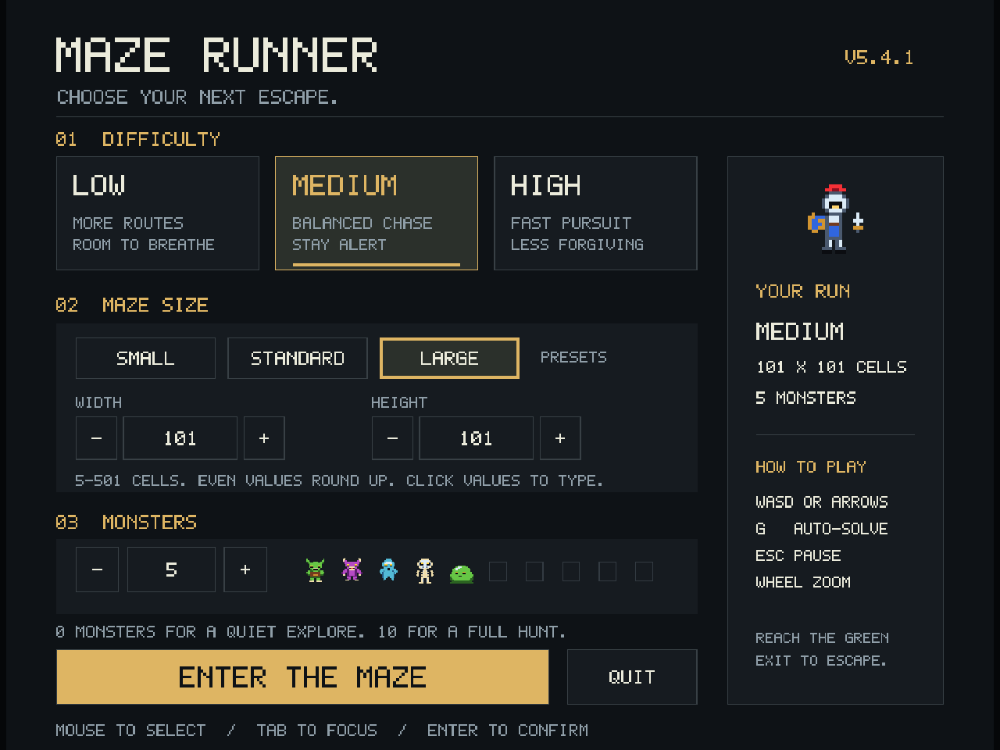
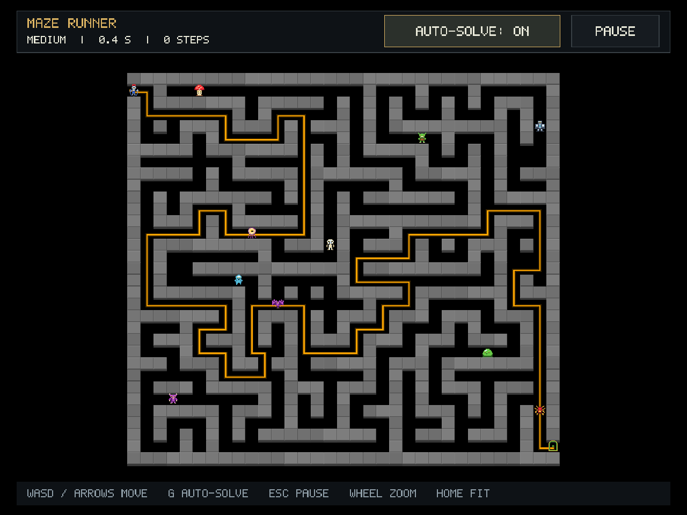
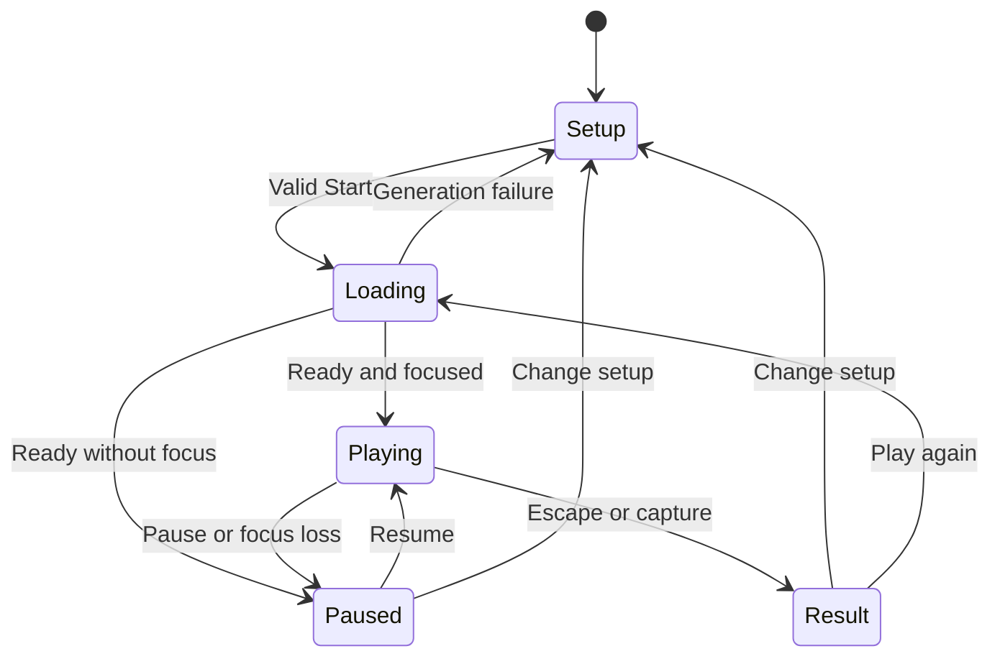

# MazeRunner V5.4.1 — AI, graphics, UI, and redesign guide

This guide describes the **implemented V5.4.1 behavior** in [src/mazerunnerV5.4.1.cpp](src/mazerunnerV5.4.1.cpp), then separates proposed redesign work from existing features. The source is unchanged in this documentation release. Its SHA-256 is `19affcaf73d4f7acc3578b53b1e5f8a0a0debe11beb2ecf8e365773b2e9ee1ae`.

The companion [line-by-line reference](01-Source-Line-by-Line.md) explains every physical source line. The [build, test, and reproduction guide](03-Build-Test-and-Reproduce.md) contains commands, evidence, platform limitations, and a screenshot index. All images below were captured from this source by the included real-OpenGL test harness; the gallery is a deliberately arranged fixture.

## 1. Architecture and game rules

The game is a single C++17 translation unit with a deliberately separated simulation and graphical front end. `Maze` owns terrain, entities, event times, path searches, director state, and terminal reporting. Its decisions do not require GLFW, a window, textures, or a GPU. A headless binary removes GL-dependent sections at preprocessing time and runs this same simulation. `Renderer` turns maze state into world geometry; `UiState` models setup and screen interaction; `UiRenderer` draws the menus; `GameApplication` owns their lifetimes and schedules background generation.

The player must reach the exit without occupying a monster's cell. Terrain is a rectangular grid containing wall, open-path, and exit cells. Actors are separate from that terrain: a moving monster does not overwrite a wall or corridor character. Coordinates use `(row,column)` in simulation and `(x=column,y=row,z=height)` in rendering. Adjacency is orthogonal, never diagonal. The generated entrance is on the left boundary near the top, and the exit is on the right boundary near the bottom.

The setup permits **0–10 monsters** and dimensions **5–501** per axis. Even dimensions round upward to odd numbers. Width and height can differ. V5.4.1's presets are **Small 33×33**, **Standard 63×63**, and **Large 101×101**. The initial editable defaults remain **31×21 with five monsters and Medium difficulty**; Standard is a selectable preset, not the initial form value. Form settings remain available during the application's lifetime but are not saved to a configuration file. Manual moves are ignored while automatic solving is enabled; turn it off with G or the HUD toggle before taking control. Gameplay movement uses initial key presses rather than GLFW key-repeat events.

### Simulation time and event order

Time is represented as signed 64-bit integer milliseconds. An automatic action is due every 40 ms, or 25 action opportunities per simulated second. A wait is an action opportunity but not a successful movement step. Rendering frequency does not change the action interval. Monsters have their own per-profile periods and initially staggered deadlines.

`Maze::advance_to` processes events chronologically. At the same event time, stale movement information expires, the director updates, due monsters act, and then the automatic player acts. This order matters: a monster scheduled at the same moment as the next player action gets its opportunity first. Capture is checked after entity movement, and capture takes precedence over winning if a monster occupies the exit cell with the player. Tests check event partitioning so advancing a time interval in pieces does not change the intended simulation result.

Monsters patrol immediately after generation even before the player's run timer has started. The displayed run timer starts after a successful player movement or when automatic solving is enabled. The director's sampling schedule starts with that timer. In the graphical application, only the Playing screen calls `advance_to`. Pausing, loading, setup, and results freeze the simulation. Losing window focus pauses play; returning focus does not resume automatically. The application caps a single host-loop update at 250 ms, limiting catch-up after a severe stall. Thus simulation milliseconds and arbitrary elapsed wall time are not always identical.

## 2. Maze generation and multiple solutions

`Maze::generate` begins with an iterative randomized depth-first carve on the odd-coordinate room lattice. Moving two cells at a time connects rooms by opening their intervening wall. The initial carved structure is a spanning tree, so by itself it has only one simple entrance-to-exit route. The generator then opens eligible separating walls to introduce loops.

The loop budget is derived from grid area, with a denominator of 100 for maximum dimension at most 40 and 150 otherwise. It is scaled by the profile's integer percentage. In source terms it is `loop_density_percent * max(1, rows*cols / denominator) / 100`, with integer division. This is a carving budget, not a percentage of every wall in the map and not a count of final solutions. Low refreshes eligible candidates after individual carves; Medium and High use the initial shuffled list. Actual openings also depend on available candidates.

The resulting graph must pass an entrance-to-exit diversity check. Medium and High require at least two distinct simple solutions. An iterative DFS computes discovery times, low-link values, and bridges. If a non-bridge edge lies on the DFS tree route from entrance to exit, a cycle supplies an alternative route between points of that route. A cycle attached only to a side branch does not satisfy this check. This distinction prevents cosmetic loops from being mistaken for meaningful alternate solutions.

Low requires a certificate of at least four choices using biconnected blocks along the route. The implementation derives each block's contribution from its edge and vertex counts, caps contributions/products at four, and applies a minimum block size for meaningful diversity. This is a conservative certificate used by this generator, not an exhaustive enumeration of all simple paths. It also does not claim four edge-disjoint or vertex-disjoint routes: alternatives may share corridors. The included small-graph tests compare these certificates against explicit path enumeration.

Generation retries until the relevant criterion passes. The same seeded random stream continues through retries; it is not reset to the same rejected candidate each time. The source has no fixed maximum attempt count. Valid topology is checked before monsters spawn, so the guarantee is about terrain. Monsters can still occupy every currently available route later.

### Graph representation and reusable searches

`rebuild_graph` caches up to four walkable neighbors per cell, degree, dead-end information, and terrain distance to the exit. Reverse BFS produces shortest grid-distance fields in linear time in the traversed graph. A small FIFO cache retains up to 24 destination fields using shared ownership, which avoids rebuilding frequently used monster-target distances. The class also exposes A* with a Manhattan heuristic and per-search epoch bookkeeping. Live monster following primarily uses reverse-distance gradients, while the auto-player combines global BFS guidance with a time-sensitive tactical search.

At the maximum 501×501 grid there are 251,001 cells, so repeated whole-grid work and mesh allocation matter. Iterative graph algorithms avoid deep recursive DFS stacks. The recovery search is separately bounded. Rendering has a large-map detail reduction described below. These limits keep work bounded in practical places but are not a promise of identical frame rate across devices or all map sizes.

## 3. Monster AI: patrol, movement hints, and pursuit

Every monster uses the same behavioral rules. The ten creature appearances are visual variants, not classes with different speed, vision, damage, or intelligence. Spawn IDs give them distinct stable artwork. Spawn selection excludes the entrance/player and exit and keeps monsters on unique open cells. It favors positions sufficiently far from the player using graph distance, but can fall back to nearer candidates when necessary; there is no universal minimum separation guarantee on all allowed sizes. On a very small maze, the requested monster count is also capped by the number of distinct available spawn cells.

### Patrol behavior

A monster begins in `Patrolling`, with no exact player target. It samples potential open-cell waypoints and favors useful travel distance while penalizing recently visited cells and targets already claimed by another monster in the same state. Patrol therefore explores the maze before the player moves. It is not a stationary guard waiting for an alarm.

Following a target uses a reverse BFS distance gradient. Recent-cell penalties discourage immediate repetition. When blocked, a monster can accept limited non-improving movement to sidestep congestion, and repeated blockage causes a new target choice. Targets are reviewed on a 700-ms schedule, but review can preserve a still-valid waypoint. Each monster keeps a bounded recent-cell history rather than a permanent visited map.

### Information available to hunting monsters

Only successful player displacement publishes movement information. Waiting, toggling the camera, or attempting to move into a wall does not create a new movement scent. The director can inspect the actual player for its own control calculations, but the monster-targeting interface receives a `LocationHint`: rectangular bounds plus a movement revision, not the player's exact cell.

The ordinary hint is a fixed quantized region of the map. It is not a rectangle centered on the player, which would leak the exact center. The base side length is nine cells on Low and five on Medium/High, with edge handling that keeps the rectangle within the maze. Expanded director hints broaden this region. Bounds can include walls; monsters select reachable walkable candidate cells inside them.

A hunting target is sampled with weighting that favors reachable nearby candidates and penalizes recent visits. A candidate already claimed by another hunting monster is strongly downweighted, encouraging a distributed search of the hinted area. A valid existing target may be retained after an updated hint; changing a hint does not necessarily force an entirely new path. The implementation does not contain line-of-sight vision, acoustic propagation, an exact trail of historical player positions, or a separate combat model.

Low reports are throttled to at least 200 ms between ordinary hints during continuing motion; its first movement after scent loss can immediately notify monsters. Every successful movement refreshes the global scent timestamp even when a throttled report is skipped. Medium and High use a zero report interval, allowing each movement to publish. Their scent lifetimes are independent of monster movement periods.

### Returning to patrol and avoiding monster overlap

If the player stops moving long enough for the profile's scent lifetime to expire, hunters return to patrol and forget their hunting target. Expiration does not stop them moving or make them harmless: a patrolling monster can still collide with an idle player. Standing still is therefore a tactical option, not invulnerability.

When several monsters act in a batch, movement priority rotates. Reservations include all starting cells and claimed destinations for that batch. Monsters cannot stack, swap through each other, or immediately follow another monster into a cell it vacated in that same batch. This prevents order-dependent overlap but can create temporary corridor congestion. Target reassessment and sidesteps help resolve congestion over later batches.

## 4. Automatic player AI

The automatic player has two related but distinct responsibilities: choose its next action under moving threats, and maintain a visible route from its current cell to the exit. Only the first action of each tactical plan is committed. Planning repeats from the resulting real state, allowing waiting, forward movement, alternate branches, and backtracking.

### Full path overlay

A reverse BFS from the exit first treats current monster cells as unavailable. If it reaches the player, following the distance gradient yields a complete route that avoids that occupancy snapshot. The overlay runs from the player's current location all the way to the exit, not merely to the tactical horizon. Its color cycles when a currently unoccupied route exists.

When all such routes are blocked, a terrain-only distance gradient still provides a full exit route and the renderer colors it amber. Amber explicitly means some current monster occupancy blocks a snapshot route. A colored clear route is not a forecast that every segment will remain safe by the time the player reaches it. The tactical player can intentionally leave the displayed route to evade, wait, or commit to a retreat; the overlay is refreshed afterward from its new position.

The pictured HUD is a deterministic Medium, ten-monster, seed-42 run at 400 ms. The zero step count and amber route reflect the actual waiting state of that short snapshot. This screenshot is not evidence that the player escaped, nor a long-duration progress measurement.

### Tactical forecast and beam search

The planner looks ahead for 12 automatic actions, nominally 480 ms, retaining at most 64 candidates at each depth. It considers five actions at each expansion: stay in place or move to one of four adjacent walkable cells. A forecast copies current monster positions, targets, states, deadlines, and reservation behavior. It projects scheduled movement within the horizon but does not simulate every possible future random target selection or newly generated director hint. Predictions are therefore useful estimates rather than perfect future knowledge.

An additional earliest-arrival estimate combines the remaining delay until a monster's next move with shortest graph travel at that profile's movement period. The conservative first action rejects cells that may be reached within the next action interval, with special exit handling. Predicted collisions and near approaches influence later search layers. Dead-end gate analysis also discourages entering a branch that a nearby threat could seal.

The score combines movement/action cost with danger, recent repetitions, decaying visit heat, and the chosen distance guidance. A wait adds 0.35; reversing toward the prior node adds 0.8; danger is weighted by 2.0 in accumulated cost. Threatened deep dead ends and low-degree endpoints receive extra penalties. These terms encourage progress and avoid short oscillations without prohibiting a necessary retreat. Deduplication retains the better candidate for a cell at a given depth. An available goal candidate is preserved before beam truncation. If no goal is reached within the horizon, the search retains a feasible deepest frontier rather than treating lack of immediate escape as failure.

The state space is approximated: per-cell/per-depth merging and a finite beam do not preserve every distinct history. The result is not a globally optimal time-expanded path and does not prove survival. With no monsters, the code bypasses tactical threat search and follows the exact terrain shortest-path gradient.

### Bounded waiting and committed recovery

The earlier indefinite-wait/oscillation problem is addressed with explicit time-based memory. When all current exit routes are blocked, the player can wait if the next action is conservatively safe. The initial waiting budget is tied to **twice the profile's scent lifetime**. Its start time is retained across decisions; it is not restarted at every 40-ms tick. A brief gap at a bottleneck does not immediately restore a fresh full waiting budget. The code requires a clear route to persist for a scent-duration interval before resetting that blocked episode.

After the blocked waiting budget, or after 2,400 ms without recognized navigation progress, recovery can select a temporary detour goal. Search explores at most 4,096 cells and depth 32, considers sufficiently distant candidates, and checks time clearance relative to estimated travel. It rewards room to maneuver, junctions, and movement away from repeated cells, while penalizing dead ends, excessive exit-distance increase, returning to the entrance, and recently tried recovery areas. Candidates can be behind the player's current apparent forward direction: backtracking is explicitly permitted.

A chosen recovery goal is committed for up to 4,000 ms rather than reselected on every tick. Recovery has progress checks, retries, a small recent-goal history, and occupancy-aware guidance updates. Reaching a recovery point can include a pause for scent plus one monster period. A stable newly opened exit route can cancel recovery early when the downhill next step is safe, so the player does not insist on an obsolete detour.

If conservative planning fails, the planner tries a relaxed interpretation of uncertain threats. If that also yields no continuation, emergency selection scores currently unoccupied candidates by estimated time before contact, exit distance, and local degree. This hierarchy provides alternatives under pressure; it does not guarantee a winning move exists. A cornered player may be caught, and complicated moving bottlenecks can still produce long runs. Tests demonstrate bounded initial waiting and successful retreat in controlled scenarios; they do not establish a universal finite-time escape theorem.

## 5. Overwatch/director intensity control

The director controls **information precision**, rather than directly slowing monsters, teleporting them, disabling collisions, or choosing a safe corridor for the player. This preserves the distinction between the monster's local search and the game's broader pressure regulator. It is an implementation-specific tension-control design; it does not reproduce or claim knowledge of another game's internal AI.

Every 200 ms, once the run timer is active, it samples player location. A full difficulty-dependent history window is needed before declaring confinement. The implemented spatial test checks a small number of unique cells and a compact bounding box; persistent auto-player lack of progress also contributes. Specifically, a window with at most twelve unique cells and row/column spans at most eight represents confinement. Waiting and short back-and-forth motion can therefore trigger relief without requiring the player to be literally motionless.

When relief begins, padding expands the nominal hint region and old hunting targets are invalidated so hunters can spread across the less precise area. The change updates active hunting information but does not wake patrolling monsters or renew an expired scent. Ongoing confinement can extend relief and increase padding up to the profile limit. Because a wider region only changes sampled targets, relief gives the player an opportunity probabilistically; it does not guarantee that the next monster move clears a passage.

Restoring normal precision requires the minimum relief hold to expire and sustained recovery rather than one favorable tick. The 2,000-ms recovery hysteresis prevents rapid precision flicker. The player must no longer qualify as confined and must show meaningful spatial/exit progress; auto mode additionally checks that an exit route is open. For automatic play, exit-distance improvement is compared with the relief baseline; manual play can demonstrate sufficient movement away from the relief anchor. This makes relief harder to cancel merely by pacing in the same pocket.

## 6. Exact difficulty parameters

All values below are read from `difficulty_settings`; no balancing parameters were changed for this documentation package. Lower periods mean more frequent monster actions. Larger hint side lengths mean less precise information. Loop density is a budget multiplier, not an escape probability.

| Parameter | Low | Medium | High |
|---|---:|---:|---:|
| Minimum certified terrain solutions | 4 | 2 | 2 |
| Loop budget percentage | 225 | 135 | 100 |
| Monster move interval, ms | 220 | 140 | 108 |
| Approximate moves per simulated second | 4.55 | 7.14 | 9.26 |
| Base hint side length, cells | 9 | 5 | 5 |
| Minimum continuing-motion report interval, ms | 200 | 0 | 0 |
| Scent lifetime after last successful move, ms | 420 | 560 | 840 |
| Director confinement window, ms | 2,500 | 4,000 | 6,000 |
| Minimum relief hold, ms | 8,000 | 6,000 | 4,000 |
| Added padding per relief escalation, cells per side | 4 | 4 | 2 |
| Maximum padding, cells per side | 16 | 16 | 8 |
| Maximum nominal expanded hint width before map clipping | 41 | 37 | 21 |
| Auto-player action interval, ms | 40 | 40 | 40 |
| Tactical horizon / beam width | 12 / 64 | 12 / 64 | 12 / 64 |

The reference escape-rate goals discussed during development were roughly 92% Low, 65% Medium, and 35% High. Those numbers must not be relabeled as measurements of this documentation run. The source's calibration note identifies **21×21/31×31 maps, five monsters, and a 60-second limit**. V5.4.1's substantially larger presets and other monster counts change travel distance, density, available alternatives, and censoring at a fixed duration. The included nine preset/profile cases are 1-second smoke tests, each repeated once; they do not estimate escape rates.

For future tuning, use a fixed published cohort of seeds, dimensions, monster counts, duration, compiler, and standard-library version. Report wins, captures, and still-running cases separately. Compute uncertainty for the win fraction; do not silently discard timeouts or compare a 60-second trial to an unlimited trial. Preserve the auto-player's shared intelligence while changing opposition/environment parameters if the intent is to keep difficulty comparable. Aesthetic-only work should leave these parameters and random-number consumption untouched.

## 7. Existing graphics implementation

### Actual 3D walls and a fixed orthographic camera

Wall cells generate real three-dimensional triangles with height **0.38 grid units**. Exposed vertical faces and top caps use different gray brightness factors. Detailed maps add 0.035-cell inset bevels with a 0.045-cell shoulder drop. Faces between adjacent solid wall cells are omitted. Base stone color varies deterministically by cell-index hashing, so this cosmetic variation cannot alter maze generation or AI randomness.

The view is a fixed **25-degree orthographic tilt**. It exposes height while preserving familiar row/column directional controls. This is not a freely rotating perspective camera. The projection fits the complete map at 1×, preserves scale under aspect changes, and follows/clamps around the knight while zoomed. Zoom ranges from 1× to 64×. The world clears to black; there is no separate textured floor covering every corridor.

For grids above 15,000 total cells, the renderer omits small cap bevels while retaining top faces and exposed vertical walls. All three square presets are below that threshold; the maximum 501×501 case is not. This is a mesh-detail policy based on total area, not camera distance. There are no normal maps, shadow maps, physical lights, or physically based materials. The apparent illumination is authored RGB brightness on each face.

### Pixel actors are billboards, not 3D character models

The knight, exit, and ten monsters are each **20×20** arrays of palette characters embedded in the `.cpp`. Every opaque pixel becomes one quad, or six triangle vertices. Dots emit no geometry. A camera-facing plane keeps the pixel image legible in the tilted world. This construction supports depth occlusion against walls without loading a texture or using alpha blending.

One pixel is 0.044 cells wide, giving a sprite a nominal 0.88-cell width. Sprites are horizontally mirrored after left/right movement. The knight has a brief step bob and a blue octagonal ground ring. Wraith, Bat, and Evil eye receive a small sinusoidal hover. Hunting eye pixels switch from gold to red. These animations are visual offsets based on simulation time; they do not interpolate actor collision positions or introduce animated sprite frames.

| Spawn ID | Appearance | Sprite constant | Cosmetic hover |
|---:|---|---|---|
| 0 | Goblin | `GOBLIN_SPRITE` | No |
| 1 | Demon | `DEMON_SPRITE` | No |
| 2 | Wraith | `WRAITH_SPRITE` | Yes |
| 3 | Skeleton | `SKELETON_SPRITE` | No |
| 4 | Slime | `SLIME_SPRITE` | No |
| 5 | Bat | `BAT_SPRITE` | Yes |
| 6 | Spider | `SPIDER_SPRITE` | No |
| 7 | Stone golem | `GOLEM_SPRITE` | No |
| 8 | Evil eye | `EVIL_EYE_SPRITE` | Yes |
| 9 | Mushroom | `MUSHROOM_SPRITE` | No |

The arranged gallery places every appearance where it can be inspected; it is not a naturally generated gameplay encounter. The render test also removes each monster in turn and checks that its absence changes visible pixels, helping detect hidden or missing variants.

### Palette and batching

The exact shared palette is below. Values are normalized RGB, not hexadecimal byte values. `E` is state-dependent; `.` is transparent. The same symbols are used in world art and setup illustrations.

| Symbol | RGB / behavior | Intended visual role |
|---|---|---|
| `.` | No geometry | Transparent background |
| `K` | 0.045, 0.050, 0.065 | Outline / near black |
| `S` | 0.290, 0.350, 0.430 | Dark steel |
| `L` | 0.860, 0.920, 0.970 | Steel highlights |
| `W` | 0.940, 0.870, 0.670 | Bone / cream |
| `Y` | 1.000, 0.830, 0.430 | Light yellow |
| `A` | 0.820, 0.580, 0.190 | Gold / ochre |
| `B` | 0.190, 0.400, 0.870 | Blue |
| `R` | 0.960, 0.190, 0.210 | Red |
| `r` | 0.550, 0.060, 0.120 | Dark red |
| `T` | 0.450, 0.230, 0.120 | Brown |
| `G` | 0.400, 0.780, 0.270 | Green |
| `g` | 0.170, 0.390, 0.130 | Dark green |
| `P` | 0.710, 0.290, 0.770 | Purple |
| `p` | 0.360, 0.110, 0.430 | Dark purple |
| `C` | 0.320, 0.730, 0.840 | Cyan |
| `D` | 0.140, 0.340, 0.510 | Dark cyan |
| `E` | Patrol: 1.000, 0.830, 0.230; hunt: 1.000, 0.120, 0.080 | Monster eyes |

`Vertex` holds six floats: three position components and three color components. A static VAO/VBO contains maze walls. A second batch is regenerated for the route, exit, monsters, and knight. The UI has its own streaming batch. A normal gameplay frame therefore uses two world triangle draws plus one UI draw; setup needs only its UI batch. Buffer capacity can grow when a long full-map overlay requires more vertices than the initial reservation.

The shared GLSL 3.30 shader multiplies a vertex by `viewProjection` and forwards RGB. The fragment shader writes opaque alpha. Depth testing is enabled for the world and disabled for UI. Blending, multisampling, and dithering are disabled for crisp opaque rendering. The route's “glow” consists of a broad dark strip and narrow bright strip at slightly different heights, not bloom or a lighting effect.

## 8. UI structure and redesign boundaries

The UI is custom immediate geometry over a **1000×760 logical canvas**. `UiTransform` uniformly fits and centers that canvas in the framebuffer. Cursor conversion first accounts for window-to-framebuffer DPI scaling, then reverses the same letterbox transform. This is why widget rectangles must remain shared between drawing and hit testing.

`UiState::widgets` defines control IDs, rectangles, labels, selected flags, and enabled flags. Pointer presses store the hit control; release activates only the same enabled control. Tab/Shift+Tab traverse enabled widgets. Numeric fields hold strings while being edited, validate independently, and support replacement, deletion, and bounded stepping. Invalid input disables Start. Pressing Enter in a numeric field first focuses Start; confirming again starts the game. Control+A marks a numeric value for replacement; the current code does not map macOS Command+A.

Generation runs on a worker that owns its captured configuration and creates only the CPU-side Maze. The loading screen is presented before that work starts. Once the future is ready, the main thread constructs the OpenGL renderer and installs both objects. Every GL object must be created and destroyed while its context remains current. A future designer change that loads GPU assets on the generation worker would violate the present threading model unless a deliberate shared-context strategy were added.

Text uses an embedded **5×7** uppercase bitmap font with digits and selected punctuation. Each row is a five-bit mask. Character advance is six pixels times scale. Unsupported bytes render a question-mark glyph; this is not Unicode layout, kerning, multiline wrapping, or a general font engine. Labels are positioned manually and need rechecking after copy changes. Logical pixel edges remain consistent within glyphs, although arbitrary framebuffer scaling is not restricted to integer pixel magnification.

## 9. Redesign path A: keep the single-file art pipeline

This is the smallest engineering change for a graphic designer's first pass. Keep all simulation code and the appearance registry order intact. Redraw each sprite on an exact 20×20 canvas using the existing palette, preserving a common foot position and the knight's approximate cell footprint. Replace the twenty corresponding string rows. Each row must contain exactly twenty symbols, and every symbol must be in `valid_sprite`'s whitelist. Compile-time assertions catch malformed dimensions and unknown symbols before the game runs.

Use silhouette to distinguish creatures before relying on color: wings, horns, eye shape, body mass, leg count, and cap outline remain meaningful at small scale. Keep intentional transparency around limbs. Reserve `E` for visible state-sensitive eye details and inspect both patrol and hunting versions. Avoid changing a shared palette entry casually: modifying `W`, for example, changes every sprite using that symbol, including UI illustrations. For new colors, update both `sprite_color` and the whitelist, then consider whether tests expecting palette ranges need a deliberate update.

Edit theme colors in `UiRenderer` and stone brightness in `build_wall_mesh`. Maintain contrast between black corridors, gray raised walls, the player's blue ring, exit art, and route overlay. At 101×101 fitted into one window, individual sprite pixels become very small; judge navigation readability at whole-map scale as well as at zoom. The existing ring is a useful player locator. A future exit beacon or an icon outline could improve readability, but neither is currently implemented.

For UI rearrangement, change rectangles in `UiState::widgets` and matching descriptive panel/text positions in `UiRenderer::setup`, `hud`, and `draw`. Background labels and panels are not generated automatically from the widget list, so moving only a button rectangle can create overlaps even though clicks remain correctly aligned to that button. Keep focus outlines and disabled/pressed states distinct. Test the minimum 800×600 window, wide and tall windows, and a high-DPI transform. A portrait offscreen screenshot is a robustness check, not a promise the native minimum-size limits permit that exact window.

| Desired edit | Primary source location | Related constraints |
|---|---|---|
| Knight or exit drawing | [L1486](01-Source-Line-by-Line.md#l1486), [L1618](01-Source-Line-by-Line.md#l1618) | 20 rows × 20 symbols; shared palette |
| Ten monster drawings | [L1498](01-Source-Line-by-Line.md#l1498) onward | Keep registry pointers and stable IDs |
| Registry names/hover flags | [L1637](01-Source-Line-by-Line.md#l1637) | Hover is cosmetic; registry size must cover max count |
| Sprite validation | [L1658](01-Source-Line-by-Line.md#l1658) | Add new palette symbols here as well as color mapping |
| Wall style | [L1693](01-Source-Line-by-Line.md#l1693) | Static upload, exposed faces, large-map policy |
| Sprite colors | [L1725](01-Source-Line-by-Line.md#l1725) | Global effect across all art using a symbol |
| World sprite size/anchor | [L1750](01-Source-Line-by-Line.md#l1750) | Camera-facing construction and wall occlusion |
| Camera fit/tilt/zoom | [L1782](01-Source-Line-by-Line.md#l1782) | Projection and sprite orientation must agree |
| Route colors/thickness | [L1813](01-Source-Line-by-Line.md#l1813) | Preserve clear/blocked semantics |
| Widget rectangles and labels | [L1905](01-Source-Line-by-Line.md#l1905) | Shared hit testing and keyboard order |
| Font shapes | [L2028](01-Source-Line-by-Line.md#l2028) | Seven rows, five bits; text metrics elsewhere |
| Menu palette and layout | [L2224](01-Source-Line-by-Line.md#l2224) | Labels, panels, and widgets need coordinated spacing |

## 10. Redesign path B: external texture sprites and richer animation

An external sprite sheet would let a designer iterate in an image editor without rewriting C++ strings. This is a **proposed extension**, not a loader already present in V5.4.1. A concrete initial asset contract could preserve 20×20 logical frames, transparent RGBA backgrounds, a documented foot pivot, and named clips for idle, walk, and hunting. A separate manifest would map the ten stable appearance IDs to sheet regions and frame timings. Larger source art is also possible, but the logical world footprint must be chosen explicitly rather than inferred from image dimensions.

Engineering work would include image decoding, texture lifetime ownership, UV coordinates in the vertex format, a texture sampler in the shader, atlas rectangles, and an asset-location policy. Nearest-neighbor sampling would preserve crisp pixel edges. Atlas gutters and careful UV boundaries would avoid neighboring-frame bleed. Transparent texels could be discarded for hard-edged pixel art while retaining depth writes; translucent effects would require an intentional blend/depth-order policy. Color-space handling should be consistent across images and vertex colors rather than relying on incidental driver defaults.

Animation should live in render state and be keyed to simulation events or timestamps. Keep collision and AI on the existing grid unless the gameplay redesign explicitly changes them. Render interpolation can make movement smoother, but it should not determine whether capture occurs. Aesthetic random variations should use deterministic hashes or a separate visual PRNG, preserving the simulation RNG stream and its seeded tests. Asset failures should produce useful diagnostics and a visible fallback, and asset paths should work when launching from a different current directory.

A designer handoff should specify canvas/frame size, foot pivot, intended world size, transparent margin, palette/color-space policy, direction conventions, animation durations, and the two pursuit-state cues. Deliver an overview sheet plus isolated frames and preview both at actual small in-game scale. Those deliverables are recommendations for a future art pass; the current package supplies the existing embedded-art screenshots and source, not a new texture pipeline.

## 11. Redesign path C: true 3D characters or a broader renderer change

Replacing billboard actors with real models is a larger change. It requires mesh/asset import, normals, material definitions, model transforms, animation data, and lighting if the models should appear shaded. A rigged knight also needs bone transforms or another explicit animation scheme. Merely extruding current pixel quads does not create articulated character animation.

Preserve the tile-centered simulation as the authoritative gameplay representation while adding a render transform for each entity. Define a shared world scale, actor origin, feet-on-floor convention, and maximum silhouette footprint. Retain a readable player marker and distinct monster silhouettes under the fixed camera. If the camera becomes rotatable or perspective, update billboard handling, projection bounds, zoom behavior, and the relationship between input directions and screen directions together.

The current portable renderer targets OpenGL 3.3 core and uses GLSL 3.30. Any new shader or asset technique must fit the chosen supported platform baseline or introduce an explicitly documented alternative renderer. macOS's existing OpenGL route should be treated as a compatibility target when evaluating new effects. A backend migration would be a separate engineering project; there is no existing abstraction here that automatically converts GL draw calls to another graphics API.

## 12. Validation workflow for visual changes

Begin with a reproducible seed and unchanged dimensions, count, difficulty, compiler, and standard library. Compare headless simulation outputs before/after after excluding measured host compute time. An art-only edit should not change the simulation state or consume additional simulation randomness. Run the portable regression suite for sprite validity, geometry/camera invariants, all profiles, and UI state. Then run the real-GL render and injected-application suites on Linux and inspect the generated PNGs.

Use the gallery to check that all ten appearances are distinct and visible, then inspect a naturally generated crowded map. Review whole-map and zoomed views, amber and cycling routes, player overlap/occlusion, the green exit, invalid setup fields, keyboard focus, pause, and results. Rerun native-window checks on each intended release platform: offscreen rendering cannot establish native DPI behavior, compositor behavior, actual keyboard mappings, or macOS/Windows driver compatibility.

For new assets or shader effects, extend tests around the changed contract rather than weakening old assertions until everything passes. A deliberate palette redesign may require updating pixel-color expectations, but depth ordering, missing actors, map aspect, input hit areas, source gameplay behavior, and GPU cleanup should remain verifiable. Store the chosen screenshots with seed/configuration and capture method so they remain useful references rather than undocumented pictures.
