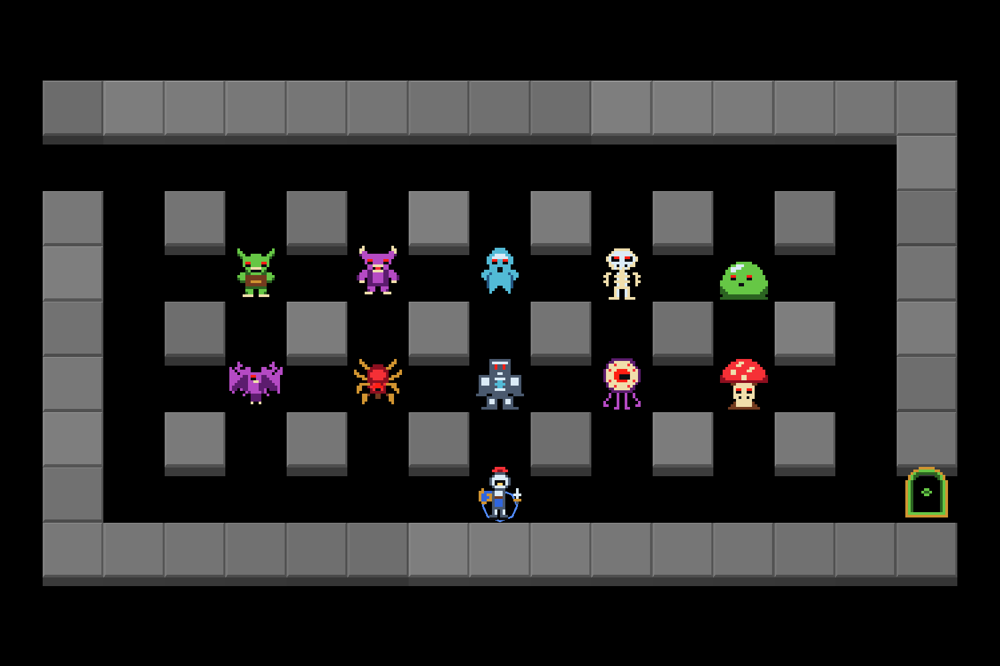
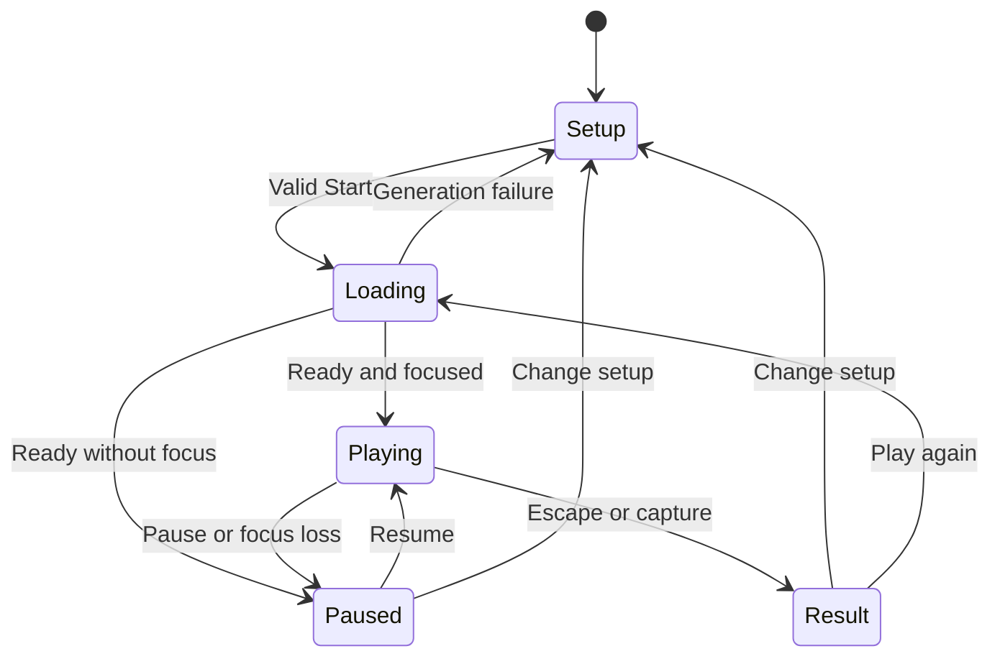

# MazeRunner V5.4.2 — AI, graphics, UI, and redesign guide

This guide describes the **implemented V5.4.2 behavior** in [src/mazerunnerV5.4.2.cpp](src/mazerunnerV5.4.2.cpp), then separates proposed redesign work from existing features. The source's SHA-256 is `1d3604ad7db5700d1658c0acdda18295405be19b5dee09c27db944944bf28dab`.

The companion [line-by-line reference](01-Source-Line-by-Line.md) explains every physical source line. The [build, test, and reproduction guide](03-Build-Test-and-Reproduce.md) contains commands, evidence, platform limitations, and a screenshot index. All images below were captured from this source by the included real-OpenGL test harness; the gallery is a deliberately arranged fixture.

### What changed from V5.4.1

| Area | V5.4.1 | V5.4.2 |
|---|---|---|
| Game start | Monsters roamed as soon as the play screen appeared | Monsters stay frozen until the first move or auto-solve toggle |
| Who reacts to a step | Every monster on the map | Only monsters within a Manhattan hearing radius |
| Losing the scent | Hunters returned to patrol at once | Hunters search the last clue area, then roam |
| Coordination | None | Up to one (Medium) or two (High) interceptors at exit-route chokepoints |
| Sight | None | High: unalerted monsters spot the player 3–6 cells down a straight corridor |
| Patrols | Random distant waypoints | Prefer regions no monster has visited recently; avoid crowding |
| Solver blocking | Any monster cell on every route blocked the plan | Only near or parked monsters block; distant ones add a detour cost |
| Solver waiting | Could wait beside a monster | Never waits for scent loss while a monster is one step away |
| Detour loops | None | Recent detours shorten waits and favor exit progress |
| Director | Standing still counted as confinement | Manual idling is excluded; blocked solver waits still count |
| Generation | No attempt cap | Falls back to adding connections after 64 attempts |
| Controls | One step per key press; Esc on setup quit | Hold to keep walking; Esc never quits |
| Balance | Medium 140 ms, High 108 ms monster steps | Medium 148 ms, High 118 ms |
| Large-map cost | 12–15 ms simulation per 16 ms frame at 501×501 | About 4.7–5.8 ms |

## 1. Architecture and game rules

The game is a single C++17 translation unit with a deliberately separated simulation and graphical front end. `Maze` owns terrain, entities, event times, path searches, director state, and terminal reporting. Its decisions do not require GLFW, a window, textures, or a GPU. A headless binary removes GL-dependent sections at preprocessing time and runs this same simulation. `Renderer` turns maze state into world geometry; `UiState` models setup and screen interaction; `UiRenderer` draws the menus; `GameApplication` owns their lifetimes, schedules background generation, and turns held movement keys into repeated steps.

The player must reach the exit without occupying a monster's cell. Terrain is a rectangular grid containing wall, open-path, and exit cells. Actors are separate from that terrain: a moving monster does not overwrite a wall or corridor character. Coordinates use `(row,column)` in simulation and `(x=column,y=row,z=height)` in rendering. Adjacency is orthogonal, never diagonal. The generated entrance is on the left boundary near the top, and the exit is on the right boundary near the bottom.

The setup permits **0–10 monsters** and dimensions **5–501** per axis. Even dimensions round upward to odd numbers. Width and height can differ. The presets are **Small 33×33**, **Standard 63×63**, and **Large 101×101**. The initial editable defaults are **31×21 with five monsters and Medium difficulty**; Standard is a selectable preset, not the initial form value. Form settings remain available during the application's lifetime but are not saved to a configuration file. Manual moves are ignored while automatic solving is enabled; turn it off with G or the HUD toggle before taking control. Pressing a movement key moves at once; holding it repeats the move after 220 ms and then every 120 ms. These repeats are driven by the application's own timer, not by the operating system's key-repeat events.

### Simulation time and event order

Time is represented as signed 64-bit integer milliseconds. An automatic action is due every 40 ms, or 25 action opportunities per simulated second. A wait is an action opportunity but not a successful movement step. Rendering frequency does not change the action interval. Monsters have their own per-profile periods and initially staggered deadlines.

`Maze::advance_to` processes events chronologically. At the same event time, due scent and search expiries are applied first, then the director updates, due monsters act, and finally the automatic player acts. A monster scheduled at the same moment as the next player action therefore gets its opportunity first. Capture is checked after entity movement, and capture takes precedence over winning if a monster occupies the exit cell with the player. Tests check event partitioning so advancing a time interval in pieces does not change the intended simulation result.

**Monsters stay frozen until the player's first successful move or until automatic solving is enabled.** At that moment `start_timer` releases them, adding the current time to their spawn-relative deadlines so their staggering is preserved. Before V5.4.2, monsters roamed from time zero. An idle player still reading the screen could then be caught, about 5% of the time within 30 seconds on a 33×33 map with ten monsters, and the result screen read "0.0 seconds, 0 steps". The HUD now shows "MOVE OR PRESS G TO START" until the first input. The run timer and the director's sampling schedule start at the same moment.

In the graphical application, only the Playing screen calls `advance_to`. Pausing, loading, setup, and results freeze the simulation. Losing window focus pauses play and cancels a held movement key; returning focus does not resume automatically. The application caps a single host-loop update at 250 ms, limiting catch-up after a severe stall. Thus simulation milliseconds and arbitrary elapsed wall time are not always identical. While playing, the loop sleeps until a frame deadline about 4.2 ms after the previous frame began, so a driver without vsync does not spin a CPU core at 100%.

## 2. Maze generation and multiple solutions

`Maze::generate` begins with an iterative randomized depth-first carve on the odd-coordinate room lattice. Moving two cells at a time connects rooms by opening their intervening wall. The initial carved structure is a spanning tree, so by itself it has only one simple entrance-to-exit route. The generator then opens eligible separating walls to introduce loops.

The loop budget is derived from grid area, with a denominator of 100 for maximum dimension at most 40 and 150 otherwise. It is scaled by the profile's integer percentage. In source terms it is `loop_density_percent * max(1, rows*cols / denominator) / 100`, with integer division. This is a carving budget, not a percentage of every wall in the map and not a count of final solutions. Low refreshes eligible candidates after individual carves; Medium and High use the initial shuffled list. Actual openings also depend on available candidates.

The resulting graph must pass an entrance-to-exit diversity check. Medium and High require at least two distinct simple solutions. An iterative DFS computes discovery times, low-link values, and bridges. If a non-bridge edge lies on the DFS tree route from entrance to exit, a cycle supplies an alternative route between points of that route. A cycle attached only to a side branch does not satisfy this check. This distinction prevents cosmetic loops from being mistaken for meaningful alternate solutions.

Low requires a certificate of at least four choices using biconnected blocks along the route. The implementation derives each block's contribution from its edge and vertex counts, caps contributions/products at four, and applies a minimum block size for meaningful diversity. Within a biconnected block, a cycle rank of r guarantees at least r+1 simple paths between its entry and exit (start from a cycle through both, then each added ear contributes a new path). This is a conservative certificate used by this generator, not an exhaustive enumeration of all simple paths. It also does not claim four edge-disjoint or vertex-disjoint routes: alternatives may share corridors. The included small-graph tests compare these certificates against explicit path enumeration.

Generation retries with the same seeded random stream continuing through attempts, so each retry is a new layout. **V5.4.2 caps reseeded attempts at 64.** After that, `add_connections_until_diverse` keeps the current layout and opens connecting walls in seeded batches (one eighth of the candidates per pass, at least one) until the requirement holds. Every pass opens at least one wall, and a fully opened interior satisfies every profile, so generation always terminates. In practice the cap is not reached: over 200 seeds per shape, the worst observed case was 31 attempts (Low, 5×33). Valid topology is checked before monsters spawn, so the guarantee is about terrain. Monsters can still occupy every currently available route later.

### Graph representation and reusable searches

`rebuild_graph` caches up to four walkable neighbors per cell, degree, dead-end information, terrain distance to the exit, the exit chokepoint tree described in section 3, patrol regions, and a terrain signature. Reverse BFS produces shortest grid-distance fields in linear time in the traversed graph. A **least-recently-used** cache retains up to 24 destination fields with shared ownership; a hit moves to the back, so long-lived monster-target fields are not evicted by churn.

Threat estimates use **bounded fields** instead of whole-grid BFS. `local_field(source)` runs a breadth-first search that stops at 64 steps and reports 65 for any farther cell. That value is a lower bound, so an arrival estimate derived from it can only be earlier than reality, which is the conservative direction for the player. Fields come from a pool of reusable buffers with generation stamps. A buffer still referenced by a live forecast is never recycled.

Debug builds (without `NDEBUG`) hash the terrain at each `rebuild_graph` and check the hash at simulation entry points. Editing `grid` without rebuilding then fails with a clear error instead of running on stale adjacency. Release builds skip the check. The exact A* search that V5.4.1 kept in the game class is now only an independent oracle in the tests; the live game never used it.

At the maximum 501×501 grid there are 251,001 cells, so repeated whole-grid work and mesh allocation matter. Iterative graph algorithms avoid deep recursive DFS stacks. The recovery search is separately bounded. With ten monsters on Medium or High, V5.4.2 spends about 4.7–5.8 ms of simulation per 16 ms frame on average, with a worst frame near 20 ms. V5.4.1 spent 12–15 ms on average with worst frames near 80 ms. The gains come from the LRU cache, bounded threat fields, short reservation lists instead of grid-sized arrays, and rebuilding the solver overlay once per frame rather than after every monster event. Rendering has a large-map detail reduction described below. These are measurements on one host, not a promise of identical frame rate across devices.

## 3. Monster AI: hearing, hunting, searching, and interception

Every monster uses the same behavioral rules. The ten creature appearances are visual variants, not classes with different speed, vision, damage, or intelligence. Spawn IDs give them distinct stable artwork. Spawn selection excludes the entrance/player and exit and keeps monsters on unique open cells. It favors positions sufficiently far from the player using graph distance, but can fall back to nearer candidates when necessary; there is no universal minimum separation guarantee on all allowed sizes. On a very small maze, the requested monster count is also capped by the number of distinct available spawn cells.

A monster is in one of three states: `Patrolling`, `Hunting`, or `Searching`. A hunter has one of two roles: a **chaser** converges on the clue area; a **cutter** waits at a chokepoint between the clue area and the exit.

### Patrol behavior

A patrolling monster has no player information. It samples 32 random open cells and scores each one. A cell scores higher the longer it has been since any monster entered its 8×8 region, capped at 20 seconds. Travel distance (capped at 20 steps) adds a small amount. The score is penalized for cells this monster visited recently, for cells another monster already claimed, and for each other monster positioned or heading within six cells. Together the monsters therefore cover the map instead of clumping. Patrol is not a stationary guard waiting for an alarm.

Following a target uses a reverse BFS distance gradient. Recent-cell penalties discourage immediate repetition. When blocked, a monster can accept limited non-improving movement to sidestep congestion, and repeated blockage causes a new target choice. Targets are reviewed on a 700-ms schedule, but review can preserve a still-valid waypoint. Each monster keeps a bounded recent-cell history rather than a permanent visited map.

### Hearing and the information monsters receive

Only successful player displacement creates sound. Waiting, toggling the camera, or attempting to move into a wall does not. **A monster hears a step only if it is within the profile's Manhattan hearing radius of the player**, measured through walls. The radius is `hearing_cells + hearing_per_100 × max(rows, cols) / 100`, so it grows on larger maps. For example, Medium hears 16 + 14 × 33 / 100 = 20 cells on a 33×33 map and 30 cells on a 101×101 map. A monster beyond the radius is unaffected: a roaming monster keeps roaming, and a hunter keeps its older clue.

The director can inspect the actual player for its own calculations, but the monster-targeting interface receives a `LocationHint`: rectangular bounds plus a revision, not the player's exact cell. The ordinary hint is a fixed quantized region of the map. It is not a rectangle centered on the player, which would leak the exact center. The base side length is nine cells on Low and five on Medium/High, with edge handling that keeps the rectangle within the maze. Expanded director hints broaden this region. Bounds can include walls; monsters select walkable candidate cells inside them.

Each monster keeps **its own scent deadline**. Every step a monster hears renews that monster's deadline to one scent period later, even when a Low report is throttled. Low publishes a fresh clue at most every 200 ms of continuous motion, and the first movement after a pause is always reported at once. A monster that newly comes into range while reports are throttled receives the most recent published clue. Medium and High publish on every move.

A hunting target is sampled inside the clue rectangle with weights favoring nearby cells and penalizing recent visits. A candidate already claimed by another hunter is strongly downweighted, encouraging a distributed search. A valid existing target may be retained after an updated clue.

### Searching after losing the scent

When a hunter's own scent deadline passes, it does not simply forget. It switches to **Searching** for the profile's search time (1.5 s Low, 2.5 s Medium, 3.5 s High). During that time it keeps sweeping the last clue area: targets are drawn from that rectangle, with distance weighted less and repeated cells penalized more than while hunting. When the sweep ends, the monster returns to roaming. Searching monsters show orange eyes. Standing still is therefore no longer a reliable way to make nearby monsters forget the player: hunters that heard the last steps stay in the area for a while.

Expiry is an exact simulation event (`next_monster_state_change`), not a frame-time check, so results do not depend on rendering cadence. A monster that hears a new step while searching becomes a hunter again immediately.

### Interceptors (Medium and High)

`rebuild_graph` builds an exit-rooted depth-first tree with an iterative Tarjan traversal. For each cell it records whether the cell's parent separates that cell's subtree from the exit. When a parent does, every route from anywhere in the subtree to the exit must pass through it. When a new clue is published, `assign_interceptors` starts from the walkable cell of the clue rectangle nearest the exit; it never uses the player's cell. It then walks up that tree for at most 80 links, collecting chokepoints outside the clue area and at least four steps ahead. For each chokepoint, the nearest eligible hunter is sent if it can arrive before a player moving one cell per 80 ms would. Medium sends at most one interceptor and High at most two. Low sends none.

An interceptor (`Cutter` role) heads to its chokepoint and holds it for about four seconds after arriving. Then it reverts to chasing and closes in on the clue area, so a pocket is pinched from both sides rather than blocked forever. Monsters that are mid-charge after a sighting, or not hunting, are never assigned. Because each chokepoint dominates the route, its corridor distance from the clue cell is exactly the difference of the two exit distances; no extra search is needed.

### Corridor sight (High only)

High gives monsters short sight. A monster that is **not already hunting** (roaming or searching), or one already mid-charge, can see the player along a shared row or column. The distance must be 3–6 cells, and every cell between them must be open. A sighting turns the monster into a hunter targeting the exact cell where it saw the player. It keeps re-sighting while the line holds, and when the line breaks it continues to the last seen cell. Reaching that cell ends the charge.

Two limits came from measurement. Allowing sight at one or two cells made every adjacent monster an instant capture. Letting already-hunting monsters track by sight cut the High escape rate on the calibration maps from about 28% to about 14%. Sight is therefore a discovery mechanic, not continuous tracking. Hunters still follow area clues. This is the only place a monster ever receives an exact player cell.

### Avoiding monster overlap

When several monsters act in a batch, movement priority rotates. Reservations include all starting cells and claimed destinations for that batch, kept in a short list (at most about twenty cells) instead of a grid-sized array. Monsters cannot stack, swap through each other, or immediately follow another monster into a cell it vacated in that same batch. This prevents order-dependent overlap but can create temporary corridor congestion. Target reassessment and sidesteps help resolve congestion over later batches.

## 4. Automatic player AI

The automatic player has two related but distinct responsibilities: choose its next action under moving threats, and maintain a visible route from its current cell to the exit. Only the first action of each tactical plan is committed. Planning repeats from the resulting real state, allowing waiting, forward movement, alternate branches, and backtracking.

### Timing-aware guidance and the full path overlay

V5.4.1 treated every monster cell as a wall when computing exit guidance. A monster 30 cells ahead could declare the whole exit "blocked" even though it would have moved long before the player arrived. That froze the solver into wait-retreat-return cycles: games that hit the 60-second limit averaged 46 detours, against about 13 in games that escaped.

V5.4.2 classifies monsters each time guidance is built:

- **Near** (14 corridor steps or fewer from the player) or **parked** (no movement for 1.5 s): a wall.
- **Distant and moving**: passable, but entering its cell costs 24 extra steps, so routes prefer a detour of up to 24 steps.

Guidance is a weighted shortest-path field from the exit, computed with Dial's bucket queue. Edge costs are 1 or 25, so 26 circular buckets suffice. The cache key includes the classification, so guidance is rebuilt when a monster crosses the near threshold even if no monster moved. If near or parked monsters cut every route, the solver is "blocked" and uses the terrain-only field for direction.

The overlay follows the steepest descent of that field all the way from the player to the exit, not merely to the tactical horizon. Its color cycles when the route crosses no monster cell. It is amber when the route crosses at least one: either a distant monster's soft cost was cheaper than any detour, or near/parked monsters block every route and terrain guidance is shown. A colored route is not a forecast that every segment will stay safe. The tactical player can leave it to evade, wait, or retreat, and the overlay is refreshed afterward.

The pictured HUD is a deterministic Medium, ten-monster, seed-42 run at 400 ms. The player has already taken ten steps while six monsters hunt. The amber route passes through cells held by distant monsters, which V5.4.1 would have treated as a complete blockage (its capture of the same seed showed zero steps). The screenshot is not evidence that the player escaped.

### Tactical forecast and beam search

The planner normally looks ahead 12 actions (480 ms). It extends to **18 actions** when the nearest monster is 10–36 corridor steps away, close enough to shape the route but beyond the default window's view. It retains at most 64 candidates at each depth and considers five actions per expansion: stay or move to one of four neighbors. The forecast copies current monster positions, targets, states, deadlines, and reservation behavior, and projects scheduled movement within the horizon. It also applies the game's sight rule: an unalerted or charging monster that can see the player's current cell is predicted to charge it. It does not simulate future random target selection or new clues. Predictions are therefore useful estimates rather than perfect future knowledge.

An earliest-arrival estimate combines the remaining delay until a monster's next move with bounded corridor distance at that profile's movement period. The conservative first action rejects cells that may be reached within the next action interval, with special exit handling. Predicted collisions and near approaches influence later search layers. Dead-end gate analysis also discourages entering a branch that a nearby threat could seal.

The score combines movement/action cost with danger, recent repetitions, decaying visit heat, and the chosen guidance. A wait adds 0.35; reversing toward the prior node adds 0.8; danger is weighted by 2.0 in accumulated cost. Threatened deep dead ends and low-degree endpoints receive extra penalties. Deduplication retains the better candidate for a cell at a given depth. An available goal candidate is preserved before beam truncation. If no goal is reached within the horizon, the search retains a feasible deepest frontier. With no monsters, the code bypasses tactical search and follows the exact terrain shortest-path gradient.

The state space is approximated: per-cell/per-depth merging and a finite beam do not preserve every distinct history. The result is not a globally optimal time-expanded path and does not prove survival.

### Bounded waiting, loop detection, and committed recovery

When near or parked monsters block every exit route, the player can stand still to let hunters lose the scent. Two conditions apply. The next action must be conservatively safe. **No monster may be able to reach the player's cell within one action plus one monster step.** The second condition was added after traces showed the solver idling beside a monster and being caught. The waiting budget is twice the profile's scent lifetime. Its start time is kept across decisions, and a clear route must persist for one scent interval before a blocked episode resets.

**Loop detection.** Each committed detour is recorded. Boldness counts the detours started in the last 20 seconds beyond the first, capped at 4. Each boldness level shortens the waiting budget by half a scent period, never below one scent period, and raises how strongly detour selection favors cells closer to the exit. Boldness changes are logged. A more aggressive "ignore danger and press on" mode was implemented and measured, then removed: it turned timeouts into captures rather than escapes.

After the waiting budget, or after 2,400 ms without recognized navigation progress, recovery can select a temporary detour goal. Search explores at most 4,096 cells and depth 32, considers sufficiently distant candidates, and checks time clearance relative to estimated travel. It rewards room to maneuver, junctions, and movement away from repeated cells, while penalizing dead ends, exit-distance increase (weighted by boldness), returning to the entrance, and recently tried recovery areas. Backtracking is explicitly permitted. A chosen goal is committed for up to 4,000 ms, with progress checks and occupancy-aware guidance. Reaching it can include a pause for scent plus one monster period. A stable newly opened exit route cancels recovery early when the downhill next step is safe.

If conservative planning fails, the planner tries a relaxed interpretation of uncertain threats. If that also yields no continuation, emergency selection scores currently unoccupied candidates by estimated time before contact, exit distance, and local degree. This hierarchy provides alternatives under pressure; it does not guarantee a winning move exists. In the calibration runs, games that hit the time limit fell from 1–5% in V5.4.1 to 0.0–2.2%.

## 5. Overwatch/director intensity control

The director controls **information precision**, rather than directly slowing monsters, teleporting them, disabling collisions, or choosing a safe corridor for the player. This preserves the distinction between the monsters' local search and the game's broader pressure regulator. It is an implementation-specific tension-control design; it does not reproduce or claim knowledge of another game's internal AI.

Every 200 ms, once the run timer is active, it samples player location. A full difficulty-dependent history window is needed before declaring confinement. A window with at most twelve unique cells and row/column spans of at most eight counts as confinement; persistent auto-player lack of progress also contributes.

**Standing still is not confinement.** V5.4.1 counted an idle player as confined: their samples all fell in one cell. A manual player who took one step and then stood still received relief in 98–99 of 100 games. Idling was already rewarded by scent loss, so it was rewarded twice. In V5.4.2, whenever the player has not moved within the last scent period, the director drops its sample window, so idle time cannot accumulate and moving must refill the window. The exception is the solver waiting because near or parked monsters block every route: that player is genuinely stuck, and excluding those waits measurably hurt escapes, so they still count.

When relief begins, padding expands the nominal hint region. Hunters that hold the latest clue receive a widened version and drop their tighter targets so they spread across the less precise area. The widened clue is built around the **last published clue cell**, not the current player cell, so a director tick never reveals a fresher position than the hint throttle allows. The change does not wake patrolling monsters or renew an expired scent. Ongoing confinement can extend relief and increase padding up to the profile limit. Because a wider region only changes sampled targets, relief gives the player an opportunity probabilistically; it does not guarantee that the next monster move clears a passage.

Restoring normal precision requires the minimum relief hold to expire and sustained recovery rather than one favorable tick. The 2,000-ms recovery hysteresis prevents rapid precision flicker. The player must no longer qualify as confined and must show meaningful spatial/exit progress; auto mode additionally checks that an exit route is open past near and parked monsters. For automatic play, exit-distance improvement is compared with the relief baseline; manual play can demonstrate sufficient movement away from the relief anchor.

## 6. Exact difficulty parameters

All values below are read from `difficulty_settings`. Lower periods mean more frequent monster actions. Larger hint side lengths mean less precise information. Loop density is a budget multiplier, not an escape probability.

| Parameter | Low | Medium | High |
|---|---:|---:|---:|
| Minimum certified terrain solutions | 4 | 2 | 2 |
| Loop budget percentage | 225 | 135 | 100 |
| Monster move interval, ms (V5.4.1) | 220 (220) | 148 (140) | 118 (108) |
| Approximate moves per simulated second | 4.55 | 6.76 | 8.47 |
| Base hint side length, cells | 9 | 5 | 5 |
| Minimum continuing-motion report interval, ms | 200 | 0 | 0 |
| Scent lifetime after last heard step, ms | 420 | 560 | 840 |
| Hearing radius, cells (base + per 100 cells of map size) | 12 + 10 | 16 + 14 | 20 + 18 |
| Hearing radius on 33×33 / 63×63 / 101×101 | 15 / 18 / 22 | 20 / 24 / 30 | 25 / 31 / 38 |
| Search sweep after losing the scent, ms | 1,500 | 2,500 | 3,500 |
| Maximum interceptors | 0 | 1 | 2 |
| Corridor sight, cells | off | off | 3–6 |
| Director confinement window, ms | 2,500 | 4,000 | 6,000 |
| Minimum relief hold, ms | 8,000 | 6,000 | 4,000 |
| Added padding per relief escalation, cells per side | 4 | 4 | 2 |
| Maximum padding, cells per side | 16 | 16 | 8 |
| Maximum nominal expanded hint width before map clipping | 41 | 37 | 21 |
| Auto-player action interval, ms | 40 | 40 | 40 |
| Tactical horizon / beam width | 12–18 / 64 | 12–18 / 64 | 12–18 / 64 |

Medium and High monsters were slowed to offset the smarter AI. Escape rates move only modestly with speed: in tuning, slowing Medium from 140 to 148 ms raised its escape rate by about five points, while further High slowdowns gained little. Most of the balance comes from the new behaviors themselves.

### Measured escape rates

The reference goals are roughly **92% Low, 65% Medium, and 35% High** for the auto-solver on **21×21 and 31×31 maps, five monsters, and a 60-second limit**. V5.4.2 is the first version measured against them. `scripts/run_calibration.py` reproduces these numbers and writes [artifacts/results/calibration.json](artifacts/results/calibration.json). The calibration cells use seeds 1–400 each, and the bracketed ranges are 95% Wilson intervals.

| Map | Difficulty | Escaped [95% CI] | Caught | Timed out | V5.4.1 escaped, same seeds |
|---|---|---:|---:|---:|---:|
| 21x21, 5 monsters | Low | 89.0% [86–92] | 10.2% | 0.8% | 88% |
| 21x21, 5 monsters | Medium | 57.0% [52–62] | 42.2% | 0.8% | 58% |
| 21x21, 5 monsters | High | 27.8% [24–32] | 71.5% | 0.8% | 33% |
| 31x31, 5 monsters | Low | 97.2% [95–98] | 2.8% | 0.0% | 97% |
| 31x31, 5 monsters | Medium | 72.8% [68–77] | 26.5% | 0.8% | 73% |
| 31x31, 5 monsters | High | 36.5% [32–41] | 61.3% | 2.2% | 40% |

Pooled over both maps: Low 93.1% [91–95], Medium 64.9% [62–68], High 32.1% [29–35] against targets of 92%, 65%, and 35%. High remains about three points under its target; the other two are on target.

The same script measures the presets with ten monsters and a 120-second limit, using seeds 1–60 per cell. These cells are small, so treat differences under about ten points as noise.

| Map | Difficulty | Escaped [95% CI] | Caught | Timed out | V5.4.1 escaped, same seeds |
|---|---|---:|---:|---:|---:|
| 33x33, 10 monsters | Low | 91.7% [82–96] | 8.3% | 0.0% | 86% |
| 33x33, 10 monsters | Medium | 45.0% [33–58] | 55.0% | 0.0% | 46% |
| 33x33, 10 monsters | High | 3.3% [1–11] | 95.0% | 1.7% | 20% |
| 63x63, 10 monsters | Low | 95.0% [86–98] | 5.0% | 0.0% | 95% |
| 63x63, 10 monsters | Medium | 46.7% [35–59] | 53.3% | 0.0% | 50% |
| 63x63, 10 monsters | High | 11.7% [6–22] | 88.3% | 0.0% | 18% |
| 101x101, 10 monsters | Low | 100.0% [94–100] | 0.0% | 0.0% | 100% |
| 101x101, 10 monsters | Medium | 76.7% [65–86] | 23.3% | 0.0% | 78% |
| 101x101, 10 monsters | High | 25.0% [16–37] | 75.0% | 0.0% | 28% |

Two limits remain. Difficulty still depends on map size, because ten monsters are dense on 33×33 and sparse on 101×101. With ten monsters, High is also much harsher on the small presets than V5.4.1 was (about 20% on 33×33). Hearing radius, search time, interceptor count, and speed did not flatten these effects in tuning. The lever that would is scaling the monster count with map area, which would override the count chosen in setup, so it was left as a design decision.

For future tuning, use a fixed published cohort of seeds, dimensions, monster counts, duration, compiler, and standard-library version. Report wins, captures, and still-running cases separately. Compute uncertainty for the win fraction; do not silently discard timeouts or compare a 60-second trial to an unlimited trial. Preserve the auto-player's shared intelligence while changing opposition/environment parameters if the intent is to keep difficulty comparable. Aesthetic-only work should leave these parameters and random-number consumption untouched.

## 7. Existing graphics implementation

### Actual 3D walls and a fixed orthographic camera

Wall cells generate real three-dimensional triangles with height **0.38 grid units**. Exposed vertical faces and top caps use different gray brightness factors. Detailed maps add 0.035-cell inset bevels with a 0.045-cell shoulder drop. Faces between adjacent solid wall cells are omitted. Base stone color varies deterministically by cell-index hashing, so this cosmetic variation cannot alter maze generation or AI randomness. `build_wall_mesh` first counts the exposed faces so its vertex reservation matches the mesh exactly. V5.4.1 reserved by cell count, which over-allocated by about a third at 501×501.

The view is a fixed **25-degree orthographic tilt**. It exposes height while preserving familiar row/column directional controls. This is not a freely rotating perspective camera. The projection fits the complete map at 1×, preserves scale under aspect changes, and follows/clamps around the knight while zoomed. Zoom ranges from 1× to 64×. The world clears to black; there is no separate textured floor covering every corridor.

For grids above 15,000 total cells, the renderer omits small cap bevels while retaining top faces and exposed vertical walls. All three square presets are below that threshold; the maximum 501×501 case is not. This is a mesh-detail policy based on total area, not camera distance. There are no normal maps, shadow maps, physical lights, or physically based materials. The apparent illumination is authored RGB brightness on each face.

### Pixel actors are billboards, not 3D character models

The knight, exit, and ten monsters are each **20×20** arrays of palette characters embedded in the `.cpp`. Every opaque pixel becomes one quad, or six triangle vertices. Dots emit no geometry. A camera-facing plane keeps the pixel image legible in the tilted world. This construction supports depth occlusion against walls without loading a texture or using alpha blending.

One pixel is 0.044 cells wide, giving a sprite a nominal 0.88-cell width. Sprites are horizontally mirrored after left/right movement. The knight has a brief step bob and a blue octagonal ground ring. Wraith, Bat, and Evil eye receive a small sinusoidal hover. **Eye pixels show monster state: gold while roaming, red while hunting, orange while searching.** These animations are visual offsets based on simulation time; they do not interpolate actor collision positions or introduce animated sprite frames.

| Spawn ID | Appearance | Sprite constant | Cosmetic hover |
|---:|---|---|---|
| 0 | Goblin | `GOBLIN_SPRITE` | No |
| 1 | Demon | `DEMON_SPRITE` | No |
| 2 | Wraith | `WRAITH_SPRITE` | Yes |
| 3 | Skeleton | `SKELETON_SPRITE` | No |
| 4 | Slime | `SLIME_SPRITE` | No |
| 5 | Bat | `BAT_SPRITE` | Yes |
| 6 | Spider | `SPIDER_SPRITE` | No |
| 7 | Stone golem | `GOLEM_SPRITE` | No |
| 8 | Evil eye | `EVIL_EYE_SPRITE` | Yes |
| 9 | Mushroom | `MUSHROOM_SPRITE` | No |

The arranged gallery places every appearance where it can be inspected; it is not a naturally generated gameplay encounter. The render test also removes each monster in turn and checks that its absence changes visible pixels, helping detect hidden or missing variants.

### Palette and batching

The exact shared palette is below. Values are normalized RGB, not hexadecimal byte values. `E` is state-dependent; `.` is transparent. The same symbols are used in world art and setup illustrations.

| Symbol | RGB / behavior | Intended visual role |
|---|---|---|
| `.` | No geometry | Transparent background |
| `K` | 0.045, 0.050, 0.065 | Outline / near black |
| `S` | 0.290, 0.350, 0.430 | Dark steel |
| `L` | 0.860, 0.920, 0.970 | Steel highlights |
| `W` | 0.940, 0.870, 0.670 | Bone / cream |
| `Y` | 1.000, 0.830, 0.430 | Light yellow |
| `A` | 0.820, 0.580, 0.190 | Gold / ochre |
| `B` | 0.190, 0.400, 0.870 | Blue |
| `R` | 0.960, 0.190, 0.210 | Red |
| `r` | 0.550, 0.060, 0.120 | Dark red |
| `T` | 0.450, 0.230, 0.120 | Brown |
| `G` | 0.400, 0.780, 0.270 | Green |
| `g` | 0.170, 0.390, 0.130 | Dark green |
| `P` | 0.710, 0.290, 0.770 | Purple |
| `p` | 0.360, 0.110, 0.430 | Dark purple |
| `C` | 0.320, 0.730, 0.840 | Cyan |
| `D` | 0.140, 0.340, 0.510 | Dark cyan |
| `E` | Roaming: 1.000, 0.830, 0.230; hunting: 1.000, 0.120, 0.080; searching: 1.000, 0.520, 0.100 | Monster eyes |

`Vertex` holds six floats: three position components and three color components. A static VAO/VBO contains maze walls. A second batch is regenerated for the route, exit, monsters, and knight. The UI has its own streaming batch. A normal gameplay frame therefore uses two world triangle draws plus one UI draw; setup needs only its UI batch. Buffer capacity can grow when a long full-map overlay requires more vertices than the initial reservation.

The shared GLSL 3.30 shader multiplies a vertex by `viewProjection` and forwards RGB. The fragment shader writes opaque alpha. Depth testing is enabled for the world and disabled for UI. Blending, multisampling, and dithering are disabled for crisp opaque rendering. The route's “glow” consists of a broad dark strip and narrow bright strip at slightly different heights, not bloom or a lighting effect.

## 8. UI structure and redesign boundaries

The UI is custom immediate geometry over a **1000×760 logical canvas**. `UiTransform` uniformly fits and centers that canvas in the framebuffer. Cursor conversion first accounts for window-to-framebuffer DPI scaling, then reverses the same letterbox transform. This is why widget rectangles must remain shared between drawing and hit testing.

`UiState::widgets` defines control IDs, rectangles, labels, selected flags, and enabled flags. Pointer presses store the hit control; release activates only the same enabled control. Tab/Shift+Tab traverse enabled widgets. Numeric fields hold strings while being edited, validate independently, and support replacement, deletion, and bounded stepping. Invalid input disables Start. Pressing Enter in a numeric field first focuses Start; confirming again starts the game. Control+A marks a numeric value for replacement; the current code does not map macOS Command+A.

**Esc never quits.** It pauses and resumes play, and on the result screen it returns to setup. On the setup screen it leaves a numeric field (focusing Start) and otherwise does nothing; during loading it is ignored. Quitting is explicit, through Q or the QUIT button. V5.4.1 quit immediately on Esc from setup, even while a field was being edited.

The HUD shows difficulty, elapsed time, and steps, plus a count of hunting monsters in red or, if none are hunting, searching monsters in orange. Before the first input it shows "MOVE OR PRESS G TO START" in gold instead.

Generation runs on a worker that owns its captured configuration and creates only the CPU-side Maze. The loading screen is presented before that work starts. Once the future is ready, the main thread constructs the OpenGL renderer and installs both objects. Every GL object must be created and destroyed while its context remains current. A future designer change that loads GPU assets on the generation worker would violate the present threading model unless a deliberate shared-context strategy were added.

Text uses an embedded **5×7** uppercase bitmap font with digits and selected punctuation, including parentheses since V5.4.2. Each row is a five-bit mask. Character advance is six pixels times scale. Unsupported bytes render a question-mark glyph; this is not Unicode layout, kerning, multiline wrapping, or a general font engine. Labels are positioned manually and need rechecking after copy changes; the V5.4.2 legend "(HOLD)" rendered as "?HOLD?" until the glyphs were added, which only a screenshot revealed. Logical pixel edges remain consistent within glyphs, although arbitrary framebuffer scaling is not restricted to integer pixel magnification.

## 9. Redesign path A: keep the single-file art pipeline

This is the smallest engineering change for a graphic designer's first pass. Keep all simulation code and the appearance registry order intact. Redraw each sprite on an exact 20×20 canvas using the existing palette, preserving a common foot position and the knight's approximate cell footprint. Replace the twenty corresponding string rows. Each row must contain exactly twenty symbols, and every symbol must be in `valid_sprite`'s whitelist. Compile-time assertions catch malformed dimensions and unknown symbols before the game runs.

Use silhouette to distinguish creatures before relying on color: wings, horns, eye shape, body mass, leg count, and cap outline remain meaningful at small scale. Keep intentional transparency around limbs. Reserve `E` for visible state-sensitive eye details and inspect the roaming, hunting, and searching versions. Avoid changing a shared palette entry casually: modifying `W`, for example, changes every sprite using that symbol, including UI illustrations. For new colors, update both `sprite_color` and the whitelist, then consider whether tests expecting palette ranges need a deliberate update.

Edit theme colors in `UiRenderer` and stone brightness in `build_wall_mesh`. Maintain contrast between black corridors, gray raised walls, the player's blue ring, exit art, and route overlay. At 101×101 fitted into one window, individual sprite pixels become very small; judge navigation readability at whole-map scale as well as at zoom. The existing ring is a useful player locator. A future exit beacon or an icon outline could improve readability, but neither is currently implemented.

For UI rearrangement, change rectangles in `UiState::widgets` and matching descriptive panel/text positions in `UiRenderer::setup`, `hud`, and `draw`. Background labels and panels are not generated automatically from the widget list, so moving only a button rectangle can create overlaps even though clicks remain correctly aligned to that button. Keep focus outlines and disabled/pressed states distinct. Test the minimum 800×600 window, wide and tall windows, and a high-DPI transform. A portrait offscreen screenshot is a robustness check, not a promise the native minimum-size limits permit that exact window.

| Desired edit | Primary source location | Related constraints |
|---|---|---|
| Knight or exit drawing | [L1952](01-Source-Line-by-Line.md#l1952), [L2084](01-Source-Line-by-Line.md#l2084) | 20 rows × 20 symbols; shared palette |
| Ten monster drawings | [L1964](01-Source-Line-by-Line.md#l1964) onward | Keep registry pointers and stable IDs |
| Registry names/hover flags | [L2103](01-Source-Line-by-Line.md#l2103) | Hover is cosmetic; registry size must cover max count |
| Sprite validation | [L2124](01-Source-Line-by-Line.md#l2124) | Add new palette symbols here as well as color mapping |
| Wall style | [L2159](01-Source-Line-by-Line.md#l2159) | Static upload, exposed faces, large-map policy |
| Sprite and eye colors | [L2203](01-Source-Line-by-Line.md#l2203) | Global effect across all art using a symbol |
| World sprite size/anchor | [L2228](01-Source-Line-by-Line.md#l2228) | Camera-facing construction and wall occlusion |
| Camera fit/tilt/zoom | [L2260](01-Source-Line-by-Line.md#l2260) | Projection and sprite orientation must agree |
| Route colors/thickness | [L2291](01-Source-Line-by-Line.md#l2291) | Preserve monster-free/amber semantics |
| Widget rectangles and labels | [L2383](01-Source-Line-by-Line.md#l2383) | Shared hit testing and keyboard order |
| Font shapes | [L2506](01-Source-Line-by-Line.md#l2506) | Seven rows, five bits; text metrics elsewhere |
| Menu palette and layout | [L2704](01-Source-Line-by-Line.md#l2704) | Labels, panels, and widgets need coordinated spacing |
| HUD text and counters | [L2792](01-Source-Line-by-Line.md#l2792) | Keep start prompt and counters clear of the HUD buttons |
| Difficulty balance | [L0112](01-Source-Line-by-Line.md#l0112) | Re-run the calibration script after any change |

## 10. Redesign path B: external texture sprites and richer animation

An external sprite sheet would let a designer iterate in an image editor without rewriting C++ strings. This is a **proposed extension**, not a loader already present in V5.4.2. A concrete initial asset contract could preserve 20×20 logical frames, transparent RGBA backgrounds, a documented foot pivot, and named clips for idle, walk, hunting, and searching. A separate manifest would map the ten stable appearance IDs to sheet regions and frame timings. Larger source art is also possible, but the logical world footprint must be chosen explicitly rather than inferred from image dimensions.

Engineering work would include image decoding, texture lifetime ownership, UV coordinates in the vertex format, a texture sampler in the shader, atlas rectangles, and an asset-location policy. Nearest-neighbor sampling would preserve crisp pixel edges. Atlas gutters and careful UV boundaries would avoid neighboring-frame bleed. Transparent texels could be discarded for hard-edged pixel art while retaining depth writes; translucent effects would require an intentional blend/depth-order policy. Color-space handling should be consistent across images and vertex colors rather than relying on incidental driver defaults.

Animation should live in render state and be keyed to simulation events or timestamps. Keep collision and AI on the existing grid unless the gameplay redesign explicitly changes them. Render interpolation can make movement smoother, but it should not determine whether capture occurs. Aesthetic random variations should use deterministic hashes or a separate visual PRNG, preserving the simulation RNG stream and its seeded tests. Asset failures should produce useful diagnostics and a visible fallback, and asset paths should work when launching from a different current directory.

A designer handoff should specify canvas/frame size, foot pivot, intended world size, transparent margin, palette/color-space policy, direction conventions, animation durations, and the three monster-state cues (roaming, hunting, searching). Deliver an overview sheet plus isolated frames and preview both at actual small in-game scale. Those deliverables are recommendations for a future art pass; the current package supplies the existing embedded-art screenshots and source, not a new texture pipeline.

## 11. Redesign path C: true 3D characters or a broader renderer change

Replacing billboard actors with real models is a larger change. It requires mesh/asset import, normals, material definitions, model transforms, animation data, and lighting if the models should appear shaded. A rigged knight also needs bone transforms or another explicit animation scheme. Merely extruding current pixel quads does not create articulated character animation.

Preserve the tile-centered simulation as the authoritative gameplay representation while adding a render transform for each entity. Define a shared world scale, actor origin, feet-on-floor convention, and maximum silhouette footprint. Retain a readable player marker and distinct monster silhouettes under the fixed camera. If the camera becomes rotatable or perspective, update billboard handling, projection bounds, zoom behavior, and the relationship between input directions and screen directions together.

The current portable renderer targets OpenGL 3.3 core and uses GLSL 3.30. Any new shader or asset technique must fit the chosen supported platform baseline or introduce an explicitly documented alternative renderer. macOS's existing OpenGL route should be treated as a compatibility target when evaluating new effects. A backend migration would be a separate engineering project; there is no existing abstraction here that automatically converts GL draw calls to another graphics API.

## 12. Validation workflow for visual changes

Begin with a reproducible seed and unchanged dimensions, count, difficulty, compiler, and standard library. Compare headless simulation outputs before/after after excluding measured host compute time. An art-only edit should not change the simulation state or consume additional simulation randomness. Run the portable regression suite for sprite validity, geometry/camera invariants, all profiles, the V5.4.2 feature tests, and UI state. Then run the real-GL render and injected-application suites on Linux (both run under CTest when EGL is available) and inspect the generated PNGs. A gameplay or balance change should also re-run `scripts/run_calibration.py`.

Use the gallery to check that all ten appearances are distinct and visible, then inspect a naturally generated crowded map. Review whole-map and zoomed views, amber and cycling routes, player overlap/occlusion, the green exit, the start prompt and hunting/searching counters, invalid setup fields, keyboard focus, pause, and results. Rerun native-window checks on each intended release platform: offscreen rendering cannot establish native DPI behavior, compositor behavior, actual keyboard mappings, or macOS/Windows driver compatibility.

For new assets or shader effects, extend tests around the changed contract rather than weakening old assertions until everything passes. A deliberate palette redesign may require updating pixel-color expectations, but depth ordering, missing actors, map aspect, input hit areas, source gameplay behavior, and GPU cleanup should remain verifiable. Store the chosen screenshots with seed/configuration and capture method so they remain useful references rather than undocumented pictures.
