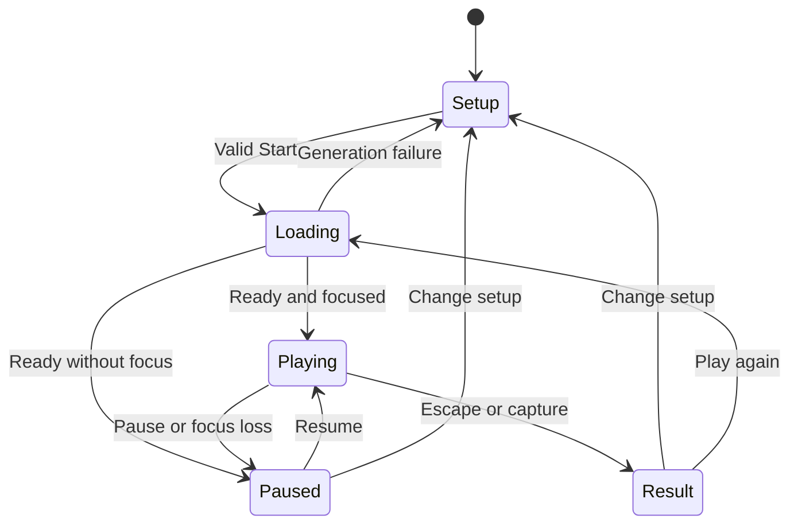

# MazeRunner V5.4.3b — AI, graphics, UI, and redesign guide

This guide describes the V5.4.3b encounter system. The source has 3,631 physical lines and SHA-256 `0ee75560b422a7a9e25aed15e26a5fad81852a3848727593358a7d42e2f4986f`. The visual redesign proposals in sections 9–11 are options a designer can implement. [Production source](src/mazerunnerV5.4.3b.cpp)

The companion [line-by-line reference](01-Source-Line-by-Line.md) explains every physical source line. The [build, test, and reproduction guide](03-Build-Test-and-Reproduce.md) contains commands, evidence, platform limitations, and a screenshot index. All images below were captured from this source by the included real-OpenGL test harness; the gallery is a deliberately arranged fixture.

### Changes since V5.4.3a

One investigator follows the best clue available to it. Other informed monsters cover different sides of the reported sector. Eligible Cutters can intercept at a chokepoint. A searcher checks junctions and alcoves, briefly turns toward an unchecked arm, and remembers where it has looked.

The Director samples menace every 200 ms. Sustained pressure can send the investigator walking away. During this quiet period the pack still hears real steps and can make contact. The HUD shows *BACKSTAGE* and the menace value (`M`). Individual monsters can learn from repeated audible scent losses, sector returns, sustained headings and reversals. A new run clears this memory.

[Encounter regressions](tests/stalker_tests.cpp) · [Radio and pack trace](artifacts/results/director-radio.log)

## 1. Architecture and game rules

The game is a single C++17 translation unit with a deliberately separated simulation and graphical front end. `Maze` owns terrain, entities, event times, path searches, director state, and terminal reporting. Its decisions do not require GLFW, a window, textures, or a GPU. A headless binary removes GL-dependent sections at preprocessing time and runs this same simulation. `Renderer` turns maze state into world geometry; `UiState` models setup and screen interaction; `UiRenderer` draws the menus; `GameApplication` owns their lifetimes, schedules background generation, and turns held movement keys into repeated steps.

The player must reach the exit without occupying a monster's cell. Terrain is a rectangular grid containing wall, open-path, and exit cells. Actors are separate from that terrain: a moving monster does not overwrite a wall or corridor character. Coordinates use `(row,column)` in simulation and `(x=column,y=row,z=height)` in rendering. Adjacency is orthogonal, never diagonal. The generated entrance is on the left boundary near the top, and the exit is on the right boundary near the bottom.

The setup permits **0–10 monsters** and dimensions **5–501** per axis. Even dimensions round upward to odd numbers. Width and height can differ. The presets are **Small 33×33**, **Standard 63×63**, and **Large 101×101**. The initial editable defaults are **31×21 with five monsters and Medium difficulty**; Standard is a selectable preset, not the initial form value. Form settings remain available during the application's lifetime but are not saved to a configuration file. Manual moves are ignored while automatic solving is enabled; turn it off with G or the HUD toggle before taking control. Pressing a movement key moves at once; holding it repeats the move after 220 ms and then every 120 ms. These repeats are driven by the maze's simulation clock, not by the operating system's key-repeat events.

### Simulation time and event order

Time is represented as signed 64-bit integer milliseconds. An automatic action is due every 40 ms, or 25 action opportunities per simulated second. A wait is an action opportunity but not a successful movement step. Rendering frequency does not change the action interval. Monsters have their own per-profile periods and initially staggered deadlines.

`Maze::advance_to` processes the earliest deadline before proceeding to the next. At equal times it expires scent/search/roles, samples the director, moves due monsters, checks for a terminal result, then dispatches an auto action or held manual repeat. Capture takes precedence when a monster and player coincide. The application applies the first accepted keypress immediately, schedules the first repeat 220 ms later and repeats successful steps every 120 ms. A wall, release, pause, focus loss or control-mode transition can cancel the hold.

**Monsters stay frozen until the player's first successful move or until automatic solving is enabled.** At that moment `start_timer` releases them, adding the current time to their spawn-relative deadlines so their staggering is preserved. Before V5.4.2, monsters roamed from time zero. An idle player still reading the screen could then be caught, about 5% of the time within 30 seconds on a 33×33 map with ten monsters, and the result screen read "0.0 seconds, 0 steps". The HUD now shows "MOVE OR PRESS G TO START" until the first input. The run timer and the director's sampling schedule start at the same moment.

The graphical application advances simulation only on the Playing screen. It consumes the complete nonnegative playing interval, including intervals longer than 250 ms, and schedules movement inside that interval. Setup, loading, pause and result screens freeze the game. Focus loss pauses play and cancels the hold. The renderer uses a frame deadline while playing.

## 2. Maze generation and multiple solutions

`Maze::generate` begins with an iterative randomized depth-first carve on the odd-coordinate room lattice. Moving two cells at a time connects rooms by opening their intervening wall. The initial carved structure is a spanning tree, so by itself it has only one simple entrance-to-exit route. The generator then opens eligible separating walls to introduce loops.

The loop budget is derived from grid area, with a denominator of 100 for maximum dimension at most 40 and 150 otherwise. It is scaled by the profile's integer percentage. In source terms it is `loop_density_percent * max(1, rows*cols / denominator) / 100`, with integer division. This is a carving budget, not a percentage of every wall in the map and not a count of final solutions. Low refreshes eligible candidates after individual carves; Medium and High use the initial shuffled list. Actual openings also depend on available candidates.

The resulting graph must pass an entrance-to-exit diversity check. Medium and High require at least two distinct simple solutions. An iterative DFS computes discovery times, low-link values, and bridges. If a non-bridge edge lies on the DFS tree route from entrance to exit, a cycle supplies an alternative route between points of that route. A cycle attached only to a side branch does not satisfy this check. This distinction prevents cosmetic loops from being mistaken for meaningful alternate solutions.

Low requires a certificate of at least four choices using biconnected blocks along the route. The implementation derives each block's contribution from its edge and vertex counts, caps contributions/products at four, and applies a minimum block size for meaningful diversity. Within a biconnected block, a cycle rank of r guarantees at least r+1 simple paths between its entry and exit (start from a cycle through both, then each added ear contributes a new path). This is a conservative certificate used by this generator, not an exhaustive enumeration of all simple paths. It also does not claim four edge-disjoint or vertex-disjoint routes: alternatives may share corridors. The included small-graph tests compare these certificates against explicit path enumeration.

Generation retries with the same seeded random stream continuing through attempts, so each retry is a new layout. **V5.4.2 caps reseeded attempts at 64.** After that, `add_connections_until_diverse` keeps the current layout and opens connecting walls in seeded batches (one eighth of the candidates per pass, at least one) until the requirement holds. Every pass opens at least one wall, and a fully opened interior satisfies every profile, so generation always terminates. In practice the cap is not reached: over 200 seeds per shape, the worst observed case was 31 attempts (Low, 5×33). Valid topology is checked before monsters spawn, so the guarantee is about terrain. Monsters can still occupy every currently available route later.

### Graph representation and reusable searches

`rebuild_graph` caches up to four walkable neighbors per cell, degree, dead-end information, terrain distance to the exit, the exit chokepoint tree described in section 3, patrol regions, and a terrain signature. Reverse BFS produces shortest grid-distance fields in linear time in the traversed graph. A **least-recently-used** cache retains up to 24 destination fields with shared ownership; a hit moves to the back, so long-lived monster-target fields are not evicted by churn.

Threat forecasts request a bounded field of 64 corridor steps. Its sentinel of 65 is a conservative lower bound for any farther cell. Hearing requests the same BFS machinery with the acoustic radius, which may exceed 64 on large maps. The cache identifies a field by source **and radius**. Generation stamps distinguish valid cells and a buffer retained by a live caller stays allocated.

Debug builds (without `NDEBUG`) hash the terrain at each `rebuild_graph` and check the hash at simulation entry points. Editing `grid` without rebuilding then fails with a clear error instead of running on stale adjacency. Release builds skip the check. The exact A* search that V5.4.1 kept in the game class is now only an independent oracle in the tests; the live game never used it.

At the maximum 501×501 grid there are 251,001 cells, so repeated whole-grid work and mesh allocation matter. Iterative graph algorithms avoid deep recursive DFS stacks. The recovery search is separately bounded. With ten monsters on Medium or High, V5.4.2 spends about 4.7–5.8 ms of simulation per 16 ms frame on average, with a worst frame near 20 ms. V5.4.1 spent 12–15 ms on average with worst frames near 80 ms. The gains come from the LRU cache, bounded threat fields, short reservation lists instead of grid-sized arrays, and rebuilding the solver overlay once per frame rather than after every monster event. Rendering has a large-map detail reduction described below. These are measurements on one host, not a promise of identical frame rate across devices.

## 3. Monster AI: hearing, hunting, searching, and interception

Every monster uses the same behavioral rules. The ten creature appearances are visual variants, not classes with different speed, vision, damage, or intelligence. Spawn IDs give them distinct stable artwork. Spawn selection excludes the entrance/player and exit and keeps monsters on unique open cells. It favors positions sufficiently far from the player using graph distance, but can fall back to nearer candidates when necessary; there is no universal minimum separation guarantee on all allowed sizes. On a very small maze, the requested monster count is also capped by the number of distinct available spawn cells.

Each monster has three independent pieces of state. Its sensory state is `Patrolling`, `Hunting`, or `Searching`. Its role is `Chaser` or `Cutter`. Its pack duty is `Roam`, `Investigate`, `Perimeter`, or `Withdraw`. A listener can still be hunting while it walks away under a withdrawal order. Eye color shows its sensory state.

The Director prefers an eligible hunter for the lead and uses the monster’s own clue to rank candidates. It favors keeping the existing investigator. Other informed monsters cover the outer two usable bands on the side assigned by spawn ID modulo four. Larger packs can share a side. An active Cutter holds its assigned interception target, and a first-hand sighting takes priority. A solo predator remains eligible to investigate.

### Patrol behavior

A patrolling monster ordinarily has no active clue. A monster that learned to double back can revisit its last junction during patrol. It samples 32 random open cells and scores each one. A cell scores higher the longer it has been since any monster entered its 8×8 region, capped at 20 seconds. Travel distance (capped at 20 steps) adds a small amount. The score is penalized for cells this monster visited recently, for cells another monster already claimed, and for each other monster positioned or heading within six cells. Together the monsters therefore cover the map instead of clumping. Patrol is not a stationary guard waiting for an alarm.

Following a target uses a reverse BFS distance gradient. Recent-cell penalties discourage immediate repetition. When blocked, a monster can accept limited non-improving movement to sidestep congestion, and repeated blockage causes a new target choice. Targets are reviewed on a 700-ms schedule, but review can preserve a still-valid waypoint. Each monster keeps a bounded recent-cell history rather than a permanent visited map.

### Local footsteps and map-wide director reports

An actual displacement can create two clues. A blocked keypress, a solver wait and a plain clock tick produce no new location report. Each clue is an inclusive, grid-quantized rectangle tagged with a revision. Fixed sector boundaries give many possible player cells the same reported bounds.

| Channel | Reach | Effect on a monster | Timing |
|---|---|---|---|
| Footstep | Shortest walkable corridor distance within the difficulty budget | The listener hunts its most recent local clue. Each genuine contact refreshes its own scent. | Test hearing on every successful step. Publishing a new local rectangle has its own throttle. |
| Director radio | All monsters on the map | One lead investigates, and remaining informed monsters cover assigned sides. A hunter continues following fresher evidence and can later use an eligible radio fallback. | First eligible step, then movement after the profile cooldown. Confinement relief doubles the cooldown. Backstage suspends broadcasts. |
| Corridor sight | High only, 3–6 cells on a clear row or column | An eligible monster may pursue a genuine last-seen cell. | Checked by the monster's own behavior. |

Hearing uses `base + floor(per_100 × max(rows, cols) / 100)`. Manhattan distance is a cheap first rejection. A bounded BFS decides which remaining monsters really hear around walls. One acoustic field serves all possible listeners for that displacement. A Medium 63×63 map has a budget of 26 steps.

The local sector side is 9/5/6 cells in Low/Medium/High. The nominal radio side is 19/17/11. Its normal side is limited to `min(profile_radio, max(local_side, floor((2 × max_dimension + 1) / 3)))`. Width and height are separately clipped at map edges. Relief adds padding on both sides. A radio recipient gets these bounds and a revision. The lead uses this as the seed of its sweep. Perimeter agents give positive weight to the nearest usable edge band and its adjacent band on their assigned side.

Each audible step renews the listener's own scent even between clue publications. Normal continuing-motion publication intervals are 200/0/0 ms. During relief they are at least 400 ms. First motion after an idle spell immediately qualifies for a fresh local clue. The radio still observes its own cooldown after an idle spell. [First-step terminal trace](artifacts/results/director-radio.log)
A hunting target is sampled inside the clue rectangle with weights favoring nearby cells and penalizing recent visits. A candidate already claimed by another hunter is strongly downweighted, encouraging a distributed search. A valid existing target may be retained after an updated clue.

### Searching after losing the scent

The investigator seeds a bounded multi-source breadth-first search with every walkable cell in the best-known sector. A more recent firsthand sighting can supply a single exact seed. Uncertainty expands through one corridor edge per 180 simulated ms, up to five layers. Junctions and branch mouths have priority. An individual discounts its last 40 inspections for 1,800 ms. Low and Medium physically inspect traversed cells. A High junction scan can also inspect an unobstructed straight arm in its existing visual range. At an eligible junction, the lead pauses for one monster period and inspects an unchecked arm. The marker points down that arm until the next movement opportunity.

### Tactics learned within a run

| Observed evidence | Behavioral change |
|---|---|
| Two audible hunts end with that listener losing scent | A known dead end becomes a higher-priority sweep target. |
| Two returns to previously heard sectors within the recent six-sector history | An eligible Cutter can hold a nearby junction inside its own clue. |
| Two consecutive audible sector changes in the same cardinal direction | The lead weights candidates in the observed heading three times as strongly. |
| Two observed reversals during audible trails | On search expiry a patrol may walk three steps away and revisit its last known junction. |

Exact player headings and unobserved idle time do not feed these counters. Widened clues clear the directional history. A subsequent run starts with fresh monsters and fresh encounter state.

At a hunter's scent deadline, it can adopt a broadcast issued strictly after its last physical contact if that report is still within the profile's search lifetime. That sweep ends at the broadcast time plus search duration. Otherwise the monster sweeps its last local area from scent loss. A new broadcast can renew a remote search. Once its search time expires without fresh evidence the monster returns to roaming. Searching uses the orange-eye state.

Expiry is an exact simulation event (`next_monster_state_change`), not a frame-time check, so results do not depend on rendering cadence. A monster that hears a new step while searching becomes a hunter again immediately.

### Interceptors (Medium and High)

`rebuild_graph` builds an exit-rooted depth-first tree with an iterative Tarjan traversal. For each cell it records whether the cell's parent separates that cell's subtree from the exit. When a parent does, every route from anywhere in the subtree to the exit must pass through it. When a new clue is published, `assign_interceptors` starts from the walkable cell of the clue rectangle nearest the exit; it never uses the player's cell. It then walks up that tree for at most 80 links, collecting chokepoints outside the clue area and at least four steps ahead. For each chokepoint, the nearest eligible hunter is sent if it can arrive before a player moving one cell per 80 ms would. Medium sends at most one interceptor and High at most two. Low sends none.

A cutter can hold a reachable chokepoint, then release it at its role deadline. The assignment code accounts for guards outside the current group of listeners before choosing additional hunters. It reserves distinct target cells and enforces the profile-wide 0/1/2 cap. A monster mid-charge after a sighting is ineligible. Relief releases existing guards and suppresses new assignments until normal precision resumes.

### Corridor sight (High only)

High gives a patrolling, searching, withdrawing, or already sighted monster short corridor vision along a shared row or column. The distance must be 3–6 cells, and every cell between them must be open. A sighting turns the monster into a hunter targeting the exact cell where it saw the player. It keeps re-sighting while the line holds, and when the line breaks it continues to the last seen cell. Reaching that cell ends the charge.

Sight is the only sensory path that can supply an exact last-seen player cell. Losing the line of sight leaves the last observed destination available. A broadcast carries rectangular bounds even if a hunter somewhere else can see the player.

### Avoiding monster overlap

When several monsters act in a batch, movement priority rotates. Reservations include all starting cells and claimed destinations for that batch, kept in a short list (at most about twenty cells) instead of a grid-sized array. Monsters cannot stack, swap through each other, or immediately follow another monster into a cell it vacated in that same batch. This prevents order-dependent overlap but can create temporary corridor congestion. Target reassessment and sidesteps help resolve congestion over later batches.

## 4. Automatic player AI

The automatic player has two related but distinct responsibilities: choose its next action under moving threats, and maintain a visible route from its current cell to the exit. Only the first action of each tactical plan is committed. Planning repeats from the resulting real state, allowing waiting, forward movement, alternate branches, and backtracking.

### Timing-aware guidance and the full path overlay

The exit field classifies monster cells before calculating the route. This lets the player take a detour around a distant patrol when the extra distance is worth paying.

- **Near** (14 corridor steps or fewer from the player) or **parked** (no movement for 1.5 s): a wall.
- **Distant and moving**: passable, but entering its cell costs 24 extra steps, so routes prefer a detour of up to 24 steps.

Guidance is a weighted shortest-path field from the exit, computed with Dial's bucket queue. Edge costs are 1 or 25, so 26 circular buckets suffice. The cache key includes the classification, so guidance is rebuilt when a monster crosses the near threshold even if no monster moved. If near or parked monsters cut every route, the solver is "blocked" and uses the terrain-only field for direction.

For a step from v into u, the candidate cost is `1 + entry_penalty(u) + distance[u]`. Relaxation stores the successor u that achieved this value. Simply choosing the neighbor with the lowest remaining distance can hide the cost of entering that neighbor and draw a route through a monster. The overlay follows the stored chain all the way to the exit. An occupied route or the fallback for a disconnected weighted field is amber. With zero monsters a downhill terrain step is sufficient. Tactical decisions may wait, retreat or take another branch.

The HUD capture shows the default five-monster setup on seed 8 at 8.800 seconds, during a physical withdrawal. [Terminal trace](artifacts/results/director-relief.log)

### Tactical forecast and beam search

The planner normally looks ahead 12 actions (480 ms). It extends to **18 actions** when the nearest monster is 10–36 corridor steps away, close enough to shape the route but beyond the default window's view. It retains at most 64 candidates at each depth and considers five actions per expansion: stay or move to one of four neighbors. The forecast copies current monster positions, targets, states, deadlines, and reservation behavior, and projects scheduled movement within the horizon. It also applies the game's sight rule: an unalerted or charging monster that can see the player's current cell is predicted to charge it. It also projects junction pauses and eligible direct sightings using copies of the actors. These speculative inspections leave the real monsters’ memories untouched. Future random target choices and new clues are outside the forecast. Predictions are therefore useful estimates rather than perfect future knowledge.

An earliest-arrival estimate combines the remaining delay until a monster's next move with bounded corridor distance at that profile's movement period. The conservative first action rejects cells that may be reached within the next action interval, with special exit handling. Predicted collisions and near approaches influence later search layers. Dead-end gate analysis also discourages entering a branch that a nearby threat could seal.

The score combines movement/action cost with danger, recent repetitions, decaying visit heat, and the chosen guidance. A wait adds 0.35; reversing toward the prior node adds 0.8; danger is weighted by 2.0 in accumulated cost. Threatened deep dead ends and low-degree endpoints receive extra penalties. Deduplication retains the better candidate for a cell at a given depth. An available goal candidate is preserved before beam truncation. If no goal is reached within the horizon, the search retains a feasible deepest frontier. With no monsters, the code bypasses tactical search and follows the exact terrain shortest-path gradient.

The state space is approximated: per-cell/per-depth merging and a finite beam do not preserve every distinct history. The result is not a globally optimal time-expanded path and does not prove survival.

### Bounded waiting, loop detection, and committed recovery

When near or parked monsters block every exit route, the player can stand still to let hunters lose the scent. Two conditions apply. The next action must be conservatively safe. **No monster may be able to reach the player's cell within one action plus one monster step.** The second condition was added after traces showed the solver idling beside a monster and being caught. The waiting budget is twice the profile's scent lifetime. Its start time is kept across decisions, and a clear route must persist for one scent interval before a blocked episode resets.

**Loop detection.** Each committed detour is recorded. Boldness counts the detours started in the last 20 seconds beyond the first, capped at 4. Each boldness level shortens the waiting budget by half a scent period, never below one scent period, and raises how strongly detour selection favors cells closer to the exit. Boldness changes are logged. A more aggressive "ignore danger and press on" mode was implemented and measured, then removed: it turned timeouts into captures rather than escapes.

After the waiting budget, or after 2,400 ms without recognized navigation progress, recovery can select a temporary detour goal. Search explores at most 4,096 cells and depth 32, considers sufficiently distant candidates, and checks time clearance relative to estimated travel. It rewards room to maneuver, junctions, and movement away from repeated cells, while penalizing dead ends, exit-distance increase (weighted by boldness), returning to the entrance, and recently tried recovery areas. Backtracking is explicitly permitted. A chosen goal is committed for up to 4,000 ms, with progress checks and occupancy-aware guidance. Reaching it can include a pause for scent plus one monster period. A stable newly opened exit route cancels recovery early when the downhill next step is safe.

If conservative planning fails, the planner tries a relaxed interpretation of uncertain threats. If that also fails, emergency selection scores unoccupied candidates by estimated time before contact, exit distance and local degree. The benchmark records escapes, captures and unfinished games separately.

## 5. Overwatch/director intensity control

The Director manages radio, confinement relief and encounter pacing. Every 200 ms it measures corridor distance to a walkable representative of each hunter's own clue and checks for genuine visual contact. It uses peak pressure, a capped contribution from a second hunter, separation after a close encounter and current confinement. Menace stays between 0 and 100. At 76, the Director releases guards and requests one physical retreat. The chosen agent uses ordinary movement, occupancy, and collision rules. A current sighting takes priority. Backstage can begin while the only eligible hunter still sees the player. Its withdrawal request stays pending until a candidate can disengage. After at least 1,400 ms, pressure at 26 or below permits backstage to end unless a pending withdrawal still has visual contact. A new broadcast then requires an eligible player step and the usual cooldown. Silence supplies no fresh radio clue.

Every 200 ms of active play the director samples the player on the simulation clock. A full profile-sized window containing at most 12 unique cells and spanning at most eight cells per axis counts as confinement. In auto mode, prolonged absence of navigation progress is another trigger. Voluntary manual idling clears the history. An active solver accumulates samples while waiting or backtracking, even when the exit field contains a technically open route.

An escalation widens the last local clue, the last radio rectangle and each informed monster's **own** memory. It clears stale waypoints, releases cutters and leaves a directly visible High target eligible for sight pursuit. It preserves the source evidence revision and the existing scent/search expiry. A director sample by itself never transmits a new position. Future reports use a wider footprint and longer cooldown. Once padding reaches its cap, another hold period can elapse without repeatedly invalidating broad plans.

Recovery requires that confinement end, the minimum hold elapse and the recovery condition remain true for 2,000 ms. The player must either gain at least six terrain steps toward the exit relative to relief entry or move at least six Manhattan cells from the relief anchor. An automatic player must also have a reachable weighted exit route. Returning to normal narrows subsequent reports. Existing broad memories keep their recorded extent until new evidence arrives.

| Time | Event in the default Medium maze, seed 8 |
|---|---|
| 4.000 s | Confinement relief releases one Cutter and widens the radio footprint to 21×25. |
| 8.600 s | Menace reaches 77. Monster 4 receives a withdrawal to row 5, column 9. |
| 10.000 s | The minimum quiet interval ends with menace at zero. |
| 11.600 s | Sustained progress restores normal clue precision. |
| 13.040 s | The solver escapes after 190 moves. The run records nine physical withdrawal steps and two junction scans. |

A wider clue can give the player time to get past a choke. The outcome depends on where monsters are and which walkable targets they choose. [Complete event trace](artifacts/results/director-relief.log)

## 6. Exact difficulty parameters

All values below are read from `difficulty_settings`. Lower periods mean more frequent monster actions. Larger hint side lengths mean less precise information. Loop density is a budget multiplier, not an escape probability.

| Parameter | Low | Medium | High |
|---|---:|---:|---:|
| Minimum certified terrain solutions | 4 | 2 | 2 |
| Loop budget percentage | 225 | 135 | 100 |
| Monster movement interval, ms | 210 | 148 | 126 |
| Approximate moves per simulated second | 4.76 | 6.76 | 7.94 |
| Normal local sector side, cells | 9 | 5 | 6 |
| Local clue cooldown during continuous movement, ms | 200 | 0 | 0 |
| Nominal normal radio sector side, cells | 19 | 17 | 11 |
| Normal / relief radio cooldown, ms | 3,000 / 6,000 | 1,800 / 3,600 | 1,000 / 2,000 |
| Scent lifetime after last heard step, ms | 420 | 560 | 840 |
| Corridor hearing budget (base + steps per 100 cells of longer axis) | 18 + 10 | 18 + 14 | 28 + 18 |
| Hearing budget on 33 / 63 / 101-cell maps | 21 / 24 / 28 | 22 / 26 / 32 | 33 / 39 / 46 |
| Search sweep after losing the scent, ms | 1,500 | 2,500 | 3,500 |
| Maximum interceptors | 0 | 1 | 2 |
| Corridor sight, cells | off | off | 3–6 |
| Director confinement window, ms | 2,500 | 4,000 | 6,000 |
| Minimum relief hold, ms | 8,000 | 6,000 | 4,000 |
| Added padding per relief escalation, cells per side | 4 | 4 | 2 |
| Maximum padding, cells per side | 16 | 16 | 8 |
| Maximum nominal expanded local sector side, cells | 41 | 37 | 22 |
| Maximum nominal expanded radio sector side before map limits, cells | 51 | 49 | 27 |
| Auto-player action interval, ms | 40 | 40 | 40 |
| Tactical horizon / beam width | 12–18 / 64 | 12–18 / 64 | 12–18 / 64 |

### Measured escape rates

The shipped code ran 4,740 deterministic auto-solver games. Five-monster calibration used seeds 1–400 on both 21×21 and 31×31 with a 60-second limit. The pooled escape counts were Low 739/800 (92.38%), Medium 526/800 (65.75%), High 290/800 (36.25%). The design targets are 92%, 65% and 35%. The fresh square-map holdouts (seeds 1201–1400) yielded Low 373/400 (93.25%), Medium 251/400 (62.75%), High 158/400 (39.50%). The rectangular setup default and ten-monster presets are separate cohorts.

| Cohort | Rows × columns | Monsters | Difficulty | Escaped | Caught | At limit | Escape rate [95% Wilson interval] |
|---|---|---:|---|---:|---:|---:|---|
| calibration | 21 × 21 | 5 | Low | 347/400 | 47 | 6 | 86.8% [83.1%, 89.7%] |
| calibration | 21 × 21 | 5 | Medium | 226/400 | 169 | 5 | 56.5% [51.6%, 61.3%] |
| calibration | 21 × 21 | 5 | High | 120/400 | 277 | 3 | 30.0% [25.7%, 34.7%] |
| calibration | 31 × 31 | 5 | Low | 392/400 | 8 | 0 | 98.0% [96.1%, 99.0%] |
| calibration | 31 × 31 | 5 | Medium | 300/400 | 93 | 7 | 75.0% [70.5%, 79.0%] |
| calibration | 31 × 31 | 5 | High | 170/400 | 219 | 11 | 42.5% [37.8%, 47.4%] |
| presets | 33 × 33 | 10 | Low | 53/60 | 7 | 0 | 88.3% [77.8%, 94.2%] |
| presets | 33 × 33 | 10 | Medium | 21/60 | 38 | 1 | 35.0% [24.2%, 47.6%] |
| presets | 33 × 33 | 10 | High | 5/60 | 55 | 0 | 8.3% [3.6%, 18.1%] |
| presets | 63 × 63 | 10 | Low | 58/60 | 2 | 0 | 96.7% [88.6%, 99.1%] |
| presets | 63 × 63 | 10 | Medium | 32/60 | 28 | 0 | 53.3% [40.9%, 65.4%] |
| presets | 63 × 63 | 10 | High | 14/60 | 45 | 1 | 23.3% [14.4%, 35.4%] |
| presets | 101 × 101 | 10 | Low | 60/60 | 0 | 0 | 100.0% [94.0%, 100.0%] |
| presets | 101 × 101 | 10 | Medium | 44/60 | 16 | 0 | 73.3% [61.0%, 82.9%] |
| presets | 101 × 101 | 10 | High | 17/60 | 41 | 2 | 28.3% [18.5%, 40.8%] |
| setup | 21 × 31 | 5 | Medium | 239/400 | 154 | 7 | 59.8% [54.9%, 64.4%] |
| holdout | 21 × 21 | 5 | Low | 184/200 | 12 | 4 | 92.0% [87.4%, 95.0%] |
| holdout | 21 × 21 | 5 | Medium | 121/200 | 72 | 7 | 60.5% [53.6%, 67.0%] |
| holdout | 21 × 21 | 5 | High | 66/200 | 131 | 3 | 33.0% [26.9%, 39.8%] |
| holdout | 31 × 31 | 5 | Low | 189/200 | 10 | 1 | 94.5% [90.4%, 96.9%] |
| holdout | 31 × 31 | 5 | Medium | 130/200 | 63 | 7 | 65.0% [58.2%, 71.3%] |
| holdout | 31 × 31 | 5 | High | 92/200 | 101 | 7 | 46.0% [39.2%, 52.9%] |
| setup-holdout | 21 × 31 | 5 | Medium | 139/200 | 58 | 3 | 69.5% [62.8%, 75.5%] |

Every game has an outcome, seed, simulated duration and step count. [Per-game CSV](artifacts/results/calibration-runs.csv) · [Summary and intervals](artifacts/results/calibration.json)

## 7. Existing graphics implementation

### Actual 3D walls and a fixed orthographic camera

Wall cells generate real three-dimensional triangles with height **0.38 grid units**. Exposed vertical faces and top caps use different gray brightness factors. Detailed maps add 0.035-cell inset bevels with a 0.045-cell shoulder drop. Faces between adjacent solid wall cells are omitted. Base stone color varies deterministically by cell-index hashing, so this cosmetic variation cannot alter maze generation or AI randomness. `build_wall_mesh` first counts the exposed faces so its vertex reservation matches the mesh exactly. V5.4.1 reserved by cell count, which over-allocated by about a third at 501×501.

The view is a fixed **25-degree orthographic tilt**. It exposes height while preserving familiar row/column directional controls. This is not a freely rotating perspective camera. The projection fits the complete map at 1×, preserves scale under aspect changes, and follows/clamps around the knight while zoomed. Zoom ranges from 1× to 64×. The world clears to black; there is no separate textured floor covering every corridor.

For grids above 15,000 total cells, the renderer omits small cap bevels while retaining top faces and exposed vertical walls. All three square presets are below that threshold; the maximum 501×501 case is not. This is a mesh-detail policy based on total area, not camera distance. There are no normal maps, shadow maps, physical lights, or physically based materials. The apparent illumination is authored RGB brightness on each face.

### Pixel actors are billboards, not 3D character models

The knight, exit, and ten monsters are each **20×20** arrays of palette characters embedded in the `.cpp`. Every opaque pixel becomes one quad, or six triangle vertices. Dots emit no geometry. A camera-facing plane keeps the pixel image legible in the tilted world. This construction supports depth occlusion against walls without loading a texture or using alpha blending.

One pixel is 0.044 cells wide, giving a sprite a nominal 0.88-cell width. Sprites are horizontally mirrored after left/right movement. The knight has a brief step bob and a blue octagonal ground ring. Wraith, Bat, and Evil eye receive a small sinusoidal hover. **Eye pixels show monster state: gold while roaming, red while hunting, orange while searching.** These animations are visual offsets based on simulation time; they do not interpolate actor collision positions or introduce animated sprite frames.

A searching investigator briefly draws an amber diamond 0.45 cells toward the inspected corridor arm. East and west scans also turn the sprite. The diamond disappears at the scan deadline. Its direction shows where the investigator looked. The amber route overlay separately indicates a potentially obstructed player route.

| Spawn ID | Appearance | Sprite constant | Cosmetic hover |
|---:|---|---|---|
| 0 | Goblin | `GOBLIN_SPRITE` | No |
| 1 | Demon | `DEMON_SPRITE` | No |
| 2 | Wraith | `WRAITH_SPRITE` | Yes |
| 3 | Skeleton | `SKELETON_SPRITE` | No |
| 4 | Slime | `SLIME_SPRITE` | No |
| 5 | Bat | `BAT_SPRITE` | Yes |
| 6 | Spider | `SPIDER_SPRITE` | No |
| 7 | Stone golem | `GOLEM_SPRITE` | No |
| 8 | Evil eye | `EVIL_EYE_SPRITE` | Yes |
| 9 | Mushroom | `MUSHROOM_SPRITE` | No |

The arranged gallery places every appearance where it can be inspected; it is not a naturally generated gameplay encounter. The render test also removes each monster in turn and checks that its absence changes visible pixels, helping detect hidden or missing variants.

### Palette and batching

The exact shared palette is below. Values are normalized RGB, not hexadecimal byte values. `E` is state-dependent; `.` is transparent. The same symbols are used in world art and setup illustrations.

| Symbol | RGB / behavior | Intended visual role |
|---|---|---|
| `.` | No geometry | Transparent background |
| `K` | 0.045, 0.050, 0.065 | Outline / near black |
| `S` | 0.290, 0.350, 0.430 | Dark steel |
| `L` | 0.860, 0.920, 0.970 | Steel highlights |
| `W` | 0.940, 0.870, 0.670 | Bone / cream |
| `Y` | 1.000, 0.830, 0.430 | Light yellow |
| `A` | 0.820, 0.580, 0.190 | Gold / ochre |
| `B` | 0.190, 0.400, 0.870 | Blue |
| `R` | 0.960, 0.190, 0.210 | Red |
| `r` | 0.550, 0.060, 0.120 | Dark red |
| `T` | 0.450, 0.230, 0.120 | Brown |
| `G` | 0.400, 0.780, 0.270 | Green |
| `g` | 0.170, 0.390, 0.130 | Dark green |
| `P` | 0.710, 0.290, 0.770 | Purple |
| `p` | 0.360, 0.110, 0.430 | Dark purple |
| `C` | 0.320, 0.730, 0.840 | Cyan |
| `D` | 0.140, 0.340, 0.510 | Dark cyan |
| `E` | Roaming: 1.000, 0.830, 0.230; hunting: 1.000, 0.120, 0.080; searching: 1.000, 0.520, 0.100 | Monster eyes |

`Vertex` holds six floats: three position components and three color components. A static VAO/VBO contains maze walls. A second batch is regenerated for the route, exit, monsters, and knight. The UI has its own streaming batch. A normal gameplay frame therefore uses two world triangle draws plus one UI draw; setup needs only its UI batch. Buffer capacity can grow when a long full-map overlay requires more vertices than the initial reservation.

The shared GLSL 3.30 shader multiplies a vertex by `viewProjection` and forwards RGB. The fragment shader writes opaque alpha. Depth testing is enabled for the world and disabled for UI. Blending, multisampling, and dithering are disabled for crisp opaque rendering. The route's “glow” consists of a broad dark strip and narrow bright strip at slightly different heights, not bloom or a lighting effect.

## 8. UI structure and redesign boundaries

The UI is custom immediate geometry over a **1000×760 logical canvas**. `UiTransform` uniformly fits and centers that canvas in the framebuffer. Cursor conversion first accounts for window-to-framebuffer DPI scaling, then reverses the same letterbox transform. This is why widget rectangles must remain shared between drawing and hit testing.

`UiState::widgets` defines control IDs, rectangles, labels, selected flags, and enabled flags. Pointer presses store the hit control; release activates only the same enabled control. Tab/Shift+Tab traverse enabled widgets. Numeric fields hold strings while being edited, validate independently, and support replacement, deletion, and bounded stepping. Invalid input disables Start. Pressing Enter in a numeric field first focuses Start; confirming again starts the game. Control+A marks a numeric value for replacement; the current code does not map macOS Command+A.

**Esc never quits.** It pauses and resumes play, and on the result screen it returns to setup. On the setup screen it leaves a numeric field (focusing Start) and otherwise does nothing; during loading it is ignored. Quitting is explicit, through Q or the QUIT button. V5.4.1 quit immediately on Esc from setup, even while a field was being edited.

The HUD shows difficulty, elapsed time and steps, plus the Director phase, menace (`M0`–`M100`), cumulative radio count and radio footprint in rows × columns. During withdrawal, `BACKSTAGE` takes the place of the normal or relief label. A widened footprint can remain visible during backstage. Hunting counts appear in red, or searching counts in orange when no monster is hunting. Before the first input it shows “MOVE OR PRESS G TO START”. Keep the phase and radio labels legible at the smallest supported viewport.

Generation runs on a worker that owns its captured configuration and creates only the CPU-side Maze. The loading screen is presented before that work starts. Once the future is ready, the main thread constructs the OpenGL renderer and installs both objects. Every GL object must be created and destroyed while its context remains current. A future designer change that loads GPU assets on the generation worker would violate the present threading model unless a deliberate shared-context strategy were added.

The embedded bitmap font stores seven five-bit rows per glyph. Most labels uppercase their input. The version passes a case-preserving option and supplies lowercase `a` and `b` glyphs, including the suffix in `V5.4.3b`. An unsupported character renders as a question mark. Advance is six pixels times scale and text positions are manually chosen. Test new labels at narrow and high-DPI sizes and keep them clear of the HUD controls.

## 9. Redesign path A: keep the single-file art pipeline

This is the smallest engineering change for a graphic designer's first pass. Keep all simulation code and the appearance registry order intact. Redraw each sprite on an exact 20×20 canvas using the existing palette, preserving a common foot position and the knight's approximate cell footprint. Replace the twenty corresponding string rows. Each row must contain exactly twenty symbols, and every symbol must be in `valid_sprite`'s whitelist. Compile-time assertions catch malformed dimensions and unknown symbols before the game runs.

Use silhouette to distinguish creatures before relying on color: wings, horns, eye shape, body mass, leg count, and cap outline remain meaningful at small scale. Keep intentional transparency around limbs. Reserve `E` for visible state-sensitive eye details and inspect the roaming, hunting, and searching versions. Avoid changing a shared palette entry casually: modifying `W`, for example, changes every sprite using that symbol, including UI illustrations. For new colors, update both `sprite_color` and the whitelist, then consider whether tests expecting palette ranges need a deliberate update.

Edit theme colors in `UiRenderer` and stone brightness in `build_wall_mesh`. Maintain contrast between black corridors, gray raised walls, the player's blue ring, exit art, and route overlay. At 101×101 fitted into one window, individual sprite pixels become very small; judge navigation readability at whole-map scale as well as at zoom. The existing ring is a useful player locator. A future exit beacon or an icon outline could improve readability, but neither is currently implemented.

For UI rearrangement, change rectangles in `UiState::widgets` and matching descriptive panel/text positions in `UiRenderer::setup`, `hud`, and `draw`. Background labels and panels are not generated automatically from the widget list, so moving only a button rectangle can create overlaps even though clicks remain correctly aligned to that button. Keep focus outlines and disabled/pressed states distinct. Test the minimum 800×600 window, wide and tall windows, and a high-DPI transform. A portrait offscreen screenshot is a robustness check, not a promise the native minimum-size limits permit that exact window.

| Desired edit | Primary source location | Related constraints |
|---|---|---|
| Knight or exit drawing | [L2416](01-Source-Line-by-Line.md#l2416), [L2548](01-Source-Line-by-Line.md#l2548) | 20 rows × 20 symbols; shared palette |
| Ten monster drawings | [L2428](01-Source-Line-by-Line.md#l2428) onward | Keep registry pointers and stable IDs |
| Registry names/hover flags | [L2567](01-Source-Line-by-Line.md#l2567) | Hover is cosmetic; registry size must cover max count |
| Sprite validation | [L2588](01-Source-Line-by-Line.md#l2588) | Add new palette symbols here as well as color mapping |
| Wall style | [L2623](01-Source-Line-by-Line.md#l2623) | Static upload, exposed faces, large-map policy |
| Sprite and eye colors | [L2667](01-Source-Line-by-Line.md#l2667) | Global effect across all art using a symbol |
| World sprite size/anchor | [L2692](01-Source-Line-by-Line.md#l2692) | Camera-facing construction and wall occlusion |
| Camera fit/tilt/zoom | [L2724](01-Source-Line-by-Line.md#l2724) | Projection and sprite orientation must agree |
| Route colors/thickness | [L2755](01-Source-Line-by-Line.md#l2755) | Preserve monster-free/amber semantics |
| Widget rectangles and labels | [L2847](01-Source-Line-by-Line.md#l2847) | Shared hit testing and keyboard order |
| Font shapes | [L2972](01-Source-Line-by-Line.md#l2972) | Seven rows, five bits; text metrics elsewhere |
| Menu palette and layout | [L3179](01-Source-Line-by-Line.md#l3179) | Labels, panels, and widgets need coordinated spacing |
| HUD text and counters | [L3267](01-Source-Line-by-Line.md#l3267) | Keep start prompt and counters clear of the HUD buttons |
| Junction scan diamond | [L3148](01-Source-Line-by-Line.md#l3148) | Keep its direction legible and let the scan deadline control visibility. |
| Difficulty balance | [L0116](01-Source-Line-by-Line.md#l0116) | Re-run the calibration script after any change |

## 10. Redesign path B: external texture sprites and richer animation

An external sprite sheet would let a designer iterate in an image editor without rewriting C++ strings. This is a **proposed extension**, not a loader already present in V5.4.3b. A concrete initial asset contract could preserve 20×20 logical frames, transparent RGBA backgrounds, a documented foot pivot, and named clips for idle, walk, hunting, and searching. A separate manifest would map the ten stable appearance IDs to sheet regions and frame timings. Larger source art is also possible, but the logical world footprint must be chosen explicitly rather than inferred from image dimensions.

Engineering work would include image decoding, texture lifetime ownership, UV coordinates in the vertex format, a texture sampler in the shader, atlas rectangles, and an asset-location policy. Nearest-neighbor sampling would preserve crisp pixel edges. Atlas gutters and careful UV boundaries would avoid neighboring-frame bleed. Transparent texels could be discarded for hard-edged pixel art while retaining depth writes; translucent effects would require an intentional blend/depth-order policy. Color-space handling should be consistent across images and vertex colors rather than relying on incidental driver defaults.

Animation should live in render state and be keyed to simulation events or timestamps. Keep collision and AI on the existing grid unless the gameplay redesign explicitly changes them. Render interpolation can make movement smoother, but it should not determine whether capture occurs. Aesthetic random variations should use deterministic hashes or a separate visual PRNG, preserving the simulation RNG stream and its seeded tests. Asset failures should produce useful diagnostics and a visible fallback, and asset paths should work when launching from a different current directory.

A designer handoff should specify canvas/frame size, foot pivot, intended world size, transparent margin, palette/color-space policy, direction conventions, animation durations, and the three monster-state cues (roaming, hunting, searching). Deliver an overview sheet plus isolated frames and preview both at actual small in-game scale. Those deliverables are recommendations for a future art pass; the current package supplies the existing embedded-art screenshots and source, not a new texture pipeline.

## 11. Redesign path C: true 3D characters or a broader renderer change

Replacing billboard actors with real models is a larger change. It requires mesh/asset import, normals, material definitions, model transforms, animation data, and lighting if the models should appear shaded. A rigged knight also needs bone transforms or another explicit animation scheme. Merely extruding current pixel quads does not create articulated character animation.

Preserve the tile-centered simulation as the authoritative gameplay representation while adding a render transform for each entity. Define a shared world scale, actor origin, feet-on-floor convention, and maximum silhouette footprint. Retain a readable player marker and distinct monster silhouettes under the fixed camera. If the camera becomes rotatable or perspective, update billboard handling, projection bounds, zoom behavior, and the relationship between input directions and screen directions together.

The current portable renderer targets OpenGL 3.3 core and uses GLSL 3.30. Any new shader or asset technique must fit the chosen supported platform baseline or introduce an explicitly documented alternative renderer. macOS's existing OpenGL route should be treated as a compatibility target when evaluating new effects. A backend migration would be a separate engineering project; there is no existing abstraction here that automatically converts GL draw calls to another graphics API.

## 12. Validation workflow for visual changes

Begin with a reproducible seed and unchanged dimensions, count, difficulty, compiler, and standard library. Compare headless simulation outputs before/after after excluding measured host compute time. An art-only edit should not change the simulation state or consume additional simulation randomness. Run the portable regression suite for sprite validity, geometry/camera invariants, all profiles, pack coordination, clue privacy, learned search choices, the release-label glyphs, and UI state. The EGL suite compares the horizontal positions of the scan diamond for left and right gazes and checks that the pixels disappear at expiry. Then run the real-GL render and injected-application suites on Linux (both run under CTest when EGL is available) and inspect the generated PNGs. A gameplay or balance change should also re-run `scripts/run_calibration.py`.

Use the gallery to check that all ten appearances are distinct and visible, then inspect a naturally generated crowded map. Review whole-map and zoomed views, amber and cycling routes, player overlap/occlusion, the green exit, the start prompt and hunting/searching counters, invalid setup fields, keyboard focus, pause, and results. Rerun native-window checks on each intended release platform: offscreen rendering cannot establish native DPI behavior, compositor behavior, actual keyboard mappings, or macOS/Windows driver compatibility.

For new assets or shader effects, extend tests around the changed contract rather than weakening old assertions until everything passes. A deliberate palette redesign may require updating pixel-color expectations, but depth ordering, missing actors, map aspect, input hit areas, source gameplay behavior, and GPU cleanup should remain verifiable. Store the chosen screenshots with seed/configuration and capture method so they remain useful references rather than undocumented pictures.
