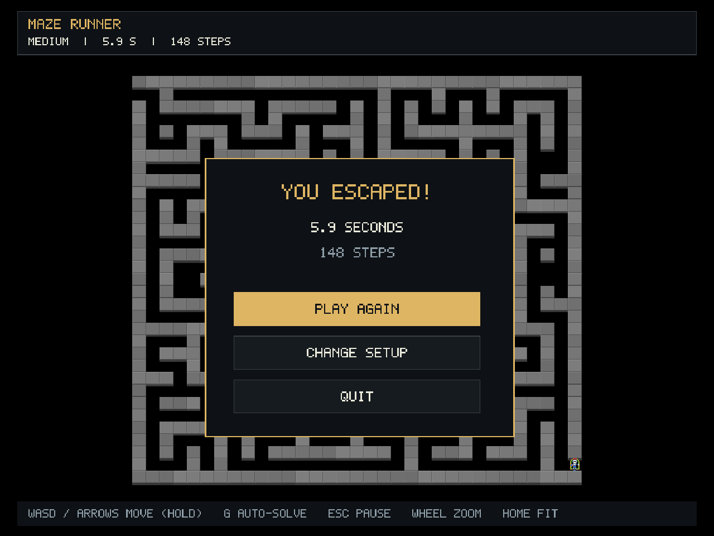

# MazeRunner V5.4.3c — compile, test, and reproduce

This guide builds the V5.4.3c stalker AI release on Ubuntu Linux, Apple Silicon macOS or Windows CMD. Use the package root for commands that start with `src/` or `scripts/`. [Production source](src/mazerunnerV5.4.3c.cpp) · [AI and graphics guide](02-AI-Graphics-and-Redesign.md)

The [Ubuntu build and CTest record](artifacts/results/cmake/validation.json) covers the desktop and headless targets. The [Linux validation record](artifacts/results/validation-summary.json) covers gameplay, sanitizers, EGL rendering and input callbacks. Native macOS and Windows builds require verification on their respective platforms.

## 1. Package contents and starting directory

Extract the developer ZIP and enter `MazeRunner-V5.4.3c`, or enter `MazeRunner` in a repository checkout. This is the **package root**. It contains the three numbered guides alongside `CMakeLists.txt`, `src`, `tests`, `scripts` and `artifacts`.

| Path | Purpose |
|---|---|
| [01-Source-Code-Explanation.md](01-Source-Code-Explanation.md) | Beginner walkthrough with examples and a linked reference for 193 functions and methods |
| [02-AI-Graphics-and-Redesign.md](02-AI-Graphics-and-Redesign.md) | AI behavior, exact difficulty settings, rendering, UI, and redesign plans |
| [src/mazerunnerV5.4.3c.cpp](src/mazerunnerV5.4.3c.cpp) | Production source, including embedded sprites/font |
| [CMakeLists.txt](CMakeLists.txt) | C++17 graphical/headless targets; portable and EGL CTest registration |
| `tests/*_tests.cpp` | Portable gameplay, director, profiles, V5.4.2 compatibility, V5.4.3c behavior, renderer and application checks |
| `tests/support/` | Narrow test-only GL/GLFW declarations/adapters |
| [scripts/run_validation.py](scripts/run_validation.py) | Linux build/test runner and screenshot conversion |
| [scripts/run_cmake_validation.py](scripts/run_cmake_validation.py) | Real CMake configure/build/CTest run with recorded logs |
| [scripts/run_calibration.py](scripts/run_calibration.py) | Square calibration, presets, default setup, and fresh square and rectangular holdouts, with one row per game |
| [scripts/package_devkit.py](scripts/package_devkit.py) | Verify and package a deterministic ZIP from the release manifest |
| [.github/workflows/validate.yml](.github/workflows/validate.yml) | Repeat Ubuntu graphical and headless CMake validation on relevant repo pushes |
| [scripts/audit_documentation.py](scripts/audit_documentation.py) | Regenerates the documentation coverage/audit records and package checksums |
| [scripts/verify_package.py](scripts/verify_package.py) | SHA-256 integrity and function-guide coverage verification |
| [manifest.json](manifest.json) and [SHA256SUMS](SHA256SUMS) | Package provenance and payload checksums |
| `artifacts/results/` | Raw logs, exact commands, environment, smoke results, CMake record, calibration results, and documentation audit |
| `artifacts/screenshots/*.png` | Eighteen fresh rendering captures |

Compiled executables, temporary PPM images, dependency packages, and private authoring files are deliberately absent from the repository. Reproduction creates its own `build/` directory and can regenerate PPM/PNG captures. There are no external art or font files to download for the game: artwork and glyphs are embedded in the source. GLFW/GLEW and the platform's OpenGL implementation remain external runtime dependencies for the graphical binary.

The source is **205,447 bytes**, **3,834 physical lines**, with SHA-256:

```text
6a9004190c02f6bcb7880a01d2cb2a68743bedec0588916beb8b6c1327679a62
```

If your editor adds a byte-order mark or converts LF newlines to CRLF, the checksum changes even when C++ behavior does not. Keep the packaged source unchanged when reproducing the recorded artifact identity. A terminal's width or soft wrapping does not change physical source line numbers.

### What each build needs

| Build | Required components | Opens a window? |
|---|---|---|
| Graphical game | C++17 compiler, threading support, GLFW, GLEW, desktop OpenGL 3.3 core or later | Yes |
| Headless simulation | C++17 compiler and standard-library/threading support | No |
| Portable gameplay/UI-state tests | Same C++17 toolchain; included test sources | No |
| Included offscreen render/application harness | Linux, EGL surfaceless Mesa support, desktop GL libraries | Offscreen only |

The headless flag removes graphics-dependent code; it does not replace the AI with a simplified implementation. The graphical game starts in the in-game setup screen, so a player need not answer terminal prompts. Starting from a terminal is still useful because state logs remain enabled by default.

Add `-DNDEBUG` to release builds, as the commands below do. Without it, the game also hashes the terrain on every `advance_to` call (once per frame) to catch edits made without `rebuild_graph()`. That debug guard is cheap on small maps but measurable on 501×501.

## 2. CMake build on all three platforms

The repository includes [CMakeLists.txt](CMakeLists.txt). Use **CMake 3.20 or newer** and a C++17 compiler. CMake generates the build system, `cmake --build` compiles its targets, and CTest runs the registered checks. These commands are an alternative to the direct compiler instructions below, not an additional required compilation pass.

The supplied configuration builds `mazerunner` (graphical game), `maze-headless` (simulator), and `maze-regressions` (the portable gameplay/UI suite). On Linux, when `libEGL` and `libGL` are found, it also builds `maze-render-tests` and `maze-app-tests`, the real-OpenGL offscreen suites. Executables go under the selected build directory's `bin/`. The graphical executable is named `mazerunnerV5.4.3c` (from the full release label), with `.exe` appended on Windows. The other executable names match their target names. CMake keeps the numeric project version at 5.4.3 and appends the lowercase suffix in `MAZERUNNER_RELEASE`. This full label supplies `MAZERUNNER_VERSION` in the game, window title, logs and CLI help. The Windows game deliberately retains its console so state logs remain visible.

### Ubuntu: configure, build, test, run

From the extracted package root:

```bash
sudo apt update
sudo apt install cmake ninja-build build-essential libglfw3-dev libglew-dev libgl1-mesa-dev libegl-dev pkg-config
cmake --version
cmake -S . -B build/cmake -G Ninja -DCMAKE_BUILD_TYPE=Release
cmake --build build/cmake --parallel
ctest --test-dir build/cmake --output-on-failure
./build/cmake/bin/mazerunnerV5.4.3c --seed 42
```

If CMake is older than 3.20, update it before configuring. The supplied file locates OpenGL and GLEW through imported targets. It first looks for GLFW's CMake package; if that is unavailable, it tries `pkg-config` metadata for GLFW 3.3 or later. Failure to find development dependencies is a configuration error, not a reason to use the test-only GL headers for the desktop build.

### Apple Silicon macOS: native arm64 build

Install Apple's command-line tools and native Homebrew as described in the macOS section below, then run in Terminal from the package root:

```bash
brew install cmake ninja glfw glew pkgconf
cmake -S . -B build/cmake -G Ninja -DCMAKE_BUILD_TYPE=Release -DCMAKE_OSX_ARCHITECTURES=arm64 -DCMAKE_PREFIX_PATH="$(brew --prefix)"
cmake --build build/cmake --parallel
ctest --test-dir build/cmake --output-on-failure
./build/cmake/bin/mazerunnerV5.4.3c --seed 42
```

The prefix helps CMake locate the native Homebrew dependencies, and `arm64` avoids silently producing an Intel build. `OpenGL::GL` supplies the platform-specific framework linkage; do not add Linux's `-lGL` manually. This still produces a command-line executable using installed libraries, not a bundled or signed `.app`.

### Windows CMD: UCRT64 with Ninja

Install/update MSYS2 and its GCC/GLFW/GLEW packages using the Windows section below. Then, in CMD, install CMake and Ninja from that same UCRT64 environment:

```bat
set "MSYSTEM=UCRT64"
"C:\msys64\usr\bin\bash.exe" -lc "pacman -S --needed mingw-w64-ucrt-x86_64-cmake mingw-w64-ucrt-x86_64-ninja"
set "PATH=C:\msys64\ucrt64\bin;%PATH%"
cd /d "%USERPROFILE%\Downloads\MazeRunner"
cmake -S . -B build/cmake -G Ninja -DCMAKE_BUILD_TYPE=Release -DCMAKE_CXX_COMPILER=C:/msys64/ucrt64/bin/g++.exe -DCMAKE_PREFIX_PATH=C:/msys64/ucrt64
cmake --build build/cmake --parallel
ctest --test-dir build/cmake --output-on-failure
build\cmake\bin\mazerunnerV5.4.3c.exe --seed 42
```

These are CMD commands, including the explicit Bash invocation for package management. Selecting `Ninja` and the UCRT64 compiler avoids accidentally combining Visual Studio/MSVC with MinGW libraries. Keep the UCRT64 `bin` directory on PATH while running so the matching GLFW, GLEW, and GCC runtime DLLs can be found. CMake does not automatically copy those DLLs into the output directory; the existing Windows DLL instructions still apply.

### Options, standalone source, and test scope

| CMake cache option | Default | Effect |
|---|---|---|
| `MAZERUNNER_BUILD_GRAPHICS` | `ON` | Build the GLFW/GLEW/OpenGL desktop game; disable to remove those dependency searches |
| `MAZERUNNER_BUILD_HEADLESS` | `ON` | Build the simulation executable with `MAZERUNNER_HEADLESS` |
| `BUILD_TESTING` | `ON` | Register the portable regression suite, CLI help, and nine preset/profile smoke cases when their targets/sources are present |
| `MAZERUNNER_EGL_TESTS` | `ON` | On Linux, also build and register the real-OpenGL render and application suites when `libEGL`/`libGL` are found; skipped with a status message otherwise |
| `MAZERUNNER_WARNINGS_AS_ERRORS` | `OFF` | Add `/WX` or `-Werror` for stricter compiler checking |
| `MAZERUNNER_SOURCE` | Detected file | Use `src/mazerunnerV<version>.cpp` from the project version, otherwise the same filename beside `CMakeLists.txt`; an explicit FILEPATH override is supported |
| `CMAKE_BUILD_TYPE` | `Release` for single-configuration generators | Choose optimization/debug settings; it does not change game difficulty |

For a dependency-free headless build on Linux or macOS with Ninja installed:

```bash
cmake -S . -B build/headless -G Ninja -DCMAKE_BUILD_TYPE=Release -DMAZERUNNER_BUILD_GRAPHICS=OFF
cmake --build build/headless --parallel
ctest --test-dir build/headless --output-on-failure
./build/headless/bin/maze-headless --simulate 33 33 5 42 60000 --difficulty medium --quiet
```

On Windows CMD, retain the explicit UCRT64 compiler choice:

```bat
cmake -S . -B build/headless -G Ninja -DCMAKE_BUILD_TYPE=Release -DMAZERUNNER_BUILD_GRAPHICS=OFF -DCMAKE_CXX_COMPILER=C:/msys64/ucrt64/bin/g++.exe
cmake --build build/headless --parallel
ctest --test-dir build/headless --output-on-failure
build\headless\bin\maze-headless.exe --simulate 33 33 5 42 60000 --difficulty medium --quiet
```

On Linux with EGL available, the repository registers **13 CTest tests**: one portable regression entry point, the `render-egl` and `app-egl` real-OpenGL suites, one CLI help check, and nine size/difficulty smoke cases. Without EGL (macOS, Windows, or Linux without the libraries) it registers 11. The EGL suites write their screenshots under the build directory, not into `artifacts/`. The separate Python validation runner still provides repeated smoke comparisons and sanitizers, which CTest does not run. To build only the desktop game, configure with `-DMAZERUNNER_BUILD_HEADLESS=OFF -DBUILD_TESTING=OFF` and retain graphics enabled.

If you download only the `.cpp` and `CMakeLists.txt`, place them in the same folder. Missing regression sources are reported and skipped; the game/headless targets can still build. In the full repository, portable tests directly include `src/mazerunnerV5.4.3c.cpp`. Selecting a different `MAZERUNNER_SOURCE` therefore requires `-DBUILD_TESTING=OFF`; this prevents a misleading result where the tests exercise another source file. No source file is downloaded automatically.

Use a fresh build directory when changing compiler, CPU architecture, or generator. A stale CMake cache can retain the previous toolchain/dependency paths. CMake's multi-configuration generators also accept `cmake --build build/cmake --config Release` and `ctest --test-dir build/cmake -C Release --output-on-failure`; the supported command recipes above use single-configuration Ninja. The file contains MSVC warning handling, but no native MSVC build was executed or established by this package.

Ubuntu CI invokes `python3 scripts/run_cmake_validation.py --generator Ninja --jobs 2`. [Hosted run](https://github.com/LeEz1219/MazeRunner/actions/runs/44621893162) · [CMake results](artifacts/results/cmake/validation.json)

## 3. Ubuntu Linux: direct compiler build

These instructions use Ubuntu's native packages and Bash. A current desktop installation with working graphics drivers is assumed. The Ubuntu package index lists the GLFW and GLEW development packages used here; GLFW's official build guide explains `pkg-config`-based linking. See the primary references at the end.

### Step 1 — install the compiler and graphics development packages

Open Terminal and run:

```bash
sudo apt update
sudo apt install build-essential libglfw3-dev libglew-dev libgl1-mesa-dev pkg-config
```

`build-essential` provides the GNU C++ toolchain. The `-dev` packages supply headers and linker metadata; merely having a runtime library is insufficient to compile. If Ubuntu reports that a package from Universe is unavailable, enable that repository and retry the installation:

```bash
sudo add-apt-repository universe
sudo apt update
sudo apt install libglfw3-dev libglew-dev
```

On a minimal image where `add-apt-repository` is missing, install `software-properties-common` first. A normal desktop installation commonly already has the repository enabled.

### Step 2 — enter the extracted package and verify dependencies

Replace the example directory with your actual extraction path; retain quotes around paths containing spaces.

```bash
cd "$HOME/Downloads/MazeRunner"
mkdir -p build
g++ --version
pkg-config --modversion glfw3 glew
sha256sum src/mazerunnerV5.4.3c.cpp
```

Compare the hash with the value above. `pkg-config` should print versions for both libraries. If it cannot find `glfw3` or `glew`, resolve that installation issue before compiling.

### Step 3 — compile the desktop game

```bash
g++ src/mazerunnerV5.4.3c.cpp -o build/mazerunnerV5.4.3c -std=c++17 -O2 -DNDEBUG -Wall -Wextra -Wpedantic $(pkg-config --cflags glfw3 glew) $(pkg-config --libs glfw3 glew) -lGL -pthread
```

The shell expands the two `pkg-config` expressions into this installation's include/link flags. Source/object inputs precede libraries so the linker can resolve references correctly. `-pthread` supports the asynchronous generation worker, the frame limiter, and the standard threading runtime. `-O2 -DNDEBUG` is a release-style configuration; it is not a difficulty setting. No `-march=native` is used, avoiding an unnecessary CPU-specific instruction requirement.

If package metadata is unavailable but the normal Ubuntu development packages are installed, the equivalent explicit-library command is:

```bash
g++ src/mazerunnerV5.4.3c.cpp -o build/mazerunnerV5.4.3c -std=c++17 -O2 -DNDEBUG -Wall -Wextra -Wpedantic -lglfw -lGLEW -lGL -pthread
```

Use either command, not both as successive mandatory steps. Successful compilation normally returns to the prompt without output. The result is a Linux executable, not a Windows `.exe` or macOS application.

### Step 4 — launch and inspect

```bash
./build/mazerunnerV5.4.3c
```

Select difficulty, a preset or custom dimensions, and monster count. Start opens a loading screen, then the maze. Monsters stay still until your first move or until you press G; the HUD says "MOVE OR PRESS G TO START" until then. Hold a movement key to keep walking. Esc pauses and resumes but never quits; use Q or the QUIT button. For a repeatable initial maze and fixed-seed replays:

```bash
./build/mazerunnerV5.4.3c --seed 42 --difficulty medium
```

`42` is simply an example seed, not a special balance parameter or a required value. The difficulty option preselects the card; the user can still change it in setup. To preserve detailed diagnostics while playing:

```bash
./build/mazerunnerV5.4.3c --seed 42 --verbose 2>&1 | tee desktop-session.log
```

`--quiet` suppresses normal state logs, while `--verbose` adds individual monster-step reports. Omit `--quiet` if you want to inspect pursuit and player state. To inspect shared-library resolution:

```bash
ldd build/mazerunnerV5.4.3c
```

Investigate any `not found` entry before debugging gameplay. Launching over SSH without a usable display is different from building successfully; use headless mode for simulation-only work in that environment.

## 4. macOS on M-series Apple Silicon

This path builds a native **arm64** executable with Apple's Clang and Homebrew dependencies. It does not produce an Intel binary, a universal binary, or a self-contained `.app` bundle. The source already requests a forward-compatible OpenGL core context under `__APPLE__`; that is not an edit you need to make.

GLFW documents Apple's core-profile context requirements and OpenGL limitations. OpenGL is deprecated on macOS, so treat the local graphical launch and driver check as part of verification rather than inferring it from a successful Linux test. The current source targets OpenGL 3.3/GLSL 3.30 and does not require a newer GL feature level.

### Step 1 — use a native Apple Silicon Terminal and install compiler tools

In Terminal:

```bash
uname -m
xcode-select --install
```

`uname -m` should report `arm64` for this workflow. If it reports `x86_64` on an M-series Mac, the terminal may be running under Rosetta; use a native terminal before installing a second, incompatible dependency set. Complete Apple's installer dialog if offered. If a suitable Xcode/toolchain is already installed, the command may report that tools are already available.

Verify the active compiler and developer directory:

```bash
xcrun clang++ --version
xcode-select -p
```

Apple's Command Line Tools package is sufficient for this command-line build; full Xcode is not required solely to compile this file.

### Step 2 — install Homebrew and the graphics libraries

If Homebrew is absent, use the current installer from [brew.sh](https://brew.sh/) or its official `.pkg` option. The published shell installer is:

```bash
/bin/bash -c "$(curl -fsSL https://raw.githubusercontent.com/Homebrew/install/HEAD/install.sh)"
```

Follow its displayed installation steps. The standard Apple Silicon prefix is `/opt/homebrew`. For the current terminal session:

```bash
eval "$(/opt/homebrew/bin/brew shellenv)"
brew install glfw glew pkgconf
brew --prefix
pkg-config --modversion glfw3 glew
```

Follow Homebrew's printed shell-profile instructions if you want its tools available in future terminals. `pkgconf` supplies the `pkg-config` command. Keep the compiler target, GLFW, and GLEW architectures consistent; do not combine an Intel `/usr/local` library set with an arm64 compilation.

### Step 3 — compile for arm64

```bash
cd "$HOME/Downloads/MazeRunner"
mkdir -p build
shasum -a 256 src/mazerunnerV5.4.3c.cpp
clang++ src/mazerunnerV5.4.3c.cpp -o build/mazerunnerV5.4.3c -std=c++17 -O2 -DNDEBUG -arch arm64 -Wall -Wextra -Wpedantic $(pkg-config --cflags glfw3 glew) $(pkg-config --libs glfw3 glew) -framework OpenGL -pthread
```

The OpenGL framework is the macOS counterpart of Linux's `-lGL`. The package metadata provides the library search paths and GLFW/GLEW linkage. If you need an explicit-path fallback for a standard Homebrew installation, use:

```bash
clang++ src/mazerunnerV5.4.3c.cpp -o build/mazerunnerV5.4.3c -std=c++17 -O2 -DNDEBUG -arch arm64 -I"$(brew --prefix)/include" -L"$(brew --prefix)/lib" -lglfw -lGLEW -framework Cocoa -framework OpenGL -framework IOKit -framework QuartzCore -pthread
```

This is an alternative to the metadata command. It is not necessary to edit system include paths or copy headers into the project.

### Step 4 — verify and run

```bash
file build/mazerunnerV5.4.3c
otool -L build/mazerunnerV5.4.3c
./build/mazerunnerV5.4.3c --seed 42 --difficulty medium
```

`file` should identify an arm64 Mach-O executable. `otool -L` shows the dynamic libraries/frameworks it expects. Run the manual checklist later in this document, including Retina pointer alignment and focus-loss pause. The game uses Control+A for numeric-field replacement; Command+A is not mapped by this source. Clicking a field already prepares it for replacement on the next digit.

A locally built executable may depend on libraries under the builder's Homebrew prefix. Sending only that executable does not automatically supply those libraries to another Mac. App bundling, dependency relocation, signing, and notarization are separate distribution work, beyond this source-compilation guide. The simplest designer workflow here is to build on the target Mac with its own native dependencies.

## 5. Windows: compile and run from CMD

These instructions target **64-bit Intel/AMD Windows** using the MSYS2 **UCRT64 MinGW-w64** toolchain. The compiler produces a native Windows executable. This is not WSL, Cygwin, or an MSVC build. All commands presented below are entered in **Command Prompt (`cmd.exe`)**, not PowerShell. Package-management commands explicitly invoke MSYS2's Bash; the actual compiler/run commands remain ordinary CMD commands.

### Step 1 — install and update MSYS2

Download the x86-64 installer from [msys2.org](https://www.msys2.org/) and use the standard `C:\msys64` installation directory for these examples. If you choose another directory, replace it consistently in all commands. Open CMD and run:

```bat
set "MSYSTEM=UCRT64"
"C:\msys64\usr\bin\bash.exe" -lc "pacman -Syu"
```

Accept the package manager's prompts as appropriate. If a core update closes the MSYS2 process or asks you to restart, invoke the same update command again from a fresh CMD session, setting `MSYSTEM` again. Complete the full update before installing dependencies; MSYS2 is a rolling environment and does not support partial package upgrades.

Install the matching UCRT64 compiler and both graphics libraries:

```bat
"C:\msys64\usr\bin\bash.exe" -lc "pacman -S --needed mingw-w64-ucrt-x86_64-gcc mingw-w64-ucrt-x86_64-glfw mingw-w64-ucrt-x86_64-glew"
```

Use the same `ucrt64` prefix for every dependency. Mixing `mingw64`, `ucrt64`, MSVC `.lib` files, or 32-bit objects can cause incompatible-runtime or link failures.

### Step 2 — select the compiler in CMD and enter the project

```bat
set "PATH=C:\msys64\ucrt64\bin;%PATH%"
where g++
g++ --version
cd /d "%USERPROFILE%\Downloads\MazeRunner"
if not exist build mkdir build
certutil -hashfile src\mazerunnerV5.4.3c.cpp SHA256
```

The first `where g++` result should be `C:\msys64\ucrt64\bin\g++.exe`. The PATH change applies to the current CMD session; repeat it when opening a new one. `cd /d` changes drive as well as directory. Compare the source hash against the package value.

Confirm that the installed headers/import libraries exist:

```bat
dir C:\msys64\ucrt64\include\GLFW\glfw3.h
dir C:\msys64\ucrt64\include\GL\glew.h
dir C:\msys64\ucrt64\lib\libglfw3.dll.a
dir C:\msys64\ucrt64\lib\libglew32.dll.a
```

### Step 3 — compile the graphical `.exe`

Paste this as one CMD command:

```bat
g++ "src\mazerunnerV5.4.3c.cpp" -o "build\mazerunnerV5.4.3c.exe" -std=c++17 -O2 -DNDEBUG -Wall -Wextra -Wpedantic -DNOMINMAX -DGLFW_DLL -I"C:\msys64\ucrt64\include" "C:\msys64\ucrt64\lib\libglfw3.dll.a" "C:\msys64\ucrt64\lib\libglew32.dll.a" -lopengl32 -pthread
```

The explicit `.dll.a` files are import libraries for the DLL versions; they avoid ambiguity with similarly named static archives. `GLFW_DLL` declares GLFW's DLL linkage. Do not add `GLEW_STATIC` to this DLL build. `NOMINMAX` prevents Windows header macros from colliding with C++ `std::min`/`std::max`. `opengl32` supplies the system GL linkage, while GLEW loads the additional context functions used by the game.

Do not add `-mwindows` to this primary command: retaining a console preserves the terminal logs used to inspect the player, monsters, and director. If distributing a later GUI-only build, provide another explicit logging destination before hiding that console.

CMD does not understand Bash's `$(pkg-config ...)`, `export`, or backslash line continuation. That is why this Windows command uses explicit paths and one line. A CMD multiline command would use `^`, but no continuation character is needed here.

### Step 4 — run with the correct DLL search path

From the same CMD session:

```bat
build\mazerunnerV5.4.3c.exe --seed 42 --difficulty medium
```

The PATH set above makes `glfw3.dll`, `glew32.dll`, and the compiler runtime DLLs available. For a diagnostic log file:

```bat
build\mazerunnerV5.4.3c.exe --seed 42 --verbose > desktop-session.log 2>&1
```

This redirects output to the file, so it will not also scroll in the CMD window. Inspect it afterward with `type desktop-session.log` or a text editor.

For a locally self-contained test folder, copy the dependency DLLs next to the `.exe` from the **same UCRT64 installation**. Common runtime dependencies include the following, but inspect your actual build rather than assuming this list is exhaustive:

```bat
copy "C:\msys64\ucrt64\bin\glfw3.dll" "build\"
copy "C:\msys64\ucrt64\bin\glew32.dll" "build\"
copy "C:\msys64\ucrt64\bin\libstdc++-6.dll" "build\"
copy "C:\msys64\ucrt64\bin\libgcc_s_seh-1.dll" "build\"
copy "C:\msys64\ucrt64\bin\libwinpthread-1.dll" "build\"
```

Use the installed toolchain to inspect imports:

```bat
objdump -p build\mazerunnerV5.4.3c.exe | findstr /C:"DLL Name"
objdump -p C:\msys64\ucrt64\bin\glfw3.dll | findstr /C:"DLL Name"
objdump -p C:\msys64\ucrt64\bin\glew32.dll | findstr /C:"DLL Name"
```

Inspect any additional non-system DLLs transitively as needed. Windows system DLLs such as `opengl32.dll` come from Windows/graphics drivers; do not substitute downloaded copies from unrelated sources. A successful link does not prove the installed graphics driver supports OpenGL 3.3. Test startup on the actual target machine, particularly under remote desktop or virtual-machine graphics.

## 6. Build and use headless simulation

A headless executable runs the same maze, monster, director, and auto-player logic without a window. It needs no GLFW/GLEW headers or graphics linkage because `MAZERUNNER_HEADLESS` removes those sections. Use it for reproducible experiments, automated tests, or machines without a display. `--simulate` enables auto-solving at time zero, which also releases the monsters, so play starts immediately.

### Ubuntu/Linux

From the package root after creating `build`:

```bash
g++ src/mazerunnerV5.4.3c.cpp -o build/maze-headless -std=c++17 -O2 -DNDEBUG -Wall -Wextra -Wpedantic -DMAZERUNNER_HEADLESS -pthread
./build/maze-headless --simulate 33 33 5 42 60000 --difficulty medium --quiet
```

### Apple Silicon macOS

```bash
clang++ src/mazerunnerV5.4.3c.cpp -o build/maze-headless -std=c++17 -O2 -DNDEBUG -arch arm64 -Wall -Wextra -Wpedantic -DMAZERUNNER_HEADLESS -pthread
./build/maze-headless --simulate 33 33 5 42 60000 --difficulty medium --quiet
```

### Windows CMD, with the UCRT64 PATH already selected

```bat
g++ src\mazerunnerV5.4.3c.cpp -o build\maze-headless.exe -std=c++17 -O2 -DNDEBUG -Wall -Wextra -Wpedantic -DMAZERUNNER_HEADLESS -pthread
build\maze-headless.exe --simulate 33 33 5 42 60000 --difficulty medium --quiet
```

### Argument meanings and result interpretation

The positional form is:

```text
--simulate ROWS COLS MONSTERS SEED [LIMIT_MS] [--difficulty low|medium|high] [--verbose] [--quiet]
```

The first two values are **rows then columns**, whereas the setup summary displays **width × height**. In a square example they happen to match. `MONSTERS` is 0–10. `SEED` is an unsigned 32-bit integer from 0 to 4,294,967,295. The optional duration is a simulated-time ceiling in milliseconds, defaulting to 120,000 and bounded by the parser at 3,600,000. `--simulate` must be the first argument. Dimensions are validated and normalized by the Maze constructor; use 5–501 in supported runs.

The final line identifies version, difficulty, seed, dimensions, monster count, outcome, simulation time, automatic steps, withdrawal episodes, physical withdrawal steps, junction scans and host compute time. `ESCAPED` means escape, `CAUGHT` means collision, and `RUNNING` means the simulation limit was reached before either terminal outcome. All three are valid runs and return process exit code zero. Input/build/runtime failures return a nonzero status, generally one from the program's top-level exception handler. A benchmark must parse the outcome rather than counting exit code zero as a win.

Run without `--quiet` to see “Local footstep area”, “Heard by”, “Director: REPORT”, “Lead investigators”, “BACKSTAGE” and “WITHDRAWING”, and precision transitions with the current radio area, retasked monsters and released interceptors. Direct High sightings and hunt/search state transitions also appear when they occur. Add `--verbose` for individual monster moves.

`simulation_ms` is game time; `compute_ms` measures host processing time for the simulation advance, excluding generation. It varies with load, compiler, and machine. Exclude `compute_ms` when comparing deterministic output. The seed controls pseudorandom choices, not difficulty or a guaranteed maze shape across different C++ library implementations. `std::mt19937` is specified, but higher-level distributions/shuffle can differ between standard libraries. Expect repeatability within the same source/settings/toolchain; validate invariants instead of requiring byte-identical cross-platform trajectories.

## 7. Automated test reproduction on Linux

### Step 1 — verify the committed package

Before running anything that overwrites committed results:

```bash
python3 scripts/verify_package.py
```

This verifies the manifest's payload hashes, the source identity, the exact three-document set, a source-matching link, explanation and rationale per function, local links, and the eighteen screenshots. It is an integrity/documentation check, not an additional gameplay simulation. It prints a success report or exits nonzero with a concrete mismatch. A modified source or regenerated log will intentionally differ from the committed manifest; after an intended change, `python3 scripts/audit_documentation.py` regenerates the coverage/audit records, `manifest.json`, and `SHA256SUMS`.

If you want to retain the committed evidence, use a second checkout for reruns. The validation runner writes fresh files under `artifacts/results` and `artifacts/screenshots` and overwrites matching filenames. It does not edit production source. After rerunning, do not expect the original package checksums to match new host timings and captures.

### Step 2 — install test prerequisites

For Ubuntu with GCC already installed:

```bash
sudo apt install python3 cmake ninja-build libegl1 libgl1 libegl-mesa0 libgl1-mesa-dri
```

The portable core tests need only Python and a C++17 compiler. The graphics harness additionally uses Linux EGL/GL shared objects and Mesa's surfaceless path. It declares its small EGL/GL interface through the included test adapters, so it does not need the native GLFW development package to run offscreen. This deliberately tests another boundary from a real desktop-window build.

### Step 3 — run the full packaged validation

```bash
python3 scripts/run_validation.py --all
```

The script locates the package root from its own path, creates output directories, invokes the compiler directly, and stops on a failed command/assertion. It records the precise compiler/test commands, return codes, and elapsed host durations in `artifacts/results/validation-summary.json`. It uses Python's standard library only. The recorded run finished all checks successfully.

For a machine without the Linux offscreen graphics path, run only the portable portion:

```bash
python3 scripts/run_validation.py --core
```

To run only rendering/application checks after changing graphics:

```bash
python3 scripts/run_validation.py --graphics
```

For the CMake/CTest record and the escape-rate benchmark:

```bash
python3 scripts/run_cmake_validation.py
python3 scripts/run_calibration.py
```

The calibration runner builds a fresh optimized headless binary. Its defaults run 2,400 balance games, 540 ten-monster preset games, 400 default-setup games and 1,400 fresh-seed holdouts. `--seeds`, `--preset-seeds`, and `--holdout-seeds` control the row counts for a local experiment. `--jobs` limits simultaneous processes. The raw CSV is ordered by cohort, map, difficulty and seed even with multiple workers. Time ceilings and partial runs appear explicitly in the data. [Raw CSV](artifacts/results/calibration-runs.csv) · [Aggregate JSON](artifacts/results/calibration.json)

An explicit compiler can be selected with `--compiler g++`. If the local compiler/runtime cannot support the sanitizer configuration, `--skip-sanitizers` records that check as skipped. A skipped sanitizer is not equivalent to the bundled successful sanitizer result. The runner and its environment-report wording are intended for Linux; use the manual portable commands in the next section on macOS/Windows.

The graphics harness requests a real offscreen desktop-OpenGL core context via Mesa's surfaceless EGL platform and uses actual driver calls for shaders, buffers, draws, and readback. It is not a mock that accepts all drawing commands. Conversely, its GL/GLFW support headers are **test-only** adapters. Never add `-Itests/support/...` to the normal graphical game build: doing so would replace real dependency headers and skip the very integration you need to validate.

### What the runner executes

| Stage | Coverage and output |
|---|---|
| Headless compilation/help | C++17, `-O2`, `-Wall -Wextra -Wpedantic -Werror -pthread`; real CLI help |
| Full portable regressions | `ui_tests.cpp` includes the previous suites and the stalker fixtures, earlier director, weighted-overlay and hearing regressions, and release-label glyph coverage |
| Director traces | First report on 63×63 and a complete Medium relief/recovery cycle on the default rectangle |
| Sanitized regressions | Same suite with `-O1 -g -fsanitize=address,undefined` |
| Preset/profile smoke matrix | Sizes 33/63/101 × Low/Medium/High; ten monsters, seed 42, 1,000 ms; each case run twice |
| Graphical syntax | Full source syntax using declaration-only test headers; no native GLFW/GLEW link claim |
| Real-GL renderer | Shader compile/link, wall/actor visibility and palette, aspect, zoom, minimized targets, all ten variants, 501×501 mesh, screenshots |
| Application integration | Production `GameApplication`/callbacks with injected window data and real GL; loading, settings transfer, focus/pause, replay, results, failures, cleanup |

The sanitizer run sets `ASAN_OPTIONS=detect_leaks=0` and `UBSAN_OPTIONS=halt_on_error=1`. Address and undefined-behavior checks passed; **leak detection was disabled**, so this is not a leak-audit result. The sanitizer pass covers the portable suite, not the EGL/driver process or a native window session.

### Test-source map

| Test file | What to inspect or extend |
|---|---|
| [feedback_tests.cpp](tests/feedback_tests.cpp) | Start grace, hearing range, roam/hunt/search transitions, approximate hints, waits and invalid movement, full overlays, route diversity (with an independent A* oracle), core regressions, terminal logs |
| [director_tests.cpp](tests/director_tests.cpp) | Bounded waits, committed retreats, alternate-branch backtracking, hint privacy/expansion, relief recovery, no relief for an idle player, event partitioning |
| [difficulty_tests.cpp](tests/difficulty_tests.cpp) | Parsing/profile values, frozen-until-start monsters, exact movement/scent/report timings, all director profiles, exhaustive small-graph diversity checks, per-profile invariants |
| [v542_tests.cpp](tests/v542_tests.cpp) | Retained start grace, searching, interceptors, corridor sight, timing-aware blocking, generation fallback, terrain guard and searching-eye tests |
| [v543a_tests.cpp](tests/v543a_tests.cpp) | Radio delivery beyond hearing, quantized privacy and cooldowns, scent expiry and fallback, relief cycles, guard release/cap, weighted path detour and hearing through corridors |
| [visual_tests.cpp](tests/visual_tests.cpp) | Wall/sprite geometry, camera projection, silhouette uniqueness, inclusion of gameplay/profile regressions |
| [stalker_tests.cpp](tests/stalker_tests.cpp) | Checks the pending-notice 447 ms bound, open and cut-open sector circuits, interrupted hunts, hidden-cell equivalence, failed local alcove inspections, pack jobs and replay timing. |
| [ui_tests.cpp](tests/ui_tests.cpp) | Release-label glyphs, 33/63/101 presets, dimensions/count validation, pointer and keyboard focus, DPI transform, transitions; top-level portable runner |
| [render_tests.cpp](tests/render_tests.cpp) | Real offscreen draw/readback, screenshot fixtures, actual shaders, sprite visibility, scan-marker direction and expiry, large-map mesh |
| [app_tests.cpp](tests/app_tests.cpp) | Injected production callbacks, async loading, pauses, Esc never quitting, hold-to-move timing and release, replay seeding, real-GL UI/world composition, error recovery |
| [egl_test_context.h](tests/egl_test_context.h) | Offscreen application-test context creation and destruction |

Tests include the production `.cpp` with macros that remove its normal `main` or selected window-startup sections. Compile the specified test entry point **alone**; do not also append the production `.cpp` to that test compile command, or duplicate definitions will result. Helper test files are included transitively and are not all standalone executables.

### Reproduce a withdrawal and a junction scan

Use the default five-monster Medium setup with seed 8 and press G. At 12.400 simulated seconds the HUD reads `BACKSTAGE M57 | RADIO 2 | 21X25`. The retreating actor has taken its first step. Backstage ends at 13.600 s. For a complete replay ending in escape use seed 26 below.

For an isolated check, `test_suspicion_scan` in the portable suite arranges a lead at a known junction, verifies one pause, then advances one monster period and checks a physical step. `test_scan_marker` in the EGL suite compares the left and right diamond on a rendered monster and checks its disappearance at expiry. Run `ctest --test-dir build/cmake -R '^(gameplay-and-ui|render-egl)$' --output-on-failure` on an EGL-enabled build. [Portable fixtures](tests/stalker_tests.cpp) · [Rendering fixture](tests/render_tests.cpp)

## 8. Manual portable tests on macOS and Windows

These commands compile the same core suite without the Linux-specific EGL harness. They are provided for local execution; there are no bundled macOS/Windows result logs claiming they passed.

### macOS, from the package root

```bash
mkdir -p build
clang++ tests/ui_tests.cpp -o build/regressions -std=c++17 -O2 -arch arm64 -Wall -Wextra -Wpedantic -pthread
./build/regressions
```

If supported by the installed Apple toolchain, a separate sanitizer run is:

```bash
clang++ tests/ui_tests.cpp -o build/regressions-asan -std=c++17 -O1 -g -arch arm64 -fsanitize=address,undefined -pthread
ASAN_OPTIONS=detect_leaks=0 UBSAN_OPTIONS=halt_on_error=1 ./build/regressions-asan
```

Record the compiler version and command output with the result. This tests the headless simulation/UI model and geometry helpers, not a Cocoa window or Retina rendering. Perform the native desktop checklist as well.

### Windows CMD, after selecting UCRT64 PATH

```bat
if not exist build mkdir build
g++ tests\ui_tests.cpp -o build\regressions.exe -std=c++17 -O2 -Wall -Wextra -Wpedantic -pthread
build\regressions.exe
```

Use the same compiler-runtime DLL search path as for the game. The Linux sanitizer and EGL instructions are not presented as supported native Windows steps. A Windows debugging/sanitizer setup requires validation of that specific toolchain's support.

## 9. Recorded V5.4.3c results

| Evidence | Recorded result |
|---|---|
| [Direct runner](artifacts/results/validation-summary.json) | All 32 recorded commands passed, including two director scenarios. Logs contain exact arguments, return codes and timings. |
| [Portable regressions](artifacts/results/gameplay-and-ui.log) | Gameplay, settings, director, route, graphics geometry and UI passed. Counts printed by nested suites include earlier assertions. Stalker fixtures check actual duties, memory, physical movement, sensor privacy and replay timing. |
| [ASan/UBSan](artifacts/results/sanitizers.log) | Same portable suite passed with address and undefined-behavior instrumentation. Leak detection was disabled. |
| [Application](artifacts/results/app.log) | Real GL drawing, injected GLFW events, stale key cancellation, time partitioning, async generation and error recovery passed. “Injected generation failure” is the intentional recovery fixture. |
| [Rendering](artifacts/results/render.log) | OpenGL 4.5 core, Mesa llvmpipe. Real shader compilation, geometry, depth, aspect ratio, all ten appearances, zoom and maximum-size mesh passed. |
| [Ubuntu CTest](artifacts/results/cmake/validation.json) | Release graphical and headless builds, 13/13 tests. The build and CTest logs accompany the record. |
| [Seed-by-seed games](artifacts/results/calibration-runs.csv) | 4,740 rows with map, seed, profile, result, simulated time and move count. |
| [Documentation coverage](artifacts/results/documentation-coverage.json) | All 193 named functions and entry points linked to their definitions with purpose and rationale. |

### Reproduce the two director examples

From the root, first run the headless direct build or `python3 scripts/run_validation.py --core`. The runner places the CLI at `build/maze-headless`. With CMake use `build/cmake/bin/maze-headless` for the build directory in section 2.

```bash
./build/maze-headless --simulate 63 63 5 42 50 --difficulty medium
./build/maze-headless --simulate 21 31 5 26 32000 --difficulty medium
```

At 40 ms all five remote monsters receive the first radio sector and one takes the lead. The second run shows confinement, a physical withdrawal and a return to normal precision before escape.

| Time | Default Medium setup, seed 26 |
|---|---|
| 4.000 s | Confinement triggers relief and widens the radio footprint to 21×25. |
| 21.800 s | Menace reaches 78. Monster 3 receives a withdrawal toward row 12, column 3. |
| 23.200 s | Backstage ends at menace zero. |
| 29.400 s | Sustained escape from confinement restores normal clue precision. |
| 30.800 s | The solver escapes after 330 moves. The pack recorded nine withdrawal steps and four junction scans. |

[First report](artifacts/results/director-radio.log) · [Encounter trace](artifacts/results/director-relief.log)

### Exact preset smoke outcomes

Every entry uses ten monsters and seed 42. Two invocations produced identical state and step counts through 1,000 simulated milliseconds after excluding host compute time. These short runs check reproducibility. The longer benchmark below measures escape frequency.

| Map | Difficulty | Outcome at 1,000 ms | Successful moves | Repeat identical |
|---|---|---|---:|---|
| 33×33 | Low | RUNNING | 23 | Yes |
| 33×33 | Medium | RUNNING | 25 | Yes |
| 33×33 | High | RUNNING | 22 | Yes |
| 63×63 | Low | RUNNING | 25 | Yes |
| 63×63 | Medium | RUNNING | 25 | Yes |
| 63×63 | High | RUNNING | 25 | Yes |
| 101×101 | Low | RUNNING | 25 | Yes |
| 101×101 | Medium | RUNNING | 25 | Yes |
| 101×101 | High | RUNNING | 25 | Yes |

### Escape rate and seed protocol

The two five-monster square calibration maps produced Low 740/800 (92.50%), Medium 529/800 (66.12%), High 271/800 (33.88%). The rectangular Medium setup escaped in 264/400 runs on seeds 401–800 and 140/200 on seeds 1201–1400. The ten-monster presets use a 120-second ceiling. [Per-map results](02-AI-Graphics-and-Redesign.md) · [Benchmark runner](scripts/run_calibration.py)

## 10. Screenshots and their reproduction

The repository contains **18 PNG captures** produced by `tests/render_tests.cpp` through actual GL draw/readback. The harness initially emits uncompressed P6 PPM files. The Python runner converts them losslessly to PNG using its standard-library encoder. No image-generation model or external art editor produced these evidence images.

| PNG under `artifacts/screenshots/` | What it shows and how it was prepared |
|---|---|
| [setup.png](artifacts/screenshots/setup.png) | Default setup: Medium, width 31, height 21, five monsters, 1280×960 |
| [preset-33.png](artifacts/screenshots/preset-33.png) | Small selected; exact 33×33 values and one matching preset highlight |
| [preset-63.png](artifacts/screenshots/preset-63.png) | Standard selected; exact 63×63 values |
| [preset-101.png](artifacts/screenshots/preset-101.png) | Large selected; exact 101×101 values |
| [setup-small.png](artifacts/screenshots/setup-small.png) | Default form at **800×600 framebuffer**; “small” in this filename means window size, not the Small maze preset |
| [setup-wide.png](artifacts/screenshots/setup-wide.png) | Default form at 1600×600, checking uniform fit/letterboxing |
| [setup-portrait.png](artifacts/screenshots/setup-portrait.png) | Default form at 600×1000 offscreen, checking tall-aspect robustness |
| [setup-invalid.png](artifacts/screenshots/setup-invalid.png) | Width `999`, focused field, visible validation and disabled Start |
| [loading.png](artifacts/screenshots/loading.png) | Noninteractive maze-generation screen |
| [hud.png](artifacts/screenshots/hud.png) | Seed 8 at 12.400 s in the default Medium setup during physical withdrawal. |
| [pause.png](artifacts/screenshots/pause.png) | Pause menu drawn over the same measured 12,400-ms backstage state. |
| [result.png](artifacts/screenshots/result.png) | Genuine escape after regenerating the same Maze object with zero monsters. The static mesh is rebuilt for that terrain. |
| [showcase.png](artifacts/screenshots/showcase.png) | Hand-arranged 13×19 geometry/actor fixture, three hunting appearances, 1200×900 |
| [wide.png](artifacts/screenshots/wide.png) | Same showcase at 1600×600 |
| [portrait.png](artifacts/screenshots/portrait.png) | Same showcase at 600×1000 |
| [zoom.png](artifacts/screenshots/zoom.png) | Same showcase after two positive zoom steps (1.25² = 1.5625×) |
| [monsters.png](artifacts/screenshots/monsters.png) | Arranged 9×15 gallery with all ten hunting appearances, knight, and exit, 1500×1000 |
| [game.png](artifacts/screenshots/game.png) | Naturally generated **21 rows × 31 columns**, Medium, six monsters, seed 42, at 1,000 ms, without UI overlay; the overlay is drawn from the solver’s current cell |

The largest 501×501 map is also drawn and checked for GL errors, but no giant-map screenshot is saved by that test. The game/result screenshots are from real simulation states; the showcase/gallery intentionally position entities for inspection. `app_tests.cpp` separately injects a Caught outcome to verify result-screen routing, so that test is not evidence of a naturally occurring capture trajectory.

To regenerate all captures on the supported Linux harness:

```bash
python3 scripts/run_validation.py --graphics
```

For the HUD fixture, launch with `--seed 8`, keep the default Medium setup, press G, and watch the period from 12.200 to 13.600 seconds. The capture is at 12.400 simulated seconds.

Pixel-identical output can vary across GL drivers and rasterization environments. The tests check geometry, invariants, visibility, and color ranges rather than claiming universal screenshot hashes across platforms. The package hashes identify the supplied PNG bytes only.


### Rebuild the release ZIP

Start from a pristine checkout or extracted release if you want the published bytes. The archive script verifies the manifest first, sorts its entries, fixes ZIP timestamps and uses standard-library DEFLATE. Reproducing the exact compressed bytes also requires compatible zlib output. After a deliberate change or evidence rerun, audit the new tree before packaging. New runtime measurements have their own hashes. The audit reports unlisted local files and excludes them from the kit. To change which files ship, edit [scripts/devkit-files.txt](scripts/devkit-files.txt) before running the audit.

```bash
python3 scripts/verify_package.py
python3 scripts/package_devkit.py
```

The archive is written to `dist/MazeRunner-V5.4.3c-Documentation-and-Validation.zip`. Its top-level folder is `MazeRunner-V5.4.3c/`. Verification works from a fresh extraction with Python 3.9 or newer, without Git, network access or compiled binaries. Compare the archive digest printed by the packager against the distributor's published SHA-256.
## 11. Native desktop acceptance checklist

Run this on each actual intended release platform after a successful native graphical build. Record OS/architecture, compiler, GLFW/GLEW versions, graphics device/driver, source hash, and whether you used a fixed seed. These checks complement the automated results; they are not marked completed by the Linux offscreen run.

1. Launch with no arguments. Verify that the window title and setup say V5.4.3c, the app opens without terminal prompts, and the initial form is Medium, 31×21, five monsters. Keep the terminal visible and verify normal logs appear when play starts.
2. Select each preset and confirm Small 33×33, Standard 63×63, Large 101×101. Confirm only the matching size button is selected. Edit one dimension to a different valid odd value and confirm the preset highlight clears appropriately.
3. Type `20` into a dimension, move focus, and start; verify normalization to `21`. Try empty fields, width `999`, and count `11`; verify a visible error and disabled Start. Confirm zero and ten monsters are accepted.
4. Use mouse, Tab, Shift+Tab, Enter, and numeric editing. Press inside a button and release outside it; confirm it does not activate. Verify the click target remains aligned after resizing and on a high-DPI display. Press Esc while editing a field: focus should move to Start and the game must not quit. Press Esc again on setup: nothing should happen.
5. Start a larger maze and confirm the Loading screen appears before play. Check black corridors, gray raised walls, the knight/ring, exit, and all selected monsters. Use ten monsters and zoom to inspect variants. They should remain visually distinct without changing their shared AI rules. Wait ten seconds without touching anything: no monster should move, and the HUD should read "MOVE OR PRESS G TO START".
6. Move, then hold a direction key along a corridor: the knight should step once immediately, then keep walking at a steady pace until you release the key or hit a wall. Switch to another window while holding the key; returning and resuming must not continue walking. Watch the HUD counter switch between red "N HUNTING" and orange "N SEARCHING", and zoom in to see eye colors change between gold, red, and orange.
7. Enable auto-solving with G and the HUD button. Confirm the path extends from the current player location to the exit, updates as the state changes, and turns amber when it crosses a monster. In suitable scenarios, inspect logs for "Heard by", "INTERCEPTING", "SEARCHING", bounded waiting, evasion, recovery, and boldness messages rather than expecting every seed to exhibit every behavior immediately. On High, look for "SPOTTED the player".
8. Pause with Escape or the button, wait several seconds, and resume. Time/positions should stay frozen during pause. Switch focus to another application; returning should still require explicit resume. Attempt movement while paused and confirm the modal prevents it.
9. Test mouse-wheel and +/- zoom, then Home to fit. Resize wide and tall; check aspect preservation, HUD separation, and mouse alignment. Minimize and restore without a crash or GL error. On a 501×501 map, gameplay should remain smooth; if the driver disables vsync, CPU usage should not sit at 100% of a core.
10. Use zero monsters to obtain a straightforward escape and inspect the result time/step count. Play Again should replay the fixed seed when `--seed` was supplied; without fixed-seed mode, ordinary replays select new seeds. Change Setup should let you change the configuration.
11. Quit through the UI and Q, and also close the native window. Confirm orderly exit. Capture any startup, shader, DLL, or driver errors rather than counting the platform as passed solely because compilation succeeded.

## 12. Troubleshooting by symptom

| Symptom | Likely cause and concrete check |
|---|---|
| Source file not found | Confirm the working directory is the extracted package root and the file is under `src/`; check for an accidental `.cpp.txt` extension |
| `GL/glew.h` or `GLFW/glfw3.h` missing | Install the development packages for the same compiler/architecture; do not use the test adapters for the real game |
| `std::clamp`, `string_view`, or other C++17 names missing | Confirm `-std=c++17` is present and the compiler is sufficiently recent |
| Undefined GLFW/GLEW/GL symbols | Check library spellings, source-before-library order, and matching static/DLL selection; use the platform-specific command rather than copying Linux flags to Windows/macOS |
| Windows executable cannot find a DLL | Restore UCRT64 `bin` at the front of PATH or copy the matching non-system runtime DLLs next to the executable |
| Windows format/architecture mismatch | Check x86-64 compiler, DLLs, and import libraries all come from UCRT64; do not mix 32-bit or MSVC artifacts |
| macOS incompatible architecture | Check `uname -m`, `file` on the executable/libraries, and `brew --prefix`; avoid mixing Rosetta Intel and arm64 dependency trees |
| macOS library not loaded | Inspect `otool -L`; ensure the linked Homebrew libraries exist on that machine rather than assuming a copied executable includes them |
| GLFW initialization/window creation failure | Check the native desktop session and graphics driver; a display-less shell needs headless simulation or the separate EGL test harness |
| GLEW or OpenGL 3.3 capability failure | Inspect the exact error and actual context/driver support; the source only tolerates its narrow documented no-GLX-on-Wayland loader case |
| EGL test initialization failure | Check Linux Mesa surfaceless EGL availability and `libEGL.so.1`/`libGL.so.1`; native graphical GLFW can work even when this particular harness cannot |
| A test's expected outcome differs on another toolchain | Preserve source/configuration, compare semantic invariants, and account for standard-library random-distribution differences; do not compare `compute_ms` |
| Large-map sprites look tiny | Use zoom; the 1× view fits the entire map, and a 101×101 grid gives each actor fewer screen pixels than a small map |
| `RUNNING` despite exit code zero | The simulation reached its duration ceiling; parse the outcome rather than treating process success as an escape |
| Monsters do not move at the start | Intended since V5.4.2: they wait for the first move or auto-solve toggle; the HUD shows the start prompt |
| Esc does not quit | Intended since V5.4.2: use Q outside text fields or the QUIT button |
| `Maze terrain changed without rebuild_graph()` | A debug build (no `NDEBUG`) detected code editing `grid` without calling `rebuild_graph()`; call it after terrain edits |
| Release build feels slower than expected on huge maps | Confirm `-DNDEBUG` (or CMake `Release`) is used; without it the debug terrain hash runs every frame |
| No logs | Remove `--quiet`; a GUI-only Windows subsystem build or output redirection also changes where logs are visible |
| Checksum verification fails after testing | The runner intentionally regenerated logs/screenshots; compare against a fresh checkout, or run `scripts/audit_documentation.py` to re-record an intended change |

## 13. Official dependency references

The source-specific commands above were constructed for this `.cpp`. External dependency facts were checked against these primary sources on **2026-11-17**. Package versions change; record the versions you actually install instead of assuming the version available today is the one used in the bundled Linux test run.

| Reference | What it supports |
|---|---|
| [GLFW application build guide](https://www.glfw.org/docs/latest/build_guide.html) | Loader-header order, Unix metadata linking, macOS framework linkage, Windows `GLFW_DLL` |
| [GLFW compatibility notes](https://www.glfw.org/docs/latest/compat.html) | macOS core/forward-compatible contexts and platform OpenGL constraints |
| [Ubuntu GLFW development package](https://packages.ubuntu.com/noble/libglfw3-dev) | Ubuntu package identity for GLFW headers/development linkage |
| [Ubuntu GLEW development package](https://packages.ubuntu.com/noble/libglew-dev) | Ubuntu package identity for GLEW development files |
| [Apple Command Line Tools installation](https://developer.apple.com/documentation/xcode/installing-the-command-line-tools) | `xcode-select --install` and the command-line toolchain alternative to full Xcode |
| [Homebrew installer](https://brew.sh/) and [installation documentation](https://docs.brew.sh/Installation) | Official installation options and Apple Silicon `/opt/homebrew` prefix |
| [Homebrew GLFW](https://formulae.brew.sh/formula/glfw), [GLEW](https://formulae.brew.sh/formula/glew), [pkgconf](https://formulae.brew.sh/formula/pkgconf) | Formula names and metadata-tool availability |
| [MSYS2 getting started](https://www.msys2.org/) | Native Windows toolchain installation entry point |
| [MSYS2 updates](https://www.msys2.org/docs/updating/) | Full upgrades and rerunning updates after core-process restart |
| [MSYS2 environments](https://www.msys2.org/docs/environments/) | UCRT64 prefix/toolchain/runtime distinction |
| [UCRT64 GLFW package](https://packages.msys2.org/packages/mingw-w64-ucrt-x86_64-glfw) | Matching package, DLL and import-library files |
| [UCRT64 GLEW package](https://packages.msys2.org/packages/mingw-w64-ucrt-x86_64-glew) | Matching package, DLL and import-library files |
| [CMake command-line manual](https://cmake.org/cmake/help/latest/manual/cmake.1.html) and [CTest manual](https://cmake.org/cmake/help/latest/manual/ctest.1.html) | Configure/build commands and test execution |
| [CMake FindGLEW](https://cmake.org/cmake/help/latest/module/FindGLEW.html) and [FindOpenGL](https://cmake.org/cmake/help/latest/module/FindOpenGL.html) | Imported graphics dependency targets |
| [Homebrew CMake](https://formulae.brew.sh/formula/cmake) and [Ninja](https://formulae.brew.sh/formula/ninja) | Native macOS build-tool packages |
| [MSYS2 UCRT64 CMake](https://packages.msys2.org/packages/mingw-w64-ucrt-x86_64-cmake) and [Ninja](https://packages.msys2.org/packages/mingw-w64-ucrt-x86_64-ninja) | Matching Windows build-tool packages |
