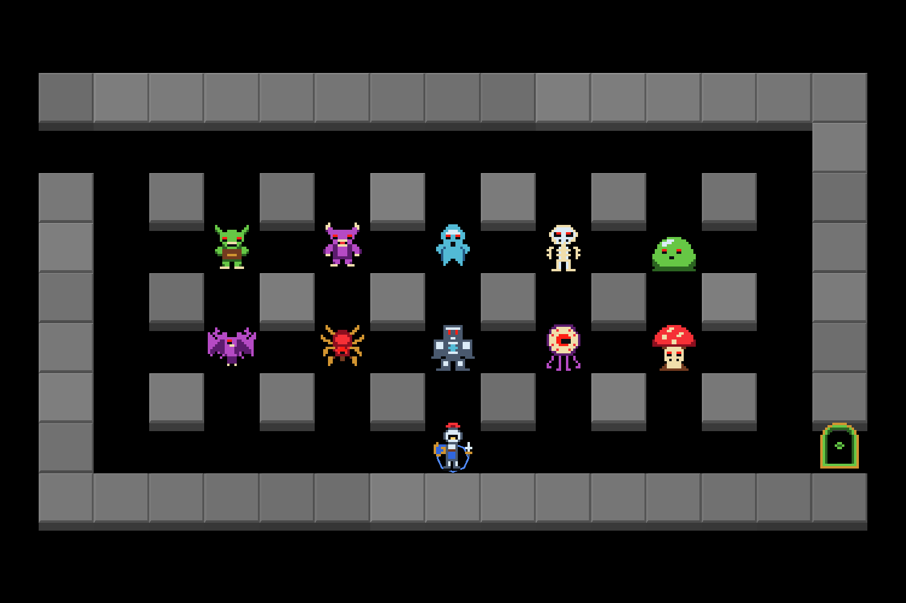
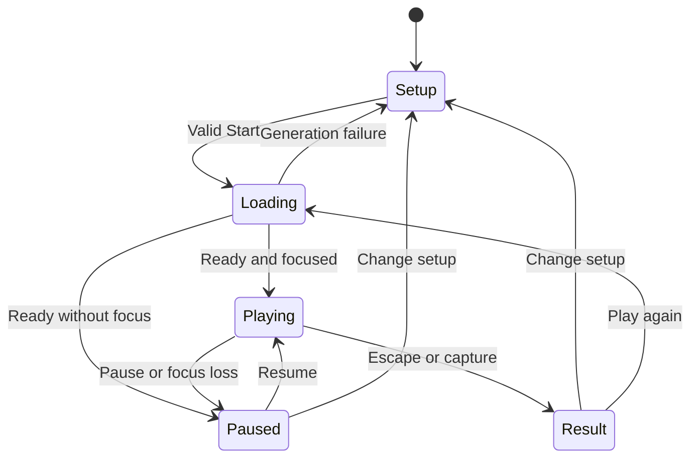

# MazeRunner v5.4.4 graphics design

Start with the design philosophy and the first Figma task if you are contributing art. For implementation details, use the renderer and integration reference below. [Production source](src/mazerunnerV5.4.4.cpp) · [Screenshot catalogue](04-Build-Test-and-Reproduce.md)

## Original design philosophy

A player looking at a crowded maze needs to answer three questions quickly: Where is the knight? Which squares can it enter? What is the nearest monster doing? The original graphics guide connects each of those decisions to a drawing choice. Start your redesign by looking at the [game at fit zoom](artifacts/screenshots/game.png) and the [character gallery](artifacts/screenshots/monsters.png).

**Give the maze depth while keeping its directions easy to read.** The black corridors show where the knight can walk. Raised gray walls, a brighter top edge and darker exposed sides make the solid cells legible. The fixed 25-degree tilt lets you see wall height while up, down, left and right still correspond to the maze grid. If you add stone detail, zoom out to a whole maze. A crack in a wall should still read as a mark on stone. If it looks like an opening, reduce its contrast.

**“Use silhouette to distinguish creatures before relying on color.”** That principle from the original guide matters most when a character is only a few pixels across. A bat’s wings, a spider’s spread legs and a mushroom’s cap should identify them even if all three are drawn in the same ink. Leave gaps between limbs and keep the feet aligned when the character turns. The small knight and blue ring help the player find their own piece among ten distinct monsters. [Original redesign guidance](https://github.com/LeEz1219/MazeRunner/blob/70e9affae3c6ee5bdf2fc45803ad62b15ef85560/02-AI-Graphics-and-Redesign.md#9-redesign-path-a-keep-the-single-file-art-pipeline)

**Give color a consistent job.** The green exit marks the destination. A monster’s gold, orange and red eyes tell the player whether it is roaming, searching or hunting. The small amber diamond beside a searching monster points down the corridor it checked. An amber line across the floor describes risk on the player’s route. In a new drawing, keep those two cues distinguishable by shape and placement. Check the same scene both at fit zoom and close up. [HUD example](artifacts/screenshots/hud.png)

**Let the player trust what they see and click.** The knight’s bob and a creature’s hover give the pieces life while their positions still read as single grid cells. Keep each actor’s footprint and the player marker readable beside walls. Apply the same principle to menus: the visible button should occupy the area that responds to a click, and a keyboard player should be able to see which button has focus. The original guide includes single-file pixel art, texture sheets and 3D characters as different redesign paths. The exercise below uses the art pipeline that ships with v5.4.4.

## First Figma task: redraw one goblin

**Deliver one editable Figma frame and one file named `goblin.png`.** The frame lets another designer adjust your work. The PNG is the finished picture the developer converts for the game. Everything in this exercise can be done in Figma.

[Download the Figma starter ZIP](design/MazeRunner-v5.4.4-Figma-starter.zip). If GitHub opens a file page, choose **Download raw file**. Unzip the download. Open `reference/goblin.png` to see the starting artwork. A *pixel* is one square of color. This picture is 20 pixels across and 20 down. The empty border counts toward those dimensions.

1. **Make the canvas.** Open a Figma Design file. Press **F** for the Frame tool and draw a frame. In the right panel set **W** and **H** to **20**. Double-click the frame name in Layers and type `goblin`. Remove the frame’s background fill and enable **Clip content**. A *frame* is the box that sets the size of the exported image.
2. **Bring in the editable drawing.** Drag `editable/goblin.svg` into the design file. In the Layers panel, drag the imported layer under `goblin` so it is indented inside the frame. Keep it at the original size. Compare the placement with `reference/goblin.png`: the top and bottom rows should be empty. If the art shifted when imported, place the reference inside the frame at X=0, Y=0, W=20, H=20, align the artwork to it, then hide the reference using its eye icon. Zoom in until you can see individual squares.
3. **Change one feature.** Try lengthening the left ear by one green pixel. Press **R** for Rectangle, draw a square, set W=1 and H=1, and give it the same green fill as the adjoining ear pixel. Use whole-number X and Y values so the edges stay sharp. Keep the four gold eye pixels in this master. The game recolors those pixels for each monster state. Look at `examples/goblin-states.png` to see the same face roaming, searching and hunting from left to right.
4. **Export the drawing.** In Layers select the outer **goblin** frame. Under **Export** in the right panel, add an export setting, select **PNG** and **1×**, then select **Export goblin**. Open the PNG’s file information: the expected size is **20 × 20**. A 40 × 40 export means the scale was 2×. A cropped export usually means only the artwork was selected. A solid background means a frame fill or reference layer is still visible. [Figma export help](https://help.figma.com/hc/en-us/articles/360040028114-Export-static-designs-from-Figma)
5. **Hand it over.** Compare the PNG on both light and dark backgrounds and look at it at actual size. Copy a link to the editable frame with access for the project team. Send the link, PNG and one sentence describing the change, such as “Extended the left ear by one pixel and kept the foot position.” The developer converts the PNG into the game’s palette and checks the result in play.

### If you were assigned a wall, button or letter

| Asset | First exercise | What to hand over |
|---|---|---|
| Stone wall | Use a screenshot of one corner. Mark the north edge with an arrow, duplicate the view and make that edge brighter in the second drawing. Look at both from a distance. | Editable frame plus a PNG showing before and after, with a color swatch beside the arrow. The developer applies it to the procedural wall material. |
| Start button | On a 1000×760 frame, place ENTER THE MAZE at X=50, Y=658, W=500, H=56. Draw four versions: ready to click, selected by keyboard, being pressed, and unavailable. Check that the label fits all four. | Frame link and proposed bounds. The starter’s `examples/start-button.csv` shows how to record the position and size. |
| Capital A | Open `examples/glyph-A.svg`. Draw inside five columns and seven rows. Place a copy beside another letter with a one-pixel gap to check spacing. | Frame link and a transparent 5×7 PNG named `glyph-A.png`. The developer converts its filled squares into the game's font data. |

For a first sprite assignment, you can stop here. The sections below preserve the renderer specification, integration instructions and longer-term redesign options for the development team.

## 1. Existing graphics implementation

### Actual 3D walls and a fixed orthographic camera

Wall cells generate real three-dimensional triangles with height **0.38 grid units**. Exposed vertical faces and top caps use different gray brightness factors. Detailed maps add 0.035-cell inset bevels with a 0.045-cell shoulder drop. Faces between adjacent solid wall cells are omitted. Base stone color varies deterministically by cell-index hashing, so this cosmetic variation cannot alter maze generation or AI randomness. `build_wall_mesh` first counts the exposed faces so its vertex reservation matches the mesh exactly. V5.4.1 reserved by cell count, which over-allocated by about a third at 501×501.

The view is a fixed **25-degree orthographic tilt**. It exposes height while preserving familiar row/column directional controls. This is not a freely rotating perspective camera. The projection fits the complete map at 1×, preserves scale under aspect changes, and follows/clamps around the knight while zoomed. Zoom ranges from 1× to 64×. The world clears to black; there is no separate textured floor covering every corridor.

For grids above 15,000 total cells, the renderer omits small cap bevels while retaining top faces and exposed vertical walls. All three square presets are below that threshold; the maximum 501×501 case is not. This is a mesh-detail policy based on total area, not camera distance. There are no normal maps, shadow maps, physical lights, or physically based materials. The apparent illumination is authored RGB brightness on each face.

### Pixel actors are billboards, not 3D character models

The knight, exit, and ten monsters are each **20×20** arrays of palette characters embedded in the `.cpp`. Every opaque pixel becomes one quad, or six triangle vertices. Dots emit no geometry. A camera-facing plane keeps the pixel image legible in the tilted world. This construction supports depth occlusion against walls without loading a texture or using alpha blending.

One pixel is 0.044 cells wide, giving a sprite a nominal 0.88-cell width. Sprites are horizontally mirrored after left/right movement. The knight has a brief step bob and a blue octagonal ground ring. Wraith, Bat, and Evil eye receive a small sinusoidal hover. **Eye pixels show monster state: gold while roaming, red while hunting, orange while searching.** These animations are visual offsets based on simulation time; they do not interpolate actor collision positions or introduce animated sprite frames.

A searching investigator briefly draws an amber diamond 0.45 cells toward the inspected corridor arm. East and west scans also turn the sprite. The diamond disappears at the scan deadline. Its direction shows where the investigator looked. The amber route overlay separately indicates a potentially obstructed player route.

| Spawn ID | Appearance | Sprite constant | Cosmetic hover |
|---:|---|---|---|
| 0 | Goblin | `GOBLIN_SPRITE` | No |
| 1 | Demon | `DEMON_SPRITE` | No |
| 2 | Wraith | `WRAITH_SPRITE` | Yes |
| 3 | Skeleton | `SKELETON_SPRITE` | No |
| 4 | Slime | `SLIME_SPRITE` | No |
| 5 | Bat | `BAT_SPRITE` | Yes |
| 6 | Spider | `SPIDER_SPRITE` | No |
| 7 | Stone golem | `GOLEM_SPRITE` | No |
| 8 | Evil eye | `EVIL_EYE_SPRITE` | Yes |
| 9 | Mushroom | `MUSHROOM_SPRITE` | No |



The arranged gallery places every appearance where it can be inspected; it is not a naturally generated gameplay encounter. The render test also removes each monster in turn and checks that its absence changes visible pixels, helping detect hidden or missing variants.

### Palette and batching

The exact shared palette is below. Values are normalized RGB, not hexadecimal byte values. `E` is state-dependent; `.` is transparent. The same symbols are used in world art and setup illustrations.

| Symbol | RGB / behavior | Intended visual role |
|---|---|---|
| `.` | No geometry | Transparent background |
| `K` | 0.045, 0.050, 0.065 | Outline / near black |
| `S` | 0.290, 0.350, 0.430 | Dark steel |
| `L` | 0.860, 0.920, 0.970 | Steel highlights |
| `W` | 0.940, 0.870, 0.670 | Bone / cream |
| `Y` | 1.000, 0.830, 0.430 | Light yellow |
| `A` | 0.820, 0.580, 0.190 | Gold / ochre |
| `B` | 0.190, 0.400, 0.870 | Blue |
| `R` | 0.960, 0.190, 0.210 | Red |
| `r` | 0.550, 0.060, 0.120 | Dark red |
| `T` | 0.450, 0.230, 0.120 | Brown |
| `G` | 0.400, 0.780, 0.270 | Green |
| `g` | 0.170, 0.390, 0.130 | Dark green |
| `P` | 0.710, 0.290, 0.770 | Purple |
| `p` | 0.360, 0.110, 0.430 | Dark purple |
| `C` | 0.320, 0.730, 0.840 | Cyan |
| `D` | 0.140, 0.340, 0.510 | Dark cyan |
| `E` | Roaming: 1.000, 0.830, 0.230; hunting: 1.000, 0.120, 0.080; searching: 1.000, 0.520, 0.100 | Monster eyes |

`Vertex` holds six floats: three position components and three color components. A static VAO/VBO contains maze walls. A second batch is regenerated for the route, exit, monsters, and knight. The UI has its own streaming batch. A normal gameplay frame therefore uses two world triangle draws plus one UI draw; setup needs only its UI batch. Buffer capacity can grow when a long full-map overlay requires more vertices than the initial reservation.

The shared GLSL 3.30 shader multiplies a vertex by `viewProjection` and forwards RGB. The fragment shader writes opaque alpha. Depth testing is enabled for the world and disabled for UI. Blending, multisampling, and dithering are disabled for crisp opaque rendering. The route's “glow” consists of a broad dark strip and narrow bright strip at slightly different heights, not bloom or a lighting effect.

## 2. UI structure and redesign boundaries

The UI is custom immediate geometry over a **1000×760 logical canvas**. `UiTransform` uniformly fits and centers that canvas in the framebuffer. Cursor conversion first accounts for window-to-framebuffer DPI scaling, then reverses the same letterbox transform. This is why widget rectangles must remain shared between drawing and hit testing.

`UiState::widgets` defines control IDs, rectangles, labels, selected flags, and enabled flags. Pointer presses store the hit control; release activates only the same enabled control. Tab/Shift+Tab traverse enabled widgets. Numeric fields hold strings while being edited, validate independently, and support replacement, deletion, and bounded stepping. Invalid input disables Start. Pressing Enter in a numeric field first focuses Start; confirming again starts the game. Control+A marks a numeric value for replacement; the current code does not map macOS Command+A.

**Esc never quits.** It pauses and resumes play, and on the result screen it returns to setup. On the setup screen it leaves a numeric field (focusing Start) and otherwise does nothing; during loading it is ignored. Quitting is explicit, through Q or the QUIT button. V5.4.1 quit immediately on Esc from setup, even while a field was being edited.

The HUD shows difficulty, elapsed time and steps, plus the Director phase, menace (`M0`–`M100`), cumulative radio count and radio footprint in rows × columns. During withdrawal, `BACKSTAGE` takes the place of the normal or relief label. A widened footprint can remain visible during backstage. Hunting counts appear in red, or searching counts in orange when no monster is hunting. Before the first input it shows “MOVE OR PRESS G TO START”. Keep the phase and radio labels legible at the smallest supported viewport.



Generation runs on a worker that owns its captured configuration and creates only the CPU-side Maze. The loading screen is presented before that work starts. Once the future is ready, the main thread constructs the OpenGL renderer and installs both objects. Every GL object must be created and destroyed while its context remains current. A future designer change that loads GPU assets on the generation worker would violate the present threading model unless a deliberate shared-context strategy were added.

The embedded bitmap font stores seven five-bit rows per glyph. Most labels uppercase their input. The version passes a case-preserving option and supplies lowercase `a`, `b` and `c` glyphs, for historical suffixes. The current version string is `V5.4.4`. An unsupported character renders as a question mark. Advance is six pixels times scale and text positions are manually chosen. Test new labels at narrow and high-DPI sizes and keep them clear of the HUD controls.

## 3. Technical reference for the full art pipeline

A contributor can replace any shipped sprite or glyph by delivering its indexed grid. Walls and menus are drawn by C++ from numeric specifications. The game opens no artwork directory at startup. Choose the deliverable in this table before drawing so that the artist and integrator agree on what can actually ship in v5.4.4.

| Asset | Full integration materials (developer prepares numeric formats) | Developer integration point |
|---|---|---|
| Knight, exit and ten monsters | Editable Figma components, 20×20 transparent master PNGs at 1×, matching 20-line indexed text grids | Replace the corresponding static `PixelSprite` initializer. Keep registry IDs, compile the existing static assertions and check the render fixture. |
| Stone cap, bevels and sides | Annotated tile drawing, neutral-color swatches and numeric material recipe in JSON or CSV | Apply the numbers in `build_wall_mesh` and `WALL_HEIGHT`. The mesh bakes colors into vertices. |
| Setup, HUD and dialogs | Editable logical-size frames, button/field state variants and a table of bounds, colors, text scale and alignment | Translate bounds to `UiState::widgets`, text/panels to `UiRenderer`, then replay input and render tests. |
| Bitmap font | 5×7 masters and seven row masks per character in a text or JSON table | Update `ui_glyph`; preserve the metrics used by the text measurement and drawing functions. |
| Proposed painted textures, animation sheets or models | Separate design exploration with dimensions, pivots, sampling and target states | Requires an engine feature. Current shaders take positions and colors; neither PNG, SVG, TTF nor a model file is loaded by the shipped program. |

### Build the character masters

Create three pages named **Masters**, **State previews** and **Handoff** in the Figma file. On Masters, make a 20×20 **frame** for each asset, disable its background fill, enable clipping and set a square layout grid of one pixel. Put the frame and child rectangles on integer coordinates. Use 1×1 filled rectangles or merged rectangles of the same color, with no strokes, blur, shadows or fractional transforms. Turn on the pixel grid when zoomed in. A larger presentation frame can display a scaled instance; export the original master. [Figma zoom and pixel grid](https://help.figma.com/hc/en-us/articles/360041065034-Adjust-your-zoom-and-view-options)

Name the masters `knight`, `exit`, `goblin`, `demon`, `wraith`, `skeleton`, `slime`, `bat`, `spider`, `stone-golem`, `evil-eye` and `mushroom`. Use top-to-bottom rows and left-to-right columns, indices 0–19. Compare to the current master before shifting the baseline. In world units the box is 0.88 cells wide, centered on the cell’s horizontal midpoint, with the foot line at row-coordinate +0.82. Bottom-row pixels have zero local height. An off-center new pose will jump horizontally when mirrored. The renderer applies mirroring, bobbing and hover, so deliver one canonical facing per asset for the current build. Distinguish a bat from a wraith and a golem from a slime first by their outer contour at 1×.

Use named sRGB color styles corresponding to the palette below. Values are an interchange convention, computed by rounding 255 times each normalized source channel to the nearest integer, ties up. They describe the *input* PNG. Rendered screenshots include projection, state cues and compositing, so sampling a screenshot is a poor way to recover a master. Keep a separate layer called **E / state-sensitive eyes**. Use the roaming eye swatch in the master. On the preview page switch just those pixels to orange for Searching and red for Hunting. Reserve regular `Y` for permanent yellow details. Any empty pixel must have alpha zero; every drawn pixel must have alpha 255.

| Material | sRGB | Material | sRGB |
|---|---|---|---|
| `K` | `#0B0D11` | `S` | `#4A596E` |
| `L` | `#DBEBF7` | `W` | `#F0DEAB` |
| `Y` | `#FFD46E` | `A` | `#D19430` |
| `B` | `#3066DE` | `R` | `#F53036` |
| `r` | `#8C0F1F` | `T` | `#733B1F` |
| `G` | `#66C745` | `g` | `#2B6321` |
| `P` | `#B54AC4` | `p` | `#5C1C6E` |
| `C` | `#52BAD6` | `D` | `#245782` |
| `E` | `#FFD43B` | `E / Searching` | `#FF851A` |
| `E / Hunting` | `#FF1F14` | `.` | `transparent` |

In Figma select each master frame, add a **PNG / 1×** export setting and export with its frame name. Verify that the file is really 20×20 RGBA, transparent outside the figure, at the intended sRGB values. Exporting only the visible layer group can trim the transparent border and change the pivot. Keep state variants and enlarged inspection images in a separate preview directory. The integrator needs the editable Figma file or shared source, the canonical PNGs and the indexed rows below. A flattened PDF of the board is suitable for comments only. [Figma static export](https://help.figma.com/hc/en-us/articles/360040028114-Export-static-designs-from-Figma) · [Export settings and color profiles](https://help.figma.com/hc/en-us/articles/13402894554519-Export-formats-and-settings-for-static-designs)

### Convert a master into a source-ready sprite

An indexed master is plain UTF-8 text with exactly 20 lines of 20 ASCII symbols, with no commas, indentation or row numbers. A dot is transparent. As a check, consecutive empty rows still contain 20 dots each. The following optional handoff helper converts the canonical PNG to a C++ initializer body. It uses Python 3 and Pillow on the designer’s or integrator’s machine. It reports the offending coordinate on partial alpha or an off-palette pixel, and it preserves `E` as a semantic material. The game build itself has no Pillow dependency.

```python
import sys
from PIL import Image

# The keys match the source sprite alphabet. E is the roaming eye color.
swatches = {"K": "0B0D11", "S": "4A596E", "L": "DBEBF7", "W": "F0DEAB",
            "Y": "FFD46E", "A": "D19430", "B": "3066DE", "R": "F53036",
            "r": "8C0F1F", "T": "733B1F", "G": "66C745", "g": "2B6321",
            "P": "B54AC4", "p": "5C1C6E", "C": "52BAD6", "D": "245782",
            "E": "FFD43B"}
decode = {bytes.fromhex(value): key for key, value in swatches.items()}

with Image.open(sys.argv[1]) as image:
    if image.format != "PNG" or image.size != (20, 20):
        raise ValueError("Expected a 20 by 20 PNG master")
    pixels = image.convert("RGBA")
    rows = []
    for y in range(20):
        row = []
        for x in range(20):
            red, green, blue, alpha = pixels.getpixel((x, y))
            rgb = bytes((red, green, blue))
            if alpha == 0:
                row.append(".")
            elif alpha == 255 and rgb in decode:
                row.append(decode[rgb])
            else:
                raise ValueError(f"Unexpected RGBA at ({x}, {y}): {(red, green, blue, alpha)}")
        rows.append("".join(row))
for row in rows:
    print(f'    "{row}",')
```

For example, save the snippet as `sprite_rows.py` and run `python3 sprite_rows.py goblin.png`. Paste the twenty quoted rows between the existing initializer braces for `GOBLIN_SPRITE`. Build, then compare the roaming, searching, hunting and mirrored poses against the monster roster image. An eye that stays yellow in Hunting was probably mapped to `Y`; a creature that shifts sideways on turning usually lost padding. Compile-time row validation catches wrong dimensions and unknown symbols. The state-rendering fixture catches mistakes that still use legal symbols. [Roster fixture](artifacts/screenshots/monsters.png) · [Render tests](tests/render_tests.cpp)

### Specify stone and floor materials

Draw one annotated orthographic cap, four exposed sides and a three-tile corner viewed with the game camera. Include a second frame showing the simplified large-map version at fit zoom. Use a repeatable base-gray range. In the shipping recipe the unsigned hash of the cell index contributes a four-bit value $h$ and base gray is $0.36+0.004h$. The top cap uses 1.18 times that gray. Small-map bevels use directional multipliers. Hidden shared sides emit no quads. A recommendation to change the north bevel should therefore identify the correct face and numeric value; a single baked lighting bitmap cannot describe that edit.

```json
{
  "height_cells": 0.38, "bevel_inset_cells": 0.035, "shoulder_drop_cells": 0.045,
  "detailed_max_board_cells": 15000,
  "gray_base": 0.36, "grain_step": 0.004, "cap_multiplier": 1.18,
  "bevel": {"north": 1.42, "east": 0.85, "south": 0.78, "west": 1.25},
  "side": {"north": 0.85, "east": 0.52, "south": 0.57, "west": 0.76}
}
```

This example records the current material in a designer-readable form. Hand over proposed changes in a similarly labeled `stone-style.json` and mark the affected faces in the Figma frame. The developer applies them in C++. For a future texture-loader proposal, a useful proof asset is a seamless 32×32 opaque sRGB PNG for the top, with separate side family, a 3×3 repeat preview and orientation labels. Those dimensions are a proposed design contract. Paint the tile edges to match, specify nearest-neighbor sampling, and decide with the renderer developer whether face tint multiplies the painted color. UVs, texture storage and sampler state are prerequisites for displaying it.

### Hand off the interface and font

Start a 1000×760 logical frame. Reconstruct Setup, Loading, Playing/HUD, Paused and both Result outcomes from the reference captures. Build button and numeric-field components with default, focus, pressed and disabled variants; also draw the invalid-value state and the pre-first-move hint. For each interactive control export a table with its existing widget ID, parent screen, top-left logical coordinates, width, height, text scale, alignment and focus order. Use actual production labels, including the longest radio footprint, counters and the numeric version string. Present read-only panels and clickable controls as separate layers so engineers can map them to their owners. Overlay each proposed hit rectangle on the visible button to catch alignment errors.

Test the composition in an 800×600 minimum-size frame, a wide frame and a portrait frame. For a framebuffer of size $W,H$, UI scale is $s=\min(W/1000,H/760)$ and the content offset is $((W-1000s)/2,(H-760s)/2)$. Use centered, uniform scale in these preview instances. At 1600×900, $s=900/760$ and the side margins are about 208 pixels each. Include a 2× framebuffer preview of one button with the same logical hit target, plus a zoomed-out HUD over a 101×101 map. A HUD label that passes on a blank canvas may disappear over bright wall tops. [Setup](artifacts/screenshots/setup.png) · [Portrait](artifacts/screenshots/setup-portrait.png) · [High-zoom view](artifacts/screenshots/zoom.png)

For the font, use a frame of five columns by seven rows for each supported glyph. Keep the sixth advance column empty. Deliver rows as seven integers 0–31, top first, with the leftmost pixel as bit 4. For example the current capital A is `[14,17,17,31,17,17,17]`; its crossbar 31 fills all five columns. Include A–Z, digits, the punctuation handled by `ui_glyph`, space, the question-mark fallback and the supported lowercase suffix letters. Supply a proof reading `BACKSTAGE M100`, `V5.4.4` and `21X25`, at actual text scale. A TTF can accompany a concept board, but replacing the runtime font needs these masks or a separate font rasterization feature.

Before sign-off, run the build and offscreen render/app suites. Compare the monster roster, zoom, setup-wide, setup-small and HUD captures. Look for a mismatched eye role, trimmed pivot, white seam, invisible scan direction, clipped glyph, or control whose click area disagrees with its visible frame. For a purely visual edit, repeat a fixed headless run and compare its simulation outcome and counters. [Build, reproduction and screenshot catalogue](04-Build-Test-and-Reproduce.md)

## 4. Redesign path A: keep the single-file art pipeline

This is the smallest engineering change for a graphic designer's first pass. Keep all simulation code and the appearance registry order intact. Redraw each sprite on an exact 20×20 canvas using the existing palette, preserving a common foot position and the knight's approximate cell footprint. Replace the twenty corresponding string rows. Each row must contain exactly twenty symbols, and every symbol must be in `valid_sprite`'s whitelist. Compile-time assertions catch malformed dimensions and unknown symbols before the game runs.

Use silhouette to distinguish creatures before relying on color: wings, horns, eye shape, body mass, leg count, and cap outline remain meaningful at small scale. Keep intentional transparency around limbs. Reserve `E` for visible state-sensitive eye details and inspect the roaming, hunting, and searching versions. Avoid changing a shared palette entry casually: modifying `W`, for example, changes every sprite using that symbol, including UI illustrations. For new colors, update both `sprite_color` and the whitelist, then consider whether tests expecting palette ranges need a deliberate update.

Edit theme colors in `UiRenderer` and stone brightness in `build_wall_mesh`. Maintain contrast between black corridors, gray raised walls, the player's blue ring, exit art, and route overlay. At 101×101 fitted into one window, individual sprite pixels become very small; judge navigation readability at whole-map scale as well as at zoom. The existing ring is a useful player locator. A future exit beacon or an icon outline could improve readability, but neither is currently implemented.

For UI rearrangement, change rectangles in `UiState::widgets` and matching descriptive panel/text positions in `UiRenderer::setup`, `hud`, and `draw`. Background labels and panels are not generated automatically from the widget list, so moving only a button rectangle can create overlaps even though clicks remain correctly aligned to that button. Keep focus outlines and disabled/pressed states distinct. Test the minimum 800×600 window, wide and tall windows, and a high-DPI transform. A portrait offscreen screenshot is a robustness check, not a promise the native minimum-size limits permit that exact window.

| Desired edit | Primary source location | Related constraints |
|---|---|---|
| Knight or exit drawing | [Knight sprite](src/mazerunnerV5.4.4.cpp#L2714), [Exit sprite](src/mazerunnerV5.4.4.cpp#L2846) | 20 rows × 20 symbols; shared palette |
| Ten monster drawings | [Monster sprites](src/mazerunnerV5.4.4.cpp#L2726) onward | Keep registry pointers and stable IDs |
| Registry names/hover flags | [Appearance registry](src/mazerunnerV5.4.4.cpp#L2865) | Hover is cosmetic; registry size must cover max count |
| Sprite validation | [Sprite validation](src/mazerunnerV5.4.4.cpp#L2886) | Add new palette symbols here as well as color mapping |
| Wall style | [Wall mesh](src/mazerunnerV5.4.4.cpp#L2921) | Static upload, exposed faces, large-map policy |
| Sprite and eye colors | [Palette](src/mazerunnerV5.4.4.cpp#L2965) | Global effect across all art using a symbol |
| World sprite size/anchor | [Sprite placement](src/mazerunnerV5.4.4.cpp#L2990) | Camera-facing construction and wall occlusion |
| Camera fit/tilt/zoom | [Projection](src/mazerunnerV5.4.4.cpp#L3022) | Projection and sprite orientation must agree |
| Route colors/thickness | [Route overlay](src/mazerunnerV5.4.4.cpp#L3053) | Preserve monster-free/amber semantics |
| Widget rectangles and labels | [Widgets](src/mazerunnerV5.4.4.cpp#L3145) | Shared hit testing and keyboard order |
| Font shapes | [Bitmap glyphs](src/mazerunnerV5.4.4.cpp#L3270) | Seven rows, five bits; text metrics elsewhere |
| Menu palette and layout | [UI geometry](src/mazerunnerV5.4.4.cpp#L3484) | Labels, panels, and widgets need coordinated spacing |
| HUD text and counters | [HUD](src/mazerunnerV5.4.4.cpp#L3565) | Keep start prompt and counters clear of the HUD buttons |
| Junction scan diamond | [World drawing](src/mazerunnerV5.4.4.cpp#L3419) | Keep its direction legible and let the scan deadline control visibility. |
| Difficulty balance | [Difficulty profiles](src/mazerunnerV5.4.4.cpp#L131) | Re-run the calibration script after any change |

## 5. Redesign path B: external texture sprites and richer animation

An external sprite sheet would let a designer iterate in an image editor without rewriting C++ strings. This is a **proposed extension**, not a loader already present in V5.4.4. A concrete initial asset contract could preserve 20×20 logical frames, transparent RGBA backgrounds, a documented foot pivot, and named clips for idle, walk, hunting, and searching. A separate manifest would map the ten stable appearance IDs to sheet regions and frame timings. Larger source art is also possible, but the logical world footprint must be chosen explicitly rather than inferred from image dimensions.

Engineering work would include image decoding, texture lifetime ownership, UV coordinates in the vertex format, a texture sampler in the shader, atlas rectangles, and an asset-location policy. Nearest-neighbor sampling would preserve crisp pixel edges. Atlas gutters and careful UV boundaries would avoid neighboring-frame bleed. Transparent texels could be discarded for hard-edged pixel art while retaining depth writes; translucent effects would require an intentional blend/depth-order policy. Color-space handling should be consistent across images and vertex colors rather than relying on incidental driver defaults.

Animation should live in render state and be keyed to simulation events or timestamps. Keep collision and AI on the existing grid unless the gameplay redesign explicitly changes them. Render interpolation can make movement smoother, but it should not determine whether capture occurs. Aesthetic random variations should use deterministic hashes or a separate visual PRNG, preserving the simulation RNG stream and its seeded tests. Asset failures should produce useful diagnostics and a visible fallback, and asset paths should work when launching from a different current directory.

A designer handoff should specify canvas/frame size, foot pivot, intended world size, transparent margin, palette/color-space policy, direction conventions, animation durations, and the three monster-state cues (roaming, hunting, searching). Deliver an overview sheet plus isolated frames and preview both at actual small in-game scale. Those deliverables are recommendations for a future art pass; the current package supplies the existing embedded-art screenshots and source, not a new texture pipeline.

## 6. Redesign path C: true 3D characters or a broader renderer change

Replacing billboard actors with real models is a larger change. It requires mesh/asset import, normals, material definitions, model transforms, animation data, and lighting if the models should appear shaded. A rigged knight also needs bone transforms or another explicit animation scheme. Merely extruding current pixel quads does not create articulated character animation.

Preserve the tile-centered simulation as the authoritative gameplay representation while adding a render transform for each entity. Define a shared world scale, actor origin, feet-on-floor convention, and maximum silhouette footprint. Retain a readable player marker and distinct monster silhouettes under the fixed camera. If the camera becomes rotatable or perspective, update billboard handling, projection bounds, zoom behavior, and the relationship between input directions and screen directions together.

The current portable renderer targets OpenGL 3.3 core and uses GLSL 3.30. Any new shader or asset technique must fit the chosen supported platform baseline or introduce an explicitly documented alternative renderer. macOS's existing OpenGL route should be treated as a compatibility target when evaluating new effects. A backend migration would be a separate engineering project; there is no existing abstraction here that automatically converts GL draw calls to another graphics API.

## 7. Validation workflow for visual changes

Begin with a reproducible seed and unchanged dimensions, count, difficulty, compiler, and standard library. Compare headless simulation outputs before/after after excluding measured host compute time. An art-only edit should not change the simulation state or consume additional simulation randomness. Run the portable regression suite for sprite validity, geometry/camera invariants, all profiles, pack coordination, clue privacy, learned search choices, the release-label glyphs, and UI state. The EGL suite compares the horizontal positions of the scan diamond for left and right gazes and checks that the pixels disappear at expiry. Then run the real-GL render and injected-application suites on Linux (both run under CTest when EGL is available) and inspect the generated PNGs. A gameplay or balance change should also re-run `scripts/run_calibration.py`.

Use the gallery to check that all ten appearances are distinct and visible, then inspect a naturally generated crowded map. Review whole-map and zoomed views, amber and cycling routes, player overlap/occlusion, the green exit, the start prompt and hunting/searching counters, invalid setup fields, keyboard focus, pause, and results. Rerun native-window checks on each intended release platform: offscreen rendering cannot establish native DPI behavior, compositor behavior, actual keyboard mappings, or macOS/Windows driver compatibility.

For new assets or shader effects, extend tests around the changed contract rather than weakening old assertions until everything passes. A deliberate palette redesign may require updating pixel-color expectations, but depth ordering, missing actors, map aspect, input hit areas, source gameplay behavior, and GPU cleanup should remain verifiable. Store the chosen screenshots with seed/configuration and capture method so they remain useful references rather than undocumented pictures.
