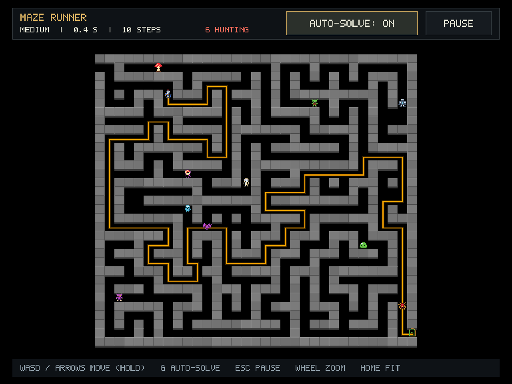

# Auto-solver, backtracking and the route overlay

[MazeRunner V5.4.3a wiki](Home.md)

## Automatic player AI

The automatic player has two related but distinct responsibilities: choose its next action under moving threats, and maintain a visible route from its current cell to the exit. Only the first action of each tactical plan is committed. Planning repeats from the resulting real state, allowing waiting, forward movement, alternate branches, and backtracking.

### Timing-aware guidance and the full path overlay

The exit field classifies monster cells before calculating the route. This lets the player take a detour around a distant patrol when the extra distance is worth paying.

- **Near** (14 corridor steps or fewer from the player) or **parked** (no movement for 1.5 s): a wall.
- **Distant and moving**: passable, but entering its cell costs 24 extra steps, so routes prefer a detour of up to 24 steps.

Guidance is a weighted shortest-path field from the exit, computed with Dial's bucket queue. Edge costs are 1 or 25, so 26 circular buckets suffice. The cache key includes the classification, so guidance is rebuilt when a monster crosses the near threshold even if no monster moved. If near or parked monsters cut every route, the solver is "blocked" and uses the terrain-only field for direction.

For a step from v into u, the candidate cost is `1 + entry_penalty(u) + distance[u]`. Relaxation stores the successor u that achieved this value. Simply choosing the neighbor with the lowest remaining distance can hide the cost of entering that neighbor and draw a route through a monster. The overlay follows the stored chain all the way to the exit. An occupied route or the fallback for a disconnected weighted field is amber. With zero monsters a downhill terrain step is sufficient. Tactical decisions may wait, retreat or take another branch.

The HUD is a real 21-row × 31-column Medium game, seed 7, with five monsters. At the first relief tick the run shows 50 steps, three hunters and three radio reports. The map and counter use the same simulation state as the director trace. [Terminal record](https://github.com/LeEz1219/MazeRunner/blob/b73842a26759c888d9919c48f04be167cca99ad2/artifacts/results/director-relief.log)

### Tactical forecast and beam search

The planner normally looks ahead 12 actions (480 ms). It extends to **18 actions** when the nearest monster is 10–36 corridor steps away, close enough to shape the route but beyond the default window's view. It retains at most 64 candidates at each depth and considers five actions per expansion: stay or move to one of four neighbors. The forecast copies current monster positions, targets, states, deadlines, and reservation behavior, and projects scheduled movement within the horizon. It also applies the game's sight rule: an unalerted or charging monster that can see the player's current cell is predicted to charge it. It does not simulate future random target selection or new clues. Predictions are therefore useful estimates rather than perfect future knowledge.

An earliest-arrival estimate combines the remaining delay until a monster's next move with bounded corridor distance at that profile's movement period. The conservative first action rejects cells that may be reached within the next action interval, with special exit handling. Predicted collisions and near approaches influence later search layers. Dead-end gate analysis also discourages entering a branch that a nearby threat could seal.

The score combines movement/action cost with danger, recent repetitions, decaying visit heat, and the chosen guidance. A wait adds 0.35; reversing toward the prior node adds 0.8; danger is weighted by 2.0 in accumulated cost. Threatened deep dead ends and low-degree endpoints receive extra penalties. Deduplication retains the better candidate for a cell at a given depth. An available goal candidate is preserved before beam truncation. If no goal is reached within the horizon, the search retains a feasible deepest frontier. With no monsters, the code bypasses tactical search and follows the exact terrain shortest-path gradient.

The state space is approximated: per-cell/per-depth merging and a finite beam do not preserve every distinct history. The result is not a globally optimal time-expanded path and does not prove survival.

### Bounded waiting, loop detection, and committed recovery

When near or parked monsters block every exit route, the player can stand still to let hunters lose the scent. Two conditions apply. The next action must be conservatively safe. **No monster may be able to reach the player's cell within one action plus one monster step.** The second condition was added after traces showed the solver idling beside a monster and being caught. The waiting budget is twice the profile's scent lifetime. Its start time is kept across decisions, and a clear route must persist for one scent interval before a blocked episode resets.

**Loop detection.** Each committed detour is recorded. Boldness counts the detours started in the last 20 seconds beyond the first, capped at 4. Each boldness level shortens the waiting budget by half a scent period, never below one scent period, and raises how strongly detour selection favors cells closer to the exit. Boldness changes are logged. A more aggressive "ignore danger and press on" mode was implemented and measured, then removed: it turned timeouts into captures rather than escapes.

After the waiting budget, or after 2,400 ms without recognized navigation progress, recovery can select a temporary detour goal. Search explores at most 4,096 cells and depth 32, considers sufficiently distant candidates, and checks time clearance relative to estimated travel. It rewards room to maneuver, junctions, and movement away from repeated cells, while penalizing dead ends, exit-distance increase (weighted by boldness), returning to the entrance, and recently tried recovery areas. Backtracking is explicitly permitted. A chosen goal is committed for up to 4,000 ms, with progress checks and occupancy-aware guidance. Reaching it can include a pause for scent plus one monster period. A stable newly opened exit route cancels recovery early when the downhill next step is safe.

If conservative planning fails, the planner tries a relaxed interpretation of uncertain threats. If that also fails, emergency selection scores unoccupied candidates by estimated time before contact, exit distance and local degree. The benchmark records escapes, captures and unfinished games separately.
