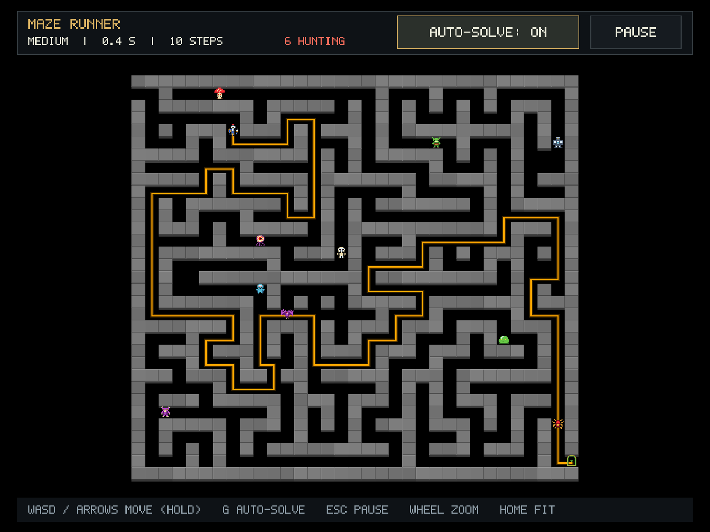

# Director radio and intensity relief

[MazeRunner V5.4.3a wiki](Home.md)

A footstep and a radio report can originate on the same move. A monster within acoustic reach can hunt. A distant monster gets an approximate sector to investigate, even across the map. Standing still stops new movement reports and lets existing evidence expire. The director can still widen remembered clues when the solver is confined.

## Overwatch/director intensity control

The director has two jobs. It decides when to broadcast coarse movement information and adjusts how precisely monsters can use it when play stalls. Monster movement speeds, collisions and physical hearing still use the selected profile.

Every 200 ms of active play the director samples the player on the simulation clock. A full profile-sized window containing at most 12 unique cells and spanning at most eight cells per axis counts as confinement. In auto mode, prolonged absence of navigation progress is another trigger. Voluntary manual idling clears the history. An active solver accumulates samples while waiting or backtracking, even when the exit field contains a technically open route.

An escalation widens the last local clue, the last radio rectangle and each informed monster's **own** memory. It clears stale waypoints, releases cutters and leaves a directly visible High target eligible for sight pursuit. It preserves the source evidence revision and the existing scent/search expiry. A director sample by itself never transmits a new position. Future reports use a wider footprint and longer cooldown. Once padding reaches its cap, another hold period can elapse without repeatedly invalidating broad plans.

Recovery requires that confinement end, the minimum hold elapse and the recovery condition remain true for 2,000 ms. The player must either gain at least six terrain steps toward the exit relative to relief entry or move at least six Manhattan cells from the relief anchor. An automatic player must also have a reachable weighted exit route. Returning to normal narrows subsequent reports. Existing broad memories keep their recorded extent until new evidence arrives.

| Seed 7, Medium | Event | Effect |
|---|---|---|
| 4,200 ms | Relief starts | Radio area 21×25, five monsters retasked, one interceptor released |
| 10,200 ms | Relief increases | Radio area clips to the full 21×31 board |
| 17,600 ms | Normal precision restored | Future radio area 17×17 |
| 26,600 ms | New confinement episode | Radio area returns to 21×25 |
| 31,400 ms | Escape | 462 successful automatic moves |

A wider clue can give the player time to get past a choke. The outcome depends on where monsters are and which walkable targets they choose. [Complete event trace](https://github.com/LeEz1219/MazeRunner/blob/b73842a26759c888d9919c48f04be167cca99ad2/artifacts/results/director-relief.log)
