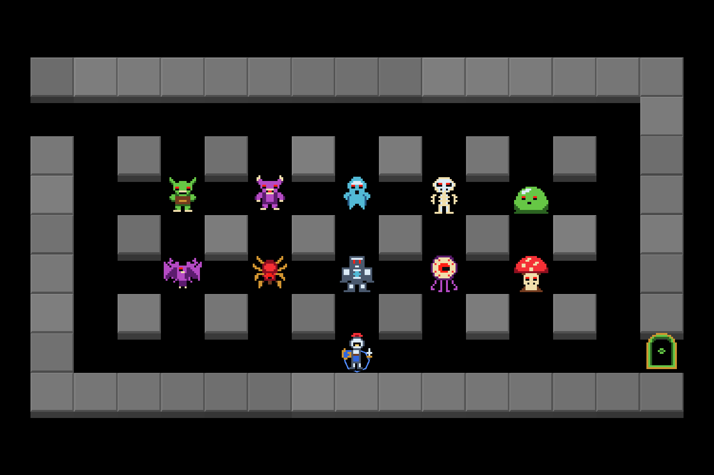
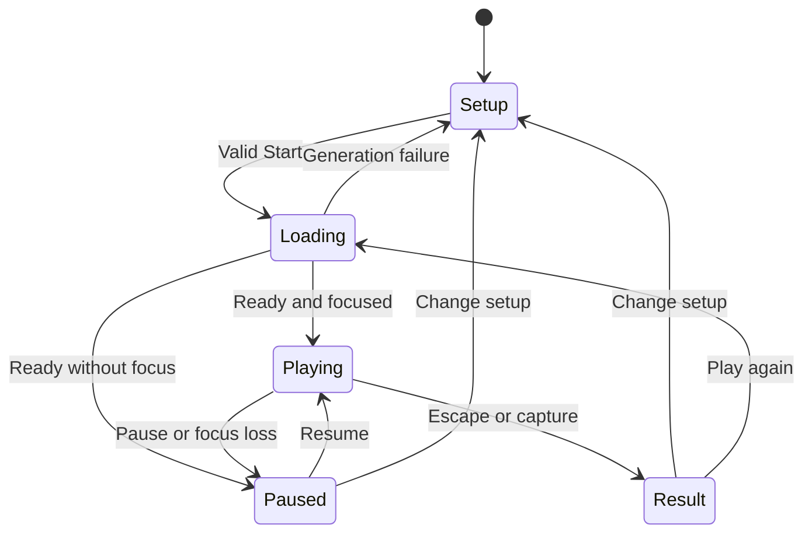

# Graphics, sprites and UI design

[MazeRunner V5.4.3a wiki](Home.md)

## Existing graphics implementation

### Actual 3D walls and a fixed orthographic camera

Wall cells generate real three-dimensional triangles with height **0.38 grid units**. Exposed vertical faces and top caps use different gray brightness factors. Detailed maps add 0.035-cell inset bevels with a 0.045-cell shoulder drop. Faces between adjacent solid wall cells are omitted. Base stone color varies deterministically by cell-index hashing, so this cosmetic variation cannot alter maze generation or AI randomness. `build_wall_mesh` first counts the exposed faces so its vertex reservation matches the mesh exactly. V5.4.1 reserved by cell count, which over-allocated by about a third at 501×501.

The view is a fixed **25-degree orthographic tilt**. It exposes height while preserving familiar row/column directional controls. This is not a freely rotating perspective camera. The projection fits the complete map at 1×, preserves scale under aspect changes, and follows/clamps around the knight while zoomed. Zoom ranges from 1× to 64×. The world clears to black; there is no separate textured floor covering every corridor.

For grids above 15,000 total cells, the renderer omits small cap bevels while retaining top faces and exposed vertical walls. All three square presets are below that threshold; the maximum 501×501 case is not. This is a mesh-detail policy based on total area, not camera distance. There are no normal maps, shadow maps, physical lights, or physically based materials. The apparent illumination is authored RGB brightness on each face.

### Pixel actors are billboards, not 3D character models

The knight, exit, and ten monsters are each **20×20** arrays of palette characters embedded in the `.cpp`. Every opaque pixel becomes one quad, or six triangle vertices. Dots emit no geometry. A camera-facing plane keeps the pixel image legible in the tilted world. This construction supports depth occlusion against walls without loading a texture or using alpha blending.

One pixel is 0.044 cells wide, giving a sprite a nominal 0.88-cell width. Sprites are horizontally mirrored after left/right movement. The knight has a brief step bob and a blue octagonal ground ring. Wraith, Bat, and Evil eye receive a small sinusoidal hover. **Eye pixels show monster state: gold while roaming, red while hunting, orange while searching.** These animations are visual offsets based on simulation time; they do not interpolate actor collision positions or introduce animated sprite frames.

| Spawn ID | Appearance | Sprite constant | Cosmetic hover |
|---:|---|---|---|
| 0 | Goblin | `GOBLIN_SPRITE` | No |
| 1 | Demon | `DEMON_SPRITE` | No |
| 2 | Wraith | `WRAITH_SPRITE` | Yes |
| 3 | Skeleton | `SKELETON_SPRITE` | No |
| 4 | Slime | `SLIME_SPRITE` | No |
| 5 | Bat | `BAT_SPRITE` | Yes |
| 6 | Spider | `SPIDER_SPRITE` | No |
| 7 | Stone golem | `GOLEM_SPRITE` | No |
| 8 | Evil eye | `EVIL_EYE_SPRITE` | Yes |
| 9 | Mushroom | `MUSHROOM_SPRITE` | No |

The arranged gallery places every appearance where it can be inspected; it is not a naturally generated gameplay encounter. The render test also removes each monster in turn and checks that its absence changes visible pixels, helping detect hidden or missing variants.

### Palette and batching

The exact shared palette is below. Values are normalized RGB, not hexadecimal byte values. `E` is state-dependent; `.` is transparent. The same symbols are used in world art and setup illustrations.

| Symbol | RGB / behavior | Intended visual role |
|---|---|---|
| `.` | No geometry | Transparent background |
| `K` | 0.045, 0.050, 0.065 | Outline / near black |
| `S` | 0.290, 0.350, 0.430 | Dark steel |
| `L` | 0.860, 0.920, 0.970 | Steel highlights |
| `W` | 0.940, 0.870, 0.670 | Bone / cream |
| `Y` | 1.000, 0.830, 0.430 | Light yellow |
| `A` | 0.820, 0.580, 0.190 | Gold / ochre |
| `B` | 0.190, 0.400, 0.870 | Blue |
| `R` | 0.960, 0.190, 0.210 | Red |
| `r` | 0.550, 0.060, 0.120 | Dark red |
| `T` | 0.450, 0.230, 0.120 | Brown |
| `G` | 0.400, 0.780, 0.270 | Green |
| `g` | 0.170, 0.390, 0.130 | Dark green |
| `P` | 0.710, 0.290, 0.770 | Purple |
| `p` | 0.360, 0.110, 0.430 | Dark purple |
| `C` | 0.320, 0.730, 0.840 | Cyan |
| `D` | 0.140, 0.340, 0.510 | Dark cyan |
| `E` | Roaming: 1.000, 0.830, 0.230; hunting: 1.000, 0.120, 0.080; searching: 1.000, 0.520, 0.100 | Monster eyes |

`Vertex` holds six floats: three position components and three color components. A static VAO/VBO contains maze walls. A second batch is regenerated for the route, exit, monsters, and knight. The UI has its own streaming batch. A normal gameplay frame therefore uses two world triangle draws plus one UI draw; setup needs only its UI batch. Buffer capacity can grow when a long full-map overlay requires more vertices than the initial reservation.

The shared GLSL 3.30 shader multiplies a vertex by `viewProjection` and forwards RGB. The fragment shader writes opaque alpha. Depth testing is enabled for the world and disabled for UI. Blending, multisampling, and dithering are disabled for crisp opaque rendering. The route's “glow” consists of a broad dark strip and narrow bright strip at slightly different heights, not bloom or a lighting effect.

## UI structure and redesign boundaries

The UI is custom immediate geometry over a **1000×760 logical canvas**. `UiTransform` uniformly fits and centers that canvas in the framebuffer. Cursor conversion first accounts for window-to-framebuffer DPI scaling, then reverses the same letterbox transform. This is why widget rectangles must remain shared between drawing and hit testing.

`UiState::widgets` defines control IDs, rectangles, labels, selected flags, and enabled flags. Pointer presses store the hit control; release activates only the same enabled control. Tab/Shift+Tab traverse enabled widgets. Numeric fields hold strings while being edited, validate independently, and support replacement, deletion, and bounded stepping. Invalid input disables Start. Pressing Enter in a numeric field first focuses Start; confirming again starts the game. Control+A marks a numeric value for replacement; the current code does not map macOS Command+A.

**Esc never quits.** It pauses and resumes play, and on the result screen it returns to setup. On the setup screen it leaves a numeric field (focusing Start) and otherwise does nothing; during loading it is ignored. Quitting is explicit, through Q or the QUIT button. V5.4.1 quit immediately on Esc from setup, even while a field was being edited.

The HUD shows difficulty, elapsed time and steps, plus the director phase, radio count and current row-by-column footprint. Hunting counts appear in red, or searching counts in orange when no monster is hunting. Before the first input it shows “MOVE OR PRESS G TO START”. Keep the phase and radio labels legible at the smallest supported viewport.

Generation runs on a worker that owns its captured configuration and creates only the CPU-side Maze. The loading screen is presented before that work starts. Once the future is ready, the main thread constructs the OpenGL renderer and installs both objects. Every GL object must be created and destroyed while its context remains current. A future designer change that loads GPU assets on the generation worker would violate the present threading model unless a deliberate shared-context strategy were added.

The embedded bitmap font stores seven five-bit rows per glyph. Most labels uppercase their input. The version passes a case-preserving option and supplies the lowercase `a` glyph for V5.4.3a. An unsupported character renders as a question mark. Advance is six pixels times scale and text positions are manually chosen. Test new labels at narrow and high-DPI sizes and keep them clear of the HUD controls.
