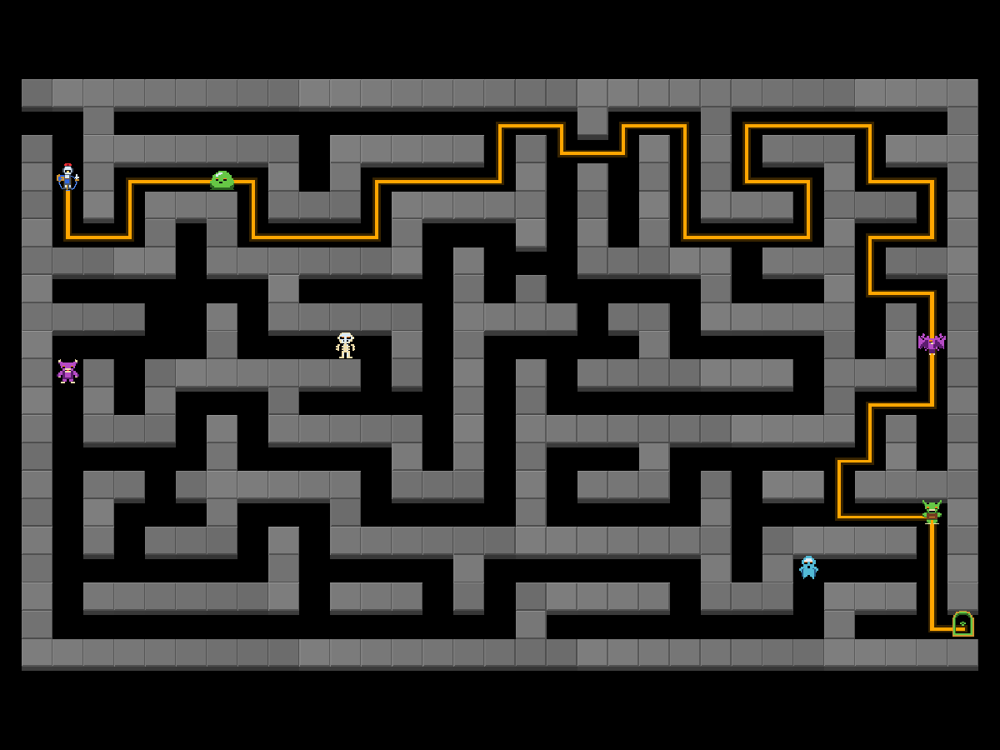

# MazeRunner V5.4.3a

Guide the pixel knight through a maze of raised gray walls while roaming monsters listen for your footsteps. Press **G** to watch the automatic player plan an escape. Its highlighted route reaches the exit, but it can pause or backtrack as monsters move.

**New to the game?** Start with [Playing your first maze](Playing-your-first-maze.md). If you downloaded the source, [Building the game](Building-the-game.md) has copyable commands for Ubuntu, Apple Silicon and Windows CMD.

## Explore the wiki

- [Playing your first maze](Playing-your-first-maze.md)
- [Maze generation and simulation time](Maze-generation-and-time.md)
- [Monster senses, patrols and interception](Monster-AI.md)
- [Director radio and intensity relief](Director.md)
- [Auto-solver, backtracking and the route overlay](Auto-solver.md)
- [Difficulty and measured escape rates](Difficulty-and-balance.md)
- [Graphics, sprites and UI design](Graphics-and-UI.md)
- [Redesigning the artwork and interface](Redesigning-the-game.md)
- [Build on Ubuntu, Apple Silicon or Windows CMD](Building-the-game.md)
- [Headless simulation, tests and reproduction](Headless-and-validation.md)
- [Screenshot gallery and troubleshooting](Screenshots-and-troubleshooting.md)

## What changed in V5.4.3a?

The director can broadcast a coarse search area to monsters beyond hearing range. During relief it widens the search and releases interceptors. The HUD exposes those changes, and the terminal records who received a report. The full route overlay now accounts for the cost of entering an occupied cell. Held-key movement shares the simulation clock with monster moves.

## Release evidence

Ubuntu built the graphical game and simulator and passed 13 CTest cases. A second Linux run passed 32 validation commands. Across the 2,400 five-monster calibration games, escape rates were 93.9% Low, 67.0% Medium and 34.1% High. The full data set contains 4,740 games across calibration, preset, default and holdout configurations. The developer kit includes 18 screenshots. Native macOS and Windows runs are unverified for this release.

[Download the developer kit](https://raw.githubusercontent.com/LeEz1219/MazeRunner/b73842a26759c888d9919c48f04be167cca99ad2/dist/MazeRunner-V5.4.3a-Documentation-and-Validation.zip) · [Annotated source](https://github.com/LeEz1219/MazeRunner/blob/b73842a26759c888d9919c48f04be167cca99ad2/01-Source-Line-by-Line.md) · [Published CI run](https://github.com/LeEz1219/MazeRunner/actions/runs/44218672309)
