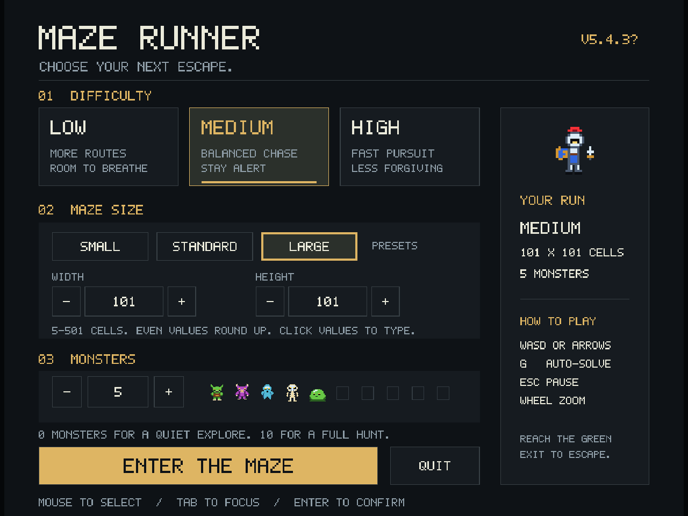

# Maze generation and simulation time

[MazeRunner V5.4.3a wiki](Home.md)

## Architecture and game rules

The game is a single C++17 translation unit with a deliberately separated simulation and graphical front end. `Maze` owns terrain, entities, event times, path searches, director state, and terminal reporting. Its decisions do not require GLFW, a window, textures, or a GPU. A headless binary removes GL-dependent sections at preprocessing time and runs this same simulation. `Renderer` turns maze state into world geometry; `UiState` models setup and screen interaction; `UiRenderer` draws the menus; `GameApplication` owns their lifetimes, schedules background generation, and turns held movement keys into repeated steps.

The player must reach the exit without occupying a monster's cell. Terrain is a rectangular grid containing wall, open-path, and exit cells. Actors are separate from that terrain: a moving monster does not overwrite a wall or corridor character. Coordinates use `(row,column)` in simulation and `(x=column,y=row,z=height)` in rendering. Adjacency is orthogonal, never diagonal. The generated entrance is on the left boundary near the top, and the exit is on the right boundary near the bottom.

The setup permits **0–10 monsters** and dimensions **5–501** per axis. Even dimensions round upward to odd numbers. Width and height can differ. The presets are **Small 33×33**, **Standard 63×63**, and **Large 101×101**. The initial editable defaults are **31×21 with five monsters and Medium difficulty**; Standard is a selectable preset, not the initial form value. Form settings remain available during the application's lifetime but are not saved to a configuration file. Manual moves are ignored while automatic solving is enabled; turn it off with G or the HUD toggle before taking control. Pressing a movement key moves at once; holding it repeats the move after 220 ms and then every 120 ms. These repeats are driven by the maze's simulation clock, not by the operating system's key-repeat events.

### Simulation time and event order

Time is represented as signed 64-bit integer milliseconds. An automatic action is due every 40 ms, or 25 action opportunities per simulated second. A wait is an action opportunity but not a successful movement step. Rendering frequency does not change the action interval. Monsters have their own per-profile periods and initially staggered deadlines.

`Maze::advance_to` processes the earliest deadline before proceeding to the next. At equal times it expires scent/search/roles, samples the director, moves due monsters, checks for a terminal result, then dispatches an auto action or held manual repeat. Capture takes precedence when a monster and player coincide. The application applies the first accepted keypress immediately, schedules the first repeat 220 ms later and repeats successful steps every 120 ms. A wall, release, pause, focus loss or control-mode transition can cancel the hold.

**Monsters stay frozen until the player's first successful move or until automatic solving is enabled.** At that moment `start_timer` releases them, adding the current time to their spawn-relative deadlines so their staggering is preserved. Before V5.4.2, monsters roamed from time zero. An idle player still reading the screen could then be caught, about 5% of the time within 30 seconds on a 33×33 map with ten monsters, and the result screen read "0.0 seconds, 0 steps". The HUD now shows "MOVE OR PRESS G TO START" until the first input. The run timer and the director's sampling schedule start at the same moment.

The graphical application advances simulation only on the Playing screen. It consumes the complete nonnegative playing interval, including intervals longer than 250 ms, and schedules movement inside that interval. Setup, loading, pause and result screens freeze the game. Focus loss pauses play and cancels the hold. The renderer uses a frame deadline while playing.

## Maze generation and multiple solutions

`Maze::generate` begins with an iterative randomized depth-first carve on the odd-coordinate room lattice. Moving two cells at a time connects rooms by opening their intervening wall. The initial carved structure is a spanning tree, so by itself it has only one simple entrance-to-exit route. The generator then opens eligible separating walls to introduce loops.

The loop budget is derived from grid area, with a denominator of 100 for maximum dimension at most 40 and 150 otherwise. It is scaled by the profile's integer percentage. In source terms it is `loop_density_percent * max(1, rows*cols / denominator) / 100`, with integer division. This is a carving budget, not a percentage of every wall in the map and not a count of final solutions. Low refreshes eligible candidates after individual carves; Medium and High use the initial shuffled list. Actual openings also depend on available candidates.

The resulting graph must pass an entrance-to-exit diversity check. Medium and High require at least two distinct simple solutions. An iterative DFS computes discovery times, low-link values, and bridges. If a non-bridge edge lies on the DFS tree route from entrance to exit, a cycle supplies an alternative route between points of that route. A cycle attached only to a side branch does not satisfy this check. This distinction prevents cosmetic loops from being mistaken for meaningful alternate solutions.

Low requires a certificate of at least four choices using biconnected blocks along the route. The implementation derives each block's contribution from its edge and vertex counts, caps contributions/products at four, and applies a minimum block size for meaningful diversity. Within a biconnected block, a cycle rank of r guarantees at least r+1 simple paths between its entry and exit (start from a cycle through both, then each added ear contributes a new path). This is a conservative certificate used by this generator, not an exhaustive enumeration of all simple paths. It also does not claim four edge-disjoint or vertex-disjoint routes: alternatives may share corridors. The included small-graph tests compare these certificates against explicit path enumeration.

Generation retries with the same seeded random stream continuing through attempts, so each retry is a new layout. **V5.4.2 caps reseeded attempts at 64.** After that, `add_connections_until_diverse` keeps the current layout and opens connecting walls in seeded batches (one eighth of the candidates per pass, at least one) until the requirement holds. Every pass opens at least one wall, and a fully opened interior satisfies every profile, so generation always terminates. In practice the cap is not reached: over 200 seeds per shape, the worst observed case was 31 attempts (Low, 5×33). Valid topology is checked before monsters spawn, so the guarantee is about terrain. Monsters can still occupy every currently available route later.

### Graph representation and reusable searches

`rebuild_graph` caches up to four walkable neighbors per cell, degree, dead-end information, terrain distance to the exit, the exit chokepoint tree described in section 3, patrol regions, and a terrain signature. Reverse BFS produces shortest grid-distance fields in linear time in the traversed graph. A **least-recently-used** cache retains up to 24 destination fields with shared ownership; a hit moves to the back, so long-lived monster-target fields are not evicted by churn.

Threat forecasts request a bounded field of 64 corridor steps. Its sentinel of 65 is a conservative lower bound for any farther cell. Hearing requests the same BFS machinery with the acoustic radius, which may exceed 64 on large maps. The cache identifies a field by source **and radius**. Generation stamps distinguish valid cells and a buffer retained by a live caller stays allocated.

Debug builds (without `NDEBUG`) hash the terrain at each `rebuild_graph` and check the hash at simulation entry points. Editing `grid` without rebuilding then fails with a clear error instead of running on stale adjacency. Release builds skip the check. The exact A* search that V5.4.1 kept in the game class is now only an independent oracle in the tests; the live game never used it.

At the maximum 501×501 grid there are 251,001 cells, so repeated whole-grid work and mesh allocation matter. Iterative graph algorithms avoid deep recursive DFS stacks. The recovery search is separately bounded. With ten monsters on Medium or High, V5.4.2 spends about 4.7–5.8 ms of simulation per 16 ms frame on average, with a worst frame near 20 ms. V5.4.1 spent 12–15 ms on average with worst frames near 80 ms. The gains come from the LRU cache, bounded threat fields, short reservation lists instead of grid-sized arrays, and rebuilding the solver overlay once per frame rather than after every monster event. Rendering has a large-map detail reduction described below. These are measurements on one host, not a promise of identical frame rate across devices.
