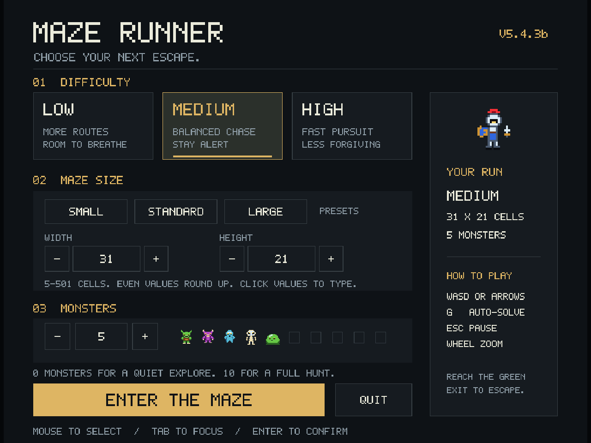
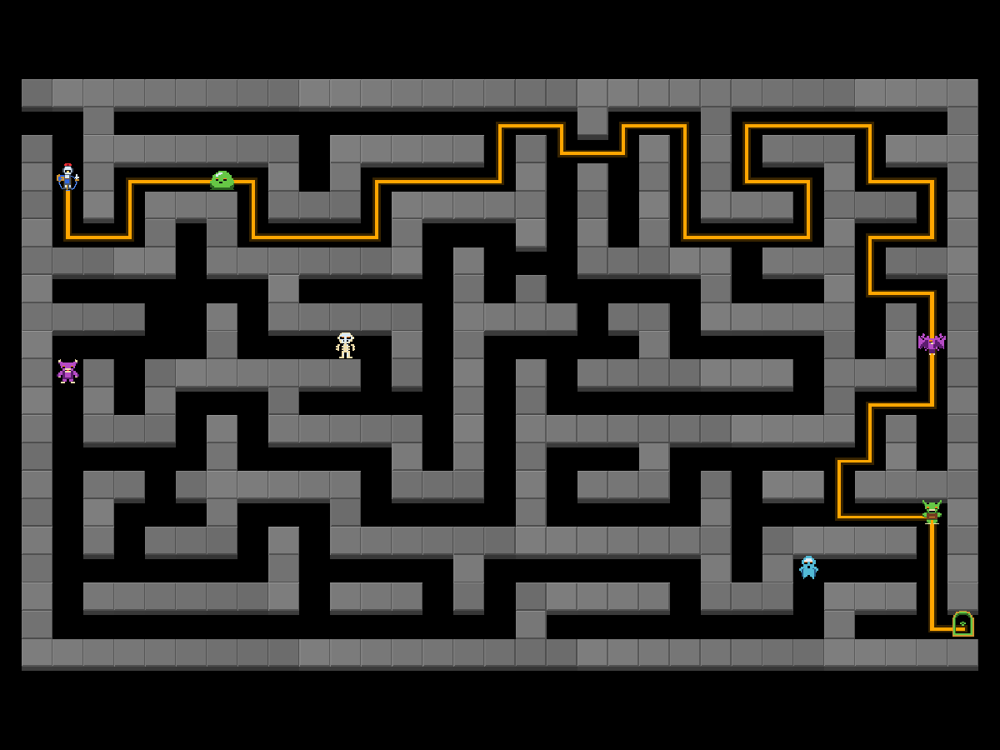

# Playing your first maze

[MazeRunner V5.4.3a wiki](Home.md)

Choose Medium, keep the default width of 31 and height of 21, and select **Start**. The knight begins by the left entrance. Reach the green exit on the right without stepping onto a monster. The board stays still until your first successful move or until you enable auto-solve. To learn the controls at your own pace, set the monster count to zero.

| Input | Action |
|---|---|
| WASD or arrows | Step one cell. Hold for another step after 220 ms, then every 120 ms while movement succeeds. |
| G or the HUD toggle | Enable the automatic player or take back manual control. |
| Escape | Pause or resume during a run. On setup, leave an active numeric field. |
| Wheel or +/− | Zoom. Home fits the entire maze again. |
| Tab, Shift+Tab, Enter | Navigate the setup controls and activate the selection. |
| Q or Quit | Exit the application. |

**Read the HUD.** A red count shows hunting monsters. An orange search count appears when none is hunting. The director readout gives its phase, cumulative broadcasts and current search area in rows by columns. A normal colored route avoids presently occupied cells. An amber route crosses a monster or uses basic terrain guidance because the weighted route is blocked. Monsters can move before you reach a highlighted cell.

**Choose a map.** Small is 33×33, Standard is 63×63 and Large is 101×101. The default rectangular setup is separate from those presets. You can edit either dimension from 5 to 501 and request zero to ten monsters. Even dimensions round upward to odd values. Losing window focus pauses the game. Resume explicitly when you return.

