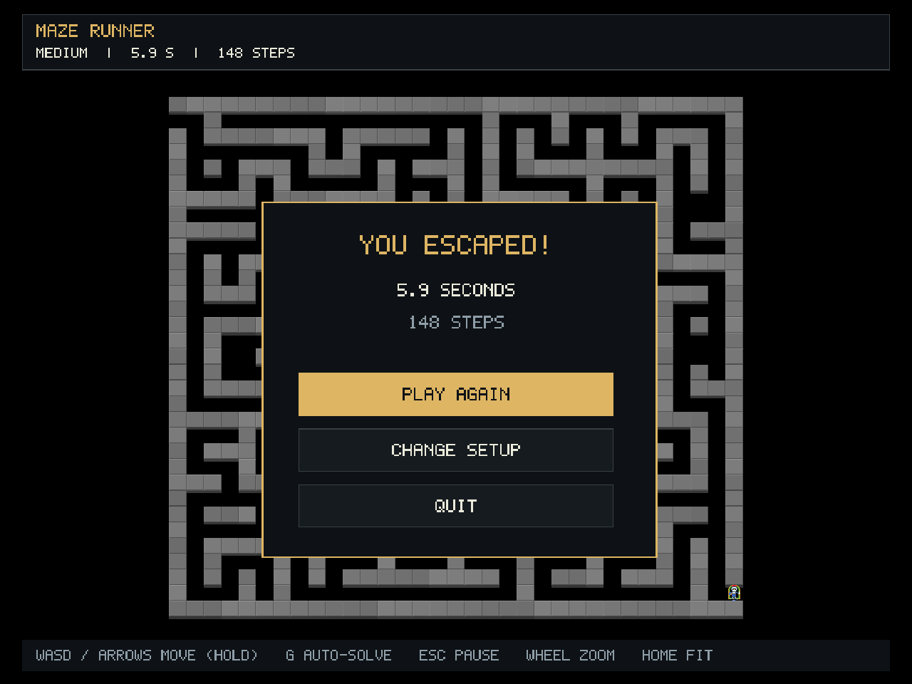

# Screenshot gallery and troubleshooting

[MazeRunner V5.4.3a wiki](Home.md)

## Screenshots and their reproduction

The repository contains **18 PNG captures** produced by `tests/render_tests.cpp` through actual GL draw/readback. The harness initially emits uncompressed P6 PPM files. The Python runner converts them losslessly to PNG using its standard-library encoder. No image-generation model or external art editor produced these evidence images.

| PNG under `artifacts/screenshots/` | What it shows and how it was prepared |
|---|---|
| [setup.png](https://github.com/LeEz1219/MazeRunner/blob/b73842a26759c888d9919c48f04be167cca99ad2/artifacts/screenshots/setup.png) | Default setup: Medium, width 31, height 21, five monsters, 1280×960 |
| [preset-33.png](https://github.com/LeEz1219/MazeRunner/blob/b73842a26759c888d9919c48f04be167cca99ad2/artifacts/screenshots/preset-33.png) | Small selected; exact 33×33 values and one matching preset highlight |
| [preset-63.png](https://github.com/LeEz1219/MazeRunner/blob/b73842a26759c888d9919c48f04be167cca99ad2/artifacts/screenshots/preset-63.png) | Standard selected; exact 63×63 values |
| [preset-101.png](https://github.com/LeEz1219/MazeRunner/blob/b73842a26759c888d9919c48f04be167cca99ad2/artifacts/screenshots/preset-101.png) | Large selected; exact 101×101 values |
| [setup-small.png](https://github.com/LeEz1219/MazeRunner/blob/b73842a26759c888d9919c48f04be167cca99ad2/artifacts/screenshots/setup-small.png) | Default form at **800×600 framebuffer**; “small” in this filename means window size, not the Small maze preset |
| [setup-wide.png](https://github.com/LeEz1219/MazeRunner/blob/b73842a26759c888d9919c48f04be167cca99ad2/artifacts/screenshots/setup-wide.png) | Default form at 1600×600, checking uniform fit/letterboxing |
| [setup-portrait.png](https://github.com/LeEz1219/MazeRunner/blob/b73842a26759c888d9919c48f04be167cca99ad2/artifacts/screenshots/setup-portrait.png) | Default form at 600×1000 offscreen, checking tall-aspect robustness |
| [setup-invalid.png](https://github.com/LeEz1219/MazeRunner/blob/b73842a26759c888d9919c48f04be167cca99ad2/artifacts/screenshots/setup-invalid.png) | Width `999`, focused field, visible validation and disabled Start |
| [loading.png](https://github.com/LeEz1219/MazeRunner/blob/b73842a26759c888d9919c48f04be167cca99ad2/artifacts/screenshots/loading.png) | Noninteractive maze-generation screen |
| [hud.png](https://github.com/LeEz1219/MazeRunner/blob/b73842a26759c888d9919c48f04be167cca99ad2/artifacts/screenshots/hud.png) | Seed 7, 21 rows × 31 columns, Medium, five monsters, 4,200 ms. Fifty steps, three hunting, three radio reports and a relief area of 21×25. |
| [pause.png](https://github.com/LeEz1219/MazeRunner/blob/b73842a26759c888d9919c48f04be167cca99ad2/artifacts/screenshots/pause.png) | Pause menu drawn over the same measured 4,200-ms relief state. |
| [result.png](https://github.com/LeEz1219/MazeRunner/blob/b73842a26759c888d9919c48f04be167cca99ad2/artifacts/screenshots/result.png) | Genuine escape after regenerating the same Maze object with zero monsters. The static mesh is rebuilt for that terrain. Result reads 3.6 s and 90 steps. |
| [showcase.png](https://github.com/LeEz1219/MazeRunner/blob/b73842a26759c888d9919c48f04be167cca99ad2/artifacts/screenshots/showcase.png) | Hand-arranged 13×19 geometry/actor fixture, three hunting appearances, 1200×900 |
| [wide.png](https://github.com/LeEz1219/MazeRunner/blob/b73842a26759c888d9919c48f04be167cca99ad2/artifacts/screenshots/wide.png) | Same showcase at 1600×600 |
| [portrait.png](https://github.com/LeEz1219/MazeRunner/blob/b73842a26759c888d9919c48f04be167cca99ad2/artifacts/screenshots/portrait.png) | Same showcase at 600×1000 |
| [zoom.png](https://github.com/LeEz1219/MazeRunner/blob/b73842a26759c888d9919c48f04be167cca99ad2/artifacts/screenshots/zoom.png) | Same showcase after two positive zoom steps (1.25² = 1.5625×) |
| [monsters.png](https://github.com/LeEz1219/MazeRunner/blob/b73842a26759c888d9919c48f04be167cca99ad2/artifacts/screenshots/monsters.png) | Arranged 9×15 gallery with all ten hunting appearances, knight, and exit, 1500×1000 |
| [game.png](https://github.com/LeEz1219/MazeRunner/blob/b73842a26759c888d9919c48f04be167cca99ad2/artifacts/screenshots/game.png) | Naturally generated **21 rows × 31 columns**, Medium, six monsters, seed 42, at 1,000 ms, without UI overlay; the amber route passes a distant monster |

The largest 501×501 map is also drawn and checked for GL errors, but no giant-map screenshot is saved by that test. The game/result screenshots are from real simulation states; the showcase/gallery intentionally position entities for inspection. `app_tests.cpp` separately injects a Caught outcome to verify result-screen routing, so that test is not evidence of a naturally occurring capture trajectory.

To regenerate all captures on the supported Linux harness:

```bash
python3 scripts/run_validation.py --graphics
```

To compare the native HUD, launch with `--seed 7`, leave the default width 31, height 21, Medium and five monsters, then press G. Watch for the first relief event around 4.2 seconds on a matching toolchain. The automated fixture stops at precisely 4,200 simulated milliseconds. A manually captured frame should be labeled with its visible time.

Pixel-identical output can vary across GL drivers and rasterization environments. The tests check geometry, invariants, visibility, and color ranges rather than claiming universal screenshot hashes across platforms. The package hashes identify the supplied PNG bytes only.


### Rebuild the release ZIP

Start from a pristine checkout or extracted release if you want the published bytes. The archive script verifies the manifest first, sorts its entries, fixes ZIP timestamps and uses standard-library DEFLATE. Reproducing the exact compressed bytes also requires compatible zlib output. After a deliberate change or evidence rerun, audit the new tree before packaging. New runtime measurements have their own hashes.

```bash
python3 scripts/verify_package.py
python3 scripts/package_devkit.py
```

The archive is written to `dist/MazeRunner-V5.4.3a-Documentation-and-Validation.zip`. Its top-level folder is `MazeRunner-V5.4.3a/`. Verification works from a fresh extraction with Python 3.9 or newer, without Git, network access or compiled binaries. Compare the archive digest printed by the packager against the distributor's published SHA-256.

## Native desktop acceptance checklist

Run this on each actual intended release platform after a successful native graphical build. Record OS/architecture, compiler, GLFW/GLEW versions, graphics device/driver, source hash, and whether you used a fixed seed. These checks complement the automated results; they are not marked completed by the Linux offscreen run.

1. Launch with no arguments. Verify that the window title and setup say V5.4.3a, the app opens without terminal prompts, and the initial form is Medium, 31×21, five monsters. Keep the terminal visible and verify normal logs appear when play starts.
2. Select each preset and confirm Small 33×33, Standard 63×63, Large 101×101. Confirm only the matching size button is selected. Edit one dimension to a different valid odd value and confirm the preset highlight clears appropriately.
3. Type `20` into a dimension, move focus, and start; verify normalization to `21`. Try empty fields, width `999`, and count `11`; verify a visible error and disabled Start. Confirm zero and ten monsters are accepted.
4. Use mouse, Tab, Shift+Tab, Enter, and numeric editing. Press inside a button and release outside it; confirm it does not activate. Verify the click target remains aligned after resizing and on a high-DPI display. Press Esc while editing a field: focus should move to Start and the game must not quit. Press Esc again on setup: nothing should happen.
5. Start a larger maze and confirm the Loading screen appears before play. Check black corridors, gray raised walls, the knight/ring, exit, and all selected monsters. Use ten monsters and zoom to inspect variants. They should remain visually distinct without changing their shared AI rules. Wait ten seconds without touching anything: no monster should move, and the HUD should read "MOVE OR PRESS G TO START".
6. Move, then hold a direction key along a corridor: the knight should step once immediately, then keep walking at a steady pace until you release the key or hit a wall. Switch to another window while holding the key; returning and resuming must not continue walking. Watch the HUD counter switch between red "N HUNTING" and orange "N SEARCHING", and zoom in to see eye colors change between gold, red, and orange.
7. Enable auto-solving with G and the HUD button. Confirm the path extends from the current player location to the exit, updates as the state changes, and turns amber when it crosses a monster. In suitable scenarios, inspect logs for "Heard by", "INTERCEPTING", "SEARCHING", bounded waiting, evasion, recovery, and boldness messages rather than expecting every seed to exhibit every behavior immediately. On High, look for "SPOTTED the player".
8. Pause with Escape or the button, wait several seconds, and resume. Time/positions should stay frozen during pause. Switch focus to another application; returning should still require explicit resume. Attempt movement while paused and confirm the modal prevents it.
9. Test mouse-wheel and +/- zoom, then Home to fit. Resize wide and tall; check aspect preservation, HUD separation, and mouse alignment. Minimize and restore without a crash or GL error. On a 501×501 map, gameplay should remain smooth; if the driver disables vsync, CPU usage should not sit at 100% of a core.
10. Use zero monsters to obtain a straightforward escape and inspect the result time/step count. Play Again should replay the fixed seed when `--seed` was supplied; without fixed-seed mode, ordinary replays select new seeds. Change Setup should let you change the configuration.
11. Quit through the UI and Q, and also close the native window. Confirm orderly exit. Capture any startup, shader, DLL, or driver errors rather than counting the platform as passed solely because compilation succeeded.

## Troubleshooting by symptom

| Symptom | Likely cause and concrete check |
|---|---|
| Source file not found | Confirm the working directory is the extracted package root and the file is under `src/`; check for an accidental `.cpp.txt` extension |
| `GL/glew.h` or `GLFW/glfw3.h` missing | Install the development packages for the same compiler/architecture; do not use the test adapters for the real game |
| `std::clamp`, `string_view`, or other C++17 names missing | Confirm `-std=c++17` is present and the compiler is sufficiently recent |
| Undefined GLFW/GLEW/GL symbols | Check library spellings, source-before-library order, and matching static/DLL selection; use the platform-specific command rather than copying Linux flags to Windows/macOS |
| Windows executable cannot find a DLL | Restore UCRT64 `bin` at the front of PATH or copy the matching non-system runtime DLLs next to the executable |
| Windows format/architecture mismatch | Check x86-64 compiler, DLLs, and import libraries all come from UCRT64; do not mix 32-bit or MSVC artifacts |
| macOS incompatible architecture | Check `uname -m`, `file` on the executable/libraries, and `brew --prefix`; avoid mixing Rosetta Intel and arm64 dependency trees |
| macOS library not loaded | Inspect `otool -L`; ensure the linked Homebrew libraries exist on that machine rather than assuming a copied executable includes them |
| GLFW initialization/window creation failure | Check the native desktop session and graphics driver; a display-less shell needs headless simulation or the separate EGL test harness |
| GLEW or OpenGL 3.3 capability failure | Inspect the exact error and actual context/driver support; the source only tolerates its narrow documented no-GLX-on-Wayland loader case |
| EGL test initialization failure | Check Linux Mesa surfaceless EGL availability and `libEGL.so.1`/`libGL.so.1`; native graphical GLFW can work even when this particular harness cannot |
| A test's expected outcome differs on another toolchain | Preserve source/configuration, compare semantic invariants, and account for standard-library random-distribution differences; do not compare `compute_ms` |
| Large-map sprites look tiny | Use zoom; the 1× view fits the entire map, and a 101×101 grid gives each actor fewer screen pixels than a small map |
| `RUNNING` despite exit code zero | The simulation reached its duration ceiling; parse the outcome rather than treating process success as an escape |
| Monsters do not move at the start | Intended since V5.4.2: they wait for the first move or auto-solve toggle; the HUD shows the start prompt |
| Esc does not quit | Intended since V5.4.2: use Q outside text fields or the QUIT button |
| `Maze terrain changed without rebuild_graph()` | A debug build (no `NDEBUG`) detected code editing `grid` without calling `rebuild_graph()`; call it after terrain edits |
| Release build feels slower than expected on huge maps | Confirm `-DNDEBUG` (or CMake `Release`) is used; without it the debug terrain hash runs every frame |
| No logs | Remove `--quiet`; a GUI-only Windows subsystem build or output redirection also changes where logs are visible |
| Checksum verification fails after testing | The runner intentionally regenerated logs/screenshots; compare against a fresh checkout, or run `scripts/audit_documentation.py` to re-record an intended change |
